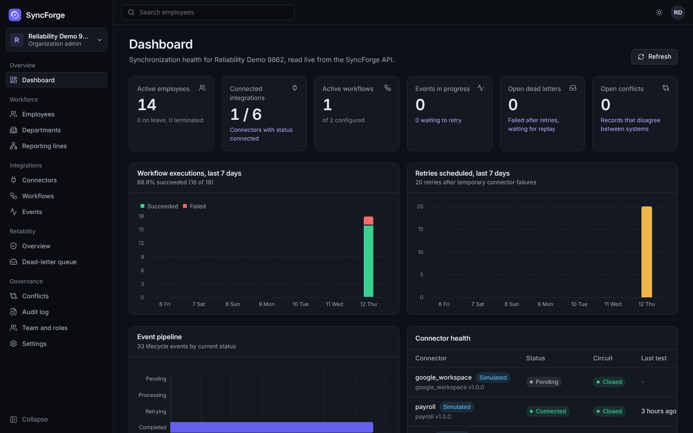
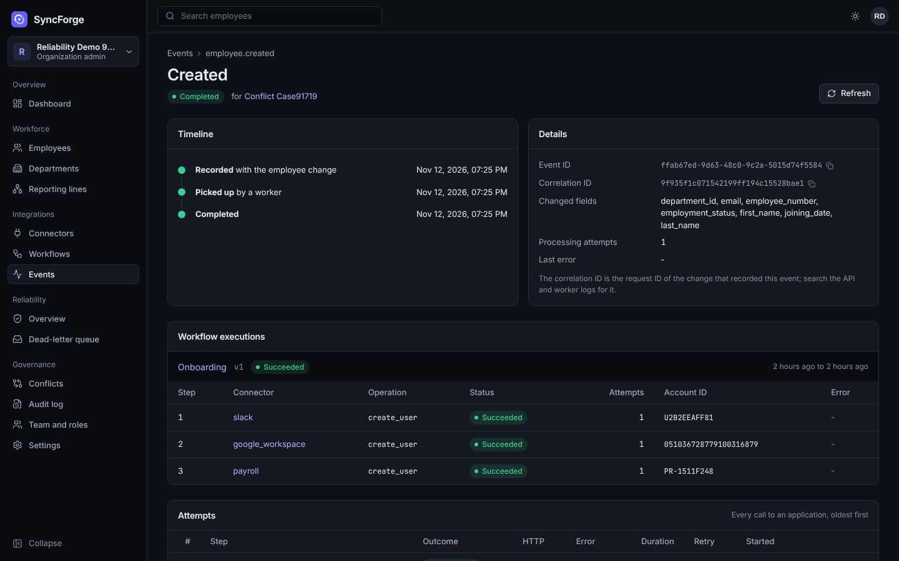
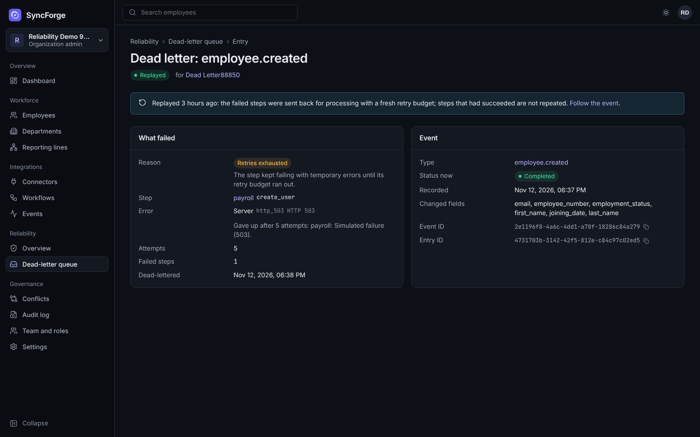
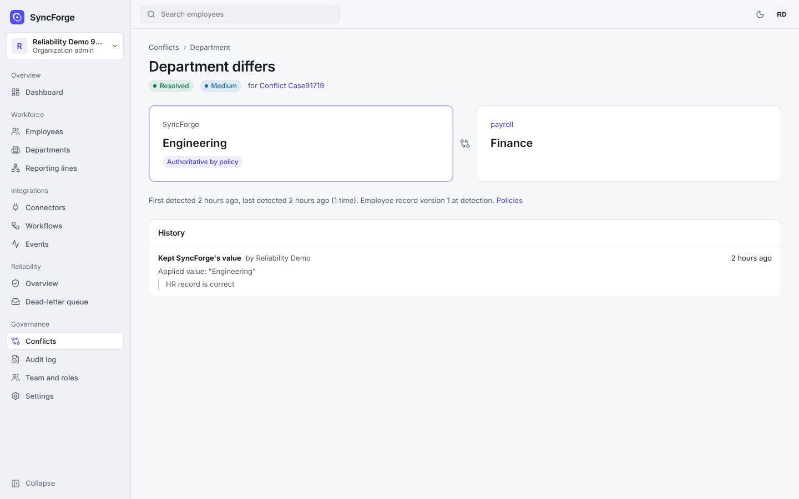
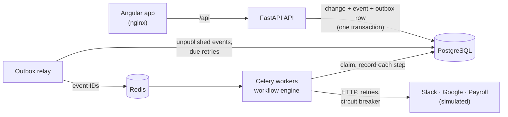

# SyncForge

[](https://github.com/praneeth-srikurmadasu/syncforge/actions/workflows/ci.yml)
[](LICENSE)

**A workforce integration platform that keeps employee data in sync across HR, Slack,
Google Workspace and payroll, and keeps it correct when those systems fail.**

When someone is hired, transferred or leaves, SyncForge turns the change into an event and
runs the organization's workflows in the background: create the Slack account, then the
Google account, then the payroll record. Failed calls are retried with backoff and then
parked for a person to replay. Disagreements between systems become conflicts that are
resolved by policy, never silently overwritten. Every action is audited.

| | |
|---|---|
|  |  |
| Dashboard built only from live API data | An onboarding event: three connector steps and every attempt |
|  |  |
| A step dead-lettered after five failed attempts, then replayed | A department conflict between SyncForge and payroll |

> The Slack, Google Workspace and payroll connectors follow the real APIs' shapes but run
> against **local simulated services** ([why](docs/connectors.md#1-real-or-simulated)).

## Highlights

- **Transactional outbox and at-least-once delivery.** A change and its events commit
  together, and a relay publishes them to Redis. Duplicate deliveries, worker crashes and
  stale events are handled safely by leases, idempotent steps and idempotency keys.
- **Reliability engine:**
  - failure classification;
  - exponential backoff with jitter that honours `Retry-After`;
  - a circuit breaker and rate limits per connector, shared by all workers;
  - a dead-letter queue with authorized, partial replay.
- **Configurable workflows.** A trigger plus ordered connector steps, run by Celery
  workers, with the history of every step and every external call.
- **Data integrity:**
  - field-level source-of-truth policies;
  - reconciliation that records conflicts instead of overwriting;
  - optimistic concurrency (ETag / `If-Match`);
  - an append-only audit log enforced by the database.
- **Multi-tenant security:**
  - organization isolation, enforced in queries and by composite foreign keys;
  - four roles;
  - Argon2id passwords and JWTs with server-side revocation;
  - sign-in rate limits;
  - encrypted connector credentials.
- **Angular admin application.** 16 areas, role-aware navigation, light and dark themes,
  phone layouts, and WCAG AA contrast checked automatically.
- **Tested:** 579 backend tests on real PostgreSQL, 60 frontend unit tests, and 13
  Playwright tests that run against the full Docker stack in CI.

## Architecture



A modular monolith: one Python codebase running as the API, the relay and the workers.
PostgreSQL is the system of record. Redis only carries "process event X" messages, so
losing it loses no work. Details: [architecture](docs/architecture.md).

| Layer | Technology |
|---|---|
| Backend | Python 3.13, FastAPI, Pydantic v2, SQLAlchemy 2, Alembic |
| Data and messaging | PostgreSQL 16, Redis 7, Celery 5 |
| Frontend | Angular 22 (standalone, signals), TypeScript, Angular CDK, ECharts |
| Security | Argon2id, JWT (PyJWT), Fernet credential encryption |
| Testing | pytest, Vitest, Playwright, axe-core |
| Delivery | Docker, Docker Compose, GitHub Actions |

## Run it

Requirements: Docker Desktop (or Docker Engine with Compose) and Git.

```bash
git clone https://github.com/praneeth-srikurmadasu/syncforge.git
cd syncforge
cp .env.example .env        # Windows PowerShell: Copy-Item .env.example .env
docker compose --profile full up -d --build
```

Open **http://localhost:8080**, create an account, then an organization. The interactive
API reference is at http://localhost:8080/docs. Compose starts these services and waits
for each to be healthy:
- PostgreSQL and Redis;
- a migration job;
- the API, a worker and the outbox relay;
- the three simulated applications;
- the web server.

To load a demo organization with 20 employees, run this after registering:

```bash
docker compose --profile full exec api python -m app.cli seed-demo --admin-email you@example.com
```

Stop with `docker compose --profile full down`; add `-v` to delete the data. To run the
backend and frontend outside Docker for development, see
[CONTRIBUTING.md](CONTRIBUTING.md#development-setup).

**See the reliability features work.** With the stack running locally (outside Docker),
`infrastructure/scripts/demo_reliability.py` injects failures into the simulated services.
In about three minutes it shows:
- retries and idempotency;
- retries exhausted, the dead-letter entry and the replay;
- the circuit breaker and a rate limit;
- a data conflict and a refused stale edit.

[Sample output](docs/reliability.md#7-seeing-it-work).

## Tests

```bash
cd backend && pytest -q                       # 579 tests; needs PostgreSQL
cd frontend && npm run test:ci && npm run e2e # 60 unit tests; 13 browser tests (needs the stack)
```

CI runs linting, migrations with a drift check, all backend and frontend tests, and the
browser tests against the Docker stack on every push ([testing](docs/testing.md)).

## Documentation

| Document | Contents |
|---|---|
| [Architecture](docs/architecture.md) | Components, layers, event pipeline, delivery guarantees, workflow engine |
| [Database](docs/database.md) | ER diagram, tables, tenant integrity, transactions, migrations |
| [API](docs/api.md) | Conventions, endpoints and permissions, error codes, v1/v2 versioning |
| [Connectors](docs/connectors.md) | Adapter design, real versus simulated, OAuth, credential security, adding a connector |
| [Reliability](docs/reliability.md) | Failure classification, retries, dead-letter queue, circuit breaker, rate limits, idempotency |
| [Data integrity](docs/data-integrity.md) | Audit log, optimistic concurrency, source-of-truth policies, conflicts |
| [Security](docs/security.md) | Authentication, roles, isolation, secrets, HTTP hardening |
| [Frontend](docs/frontend.md) | Angular architecture, session, state, API integration, testing |
| [Testing](docs/testing.md) | Test layers, key scenarios, CI |
| [Deployment](docs/deployment.md) | Components, production configuration, monitoring, troubleshooting |
| [Performance](docs/performance.md) | Measured latency, throughput and query plans, with their limits |
| [Decisions](docs/adr/README.md) | 21 architecture decision records |
| [Case studies](docs/case-studies.md), [interview guide](docs/interview-preparation.md) | Ten scenarios end to end; how to present the project |

## Known limitations

- The connectors are verified against simulated services only. Real tenants and the
  OAuth authorization-code flow are not done.
- Workflow steps run sequentially. Parallel stages are a planned extension.
- There is no MFA, no email invitations and no retention jobs yet.
- Rate limits use fixed one-minute windows. The SSRF allowlist checks host names, not
  resolved IP addresses.
- The Docker Compose setup is for local use, not production
  ([deployment](docs/deployment.md#2-production-setup)).

## License

[MIT](LICENSE). The common-password list in `backend/app/security/data/` comes from
SecLists (MIT, Daniel Miessler).
