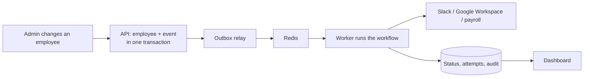

# 01 - Project overview

## The problem

Companies keep employee information in many applications: an HR system, Slack, Google
Workspace, payroll, identity providers. When someone joins, moves department or leaves,
each application has to be updated, often by hand. The result is late accounts for new
hires, wrong departments, and, worst, access that survives after someone has left.

## What SyncForge does

SyncForge is a workforce integration and synchronization platform. The HR record in
SyncForge is changed (hire, transfer, manager change, termination), and SyncForge turns
that change into an event and processes it in the background through configurable
workflows that create, update or deactivate the person's accounts in connected
applications. It retries failures safely, parks work that cannot succeed in a
dead-letter queue for a person to inspect and replay, detects when an application
disagrees with SyncForge about a field, and records every action in an audit log.

## Who uses it

| Role | Can |
|---|---|
| Super Admin | Everything, in every organization; platform status and security events |
| Organization Admin | Everything in their organization, including members and roles |
| Integration Manager | Manage connectors and workflows, replay dead letters, resolve conflicts, read the audit log; read everything else |
| Read-only Viewer | Read employees, departments, connectors, workflows, events and conflicts; no audit log; change nothing |

Each organization's data is isolated from every other organization's.

## Capabilities

- Employees: directory with search and filters, lifecycle (hire, change, terminate,
  archive), departments, reporting lines, concurrent-edit protection.
- Connectors: Slack, Google Workspace and payroll through one adapter interface;
  encrypted credentials; connection tests; manual operations; reconciliation.
- Workflows: trigger + ordered steps, activation, execution history per step.
- Event processing: transactional outbox, Redis, Celery workers, at-least-once delivery
  with idempotent processing.
- Reliability: exponential backoff with jitter, `Retry-After`, timeouts, failure
  classification, circuit breaker, per-connector rate limits, dead-letter queue and replay.
- Data integrity: field-level source-of-truth policies, conflict detection, resolution
  with override rules, history.
- Security: Argon2id, JWT with revocation, RBAC, sign-in limits, common-password refusal,
  append-only audit log and sign-in history.
- Observability: structured logs with request and correlation IDs, health and readiness,
  worker and relay heartbeats, organization summary with processing times.
- API: REST under `/api/v1`, a `/api/v2` cursor-paginated employee list, OpenAPI docs.
- Web application: Angular dashboard and administration screens, dark and light themes,
  accessible and responsive.
- Delivery: Docker images and Compose, GitHub Actions CI, documentation.

## Real versus simulated

All three connectors talk to **local mock services** in `mock-services/` that imitate
the real APIs (Slack SCIM, Google Directory with OAuth, a payroll API) including their
failure modes. No real Slack or Google tenant was used. What a real integration would
still need is listed in [docs/10 section 1](10-connector-framework.md).

## Technology

Python 3.13, FastAPI, Pydantic, SQLAlchemy 2, Alembic, PostgreSQL 16, Redis 7, Celery 5;
Angular 22 with TypeScript; pytest, Vitest, Playwright; Docker, GitHub Actions.

## Status and numbers

Ten phases, delivered in order (CHANGELOG.md). At the end of Phase 10: 579 backend
tests, 60 frontend unit tests, 13 browser tests, 58 API operations, 16 migrations,
21 architecture decision records.

## Where to go next

| To | Read |
|---|---|
| Run it | [README](../README.md) |
| Understand the design | [05 System architecture](05-system-architecture.md), [20 Design decisions](20-design-decisions.md) |
| See it handle real situations | [24 Case studies](24-case-studies.md) |
| Prepare to explain it | [22 Interview preparation](22-interview-preparation.md) |
