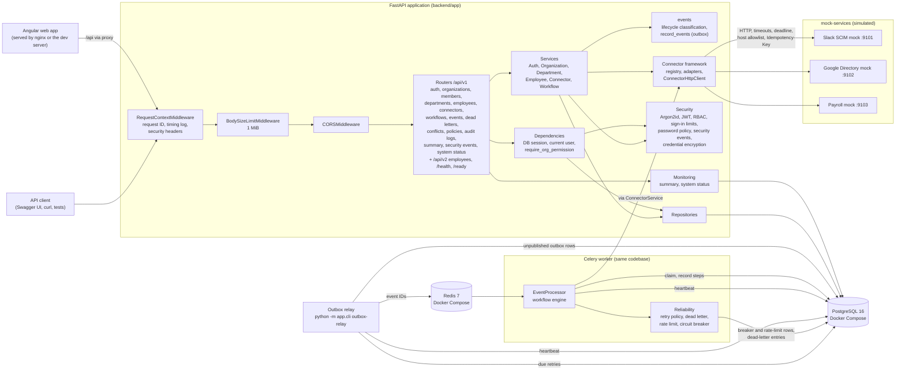
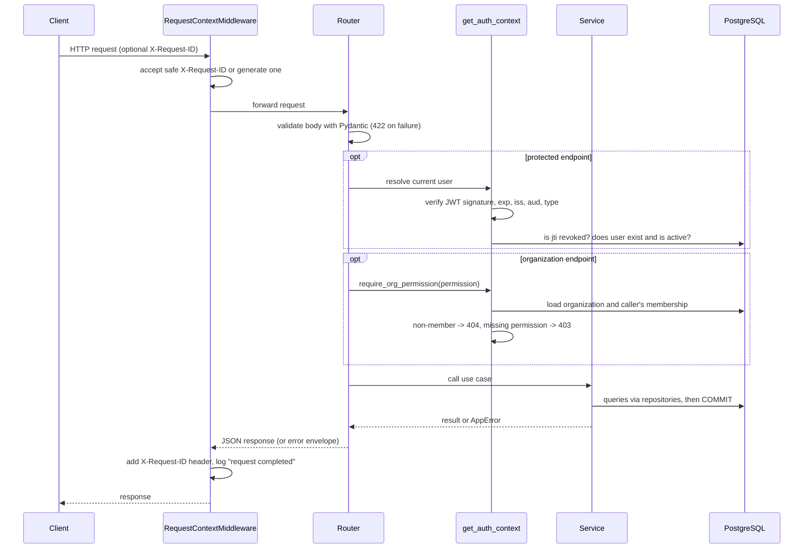
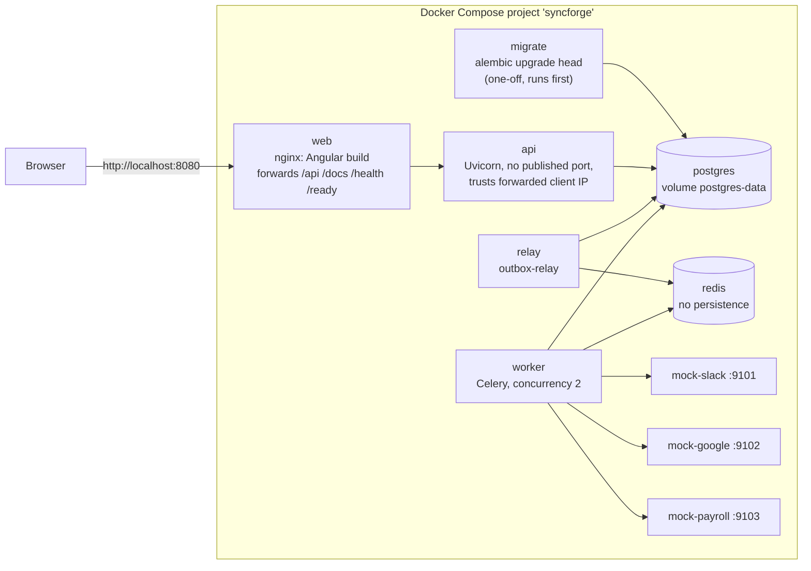

# 05 - System Architecture

> **Scope:** describes what is implemented at the end of Phase 10 (backend, Angular
> application, Docker and CI). Nothing here is planned-only.

## 1. Current components



**Architecture style:** modular monolith (see [ADR-0001](adr/0001-modular-monolith-with-fastapi.md)).
One codebase, three kinds of process: the **API**, the **outbox relay** and the **Celery
workers**. They share models, services and connectors, and scale independently. PostgreSQL
is the system of record; Redis only carries "process event X" messages. The event pipeline
is described in [docs/09](09-event-driven-architecture.md), the workflow engine in
[docs/11](11-workflow-engine.md), and the reliability engine (retries, dead-letter queue,
circuit breaker, rate limits, timeouts) in [docs/12](12-reliability-and-retries.md) and
[docs/13](13-idempotency.md); the audit log, optimistic concurrency and conflict handling
in [docs/14](14-data-integrity.md).

## 2. Application layers

| Layer | Folder | Responsibility | Must not |
|---|---|---|---|
| API (routers) | `app/api/` | HTTP: parse/validate input, call a service, shape the response | contain business rules or SQL |
| Schemas | `app/schemas/` | Public request/response contracts (Pydantic) | expose ORM objects or secrets |
| Services | `app/services/` | Business rules and **transaction boundaries** (`commit` / `rollback`) | build HTTP responses |
| Repositories | `app/repositories/` | All database queries | make business decisions |
| Models | `app/models/` | SQLAlchemy table definitions and DB constraints | contain behaviour beyond the data |
| Security | `app/security/` | Password hashing, JWT, role/permission checks and tenant isolation | depend on HTTP |
| Events | `app/events/` | `lifecycle.py`: pure functions that turn a before/after change into lifecycle events. `outbox.py`: stage events and outbox rows in the caller's transaction. `relay.py`: publish outbox rows, recover expired leases | commit on behalf of the caller (`outbox.py`), or contain workflow logic |
| Workflows | `app/workflows/` | `engine.py`: claim an event, plan executions, run steps through `ConnectorService`, record outcomes | build HTTP responses |
| Workers | `app/workers/` | Celery app configuration and thin tasks that open a session and call the engine | contain business rules |
| Audit | `app/audit.py` | Stage audit entries in the caller's transaction; actor from the session | commit, or record secrets or personal values |
| Integrity | `app/integrity/` | Pure field comparison rules and default source-of-truth policies (used by `services/conflicts.py`) | do I/O |
| Reliability | `app/reliability/` | Retry policy, dead-lettering, circuit breaker, rate limiter, idempotency records: small building blocks used by the engine, `ConnectorService` and the employees API | build HTTP responses |
| Connectors | `app/connectors/` | Adapters translating the common interface into each vendor's API; one hardened HTTP client; error normalization | contain business rules or touch the database |
| Core | `app/core/` | Settings, logging, middleware, errors, DB engine | depend on features |

Dependencies point downwards only: routers -> services -> repositories -> models.

## 3. Request lifecycle



## 4. Error handling

All errors share one response shape:

```json
{"error": {"code": "not_found", "message": "Not Found", "details": null, "request_id": "4f0c..."}}
```

| Source | Status | `code` |
|---|---|---|
| `AppError` subclasses raised by services | 400/401/403/404/409/422/502/503 | specific, e.g. `email_taken`, `token_revoked` |
| Request validation (Pydantic) | 422 | `validation_error` - `details` lists `field`, `message`, `type`; submitted values are **never echoed** |
| Unknown route / wrong method | 404 / 405 | `not_found` / `method_not_allowed` |
| Any unexpected exception | 500 | `internal_error` - generic message; full traceback goes to logs only |

Implementation: `app/core/errors.py`.

## 5. Logging and request IDs

- Every log line is one JSON object (`app/core/logging.py`) with `timestamp`, `level`,
  `logger`, `message`, `request_id` and any extra fields.
- Every response carries `X-Request-ID`. A caller-supplied ID is reused only if it matches
  `^[A-Za-z0-9._-]{1,128}$` (prevents log injection); otherwise a UUID is generated.
- Each request produces one `request completed` line with `method`, `path`,
  `status_code` and `duration_ms`.
- Logs contain user and employee IDs, never passwords, password hashes, tokens, names or
  emails. Employee lifecycle events are logged as `employee lifecycle event` lines with
  `event_type`, `employee_id` and `changed_fields` (see [component design](06-component-design.md)).
- Connector calls log connector, organization and employee IDs, operation, outcome,
  error category and latency - never credentials, config values or payloads.
- Workers and the relay write the same JSON format. A worker uses the event's
  **correlation ID** (the request ID of the API call that caused the event) as its
  `request_id`, so one ID links the API request, the event and every worker line.

**Investigating a failed request:** take the `request_id` from the error response and
search the logs for it - every line written while handling that request carries it.

**Investigating a failed synchronization:** open the dead-letter queue
(`GET .../dead-letter-events?entry_status=open`) or find the event
(`GET .../events?event_status=retrying` for work still being retried), open it
(`GET .../events/{id}`, and `.../attempts` for every external call) to see which step
failed and why, then search the worker logs for the event's `correlation_id` or `event_id`
([docs/21](21-troubleshooting.md#investigating-a-failed-synchronization)).

## 6. Health and readiness

| Endpoint | Purpose | Touches dependencies? |
|---|---|---|
| `GET /health` | Liveness: is the process running? | No - a slow database must not cause restarts |
| `GET /ready` | Readiness: can it serve traffic? | Yes - runs `SELECT 1`; returns `503 not_ready` if the DB is unreachable |

The API's readiness does not depend on Redis or the workers: employee changes are recorded
in the outbox even while they are down, and processed when they return. Workers and the
relay report heartbeats instead (`component_heartbeats`), read by Super Admins at
`GET /api/v1/system/status` together with the outbox backlog and stuck events; per
organization, `GET .../summary` gives the dashboard's counts and processing durations
([docs/18](18-observability.md)).

## 7. Configuration

Settings are read by `app/core/config.py` (pydantic-settings) from environment variables,
falling back to the repository `.env` file. Environment variables always win, which is how
tests and containers override values. In `APP_ENV=production` the application refuses to
start with the placeholder `JWT_SECRET_KEY` or `POSTGRES_PASSWORD`.

## 8. Deployment architecture (local Docker Compose)

`docker compose --profile full up -d --build` (README, docs/17). Production differences
are in [docs/17](17-deployment-guide.md) section 1 and its reference architecture.



Start-up order is enforced with health checks: PostgreSQL and Redis healthy -> `migrate`
completed -> API, worker and relay -> web after the API is healthy. One backend image runs
the API, worker, relay and migration job.

## 9. Diagram index

| Diagram | Where |
|---|---|
| High-level architecture | [01 Project overview](01-project-overview.md), section 1 above |
| Component architecture | Section 1 above; domain model in [06](06-component-design.md) 2.1; connector classes in [10](10-connector-framework.md) 2; frontend layers in [25](25-frontend.md) 3 |
| Employee onboarding sequence | [24 Case studies](24-case-studies.md), case 1 |
| Employee termination sequence | [06](06-component-design.md) 2.5 |
| Event processing sequence | [09](09-event-driven-architecture.md) 2-4, [11](11-workflow-engine.md) 4 |
| Retry and failure handling | [12](12-reliability-and-retries.md) (retry sequence, dead-letter states, circuit breaker states), [24](24-case-studies.md) case 4 |
| Database relationships | [07](07-database-design.md) section 1 |
| Deployment architecture | Section 8 above (local), [17](17-deployment-guide.md) section 3 (production reference) |
| Request lifecycle | Section 3 above |
| Authentication (sign-in, token lifecycle) | [25](25-frontend.md) 5, [15](15-security-design.md) |
