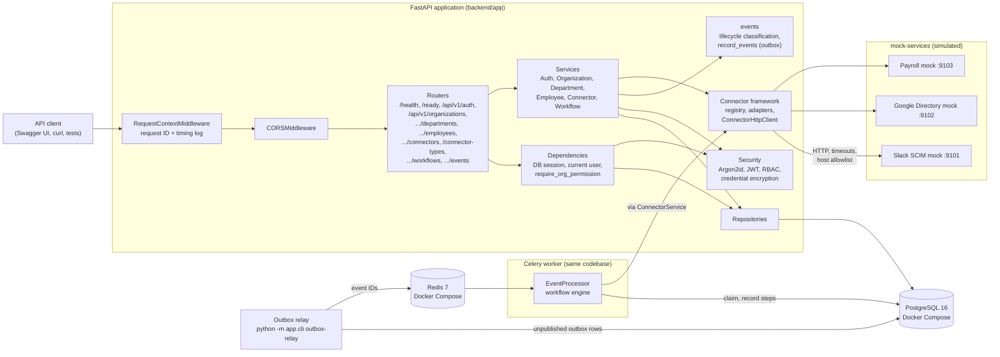
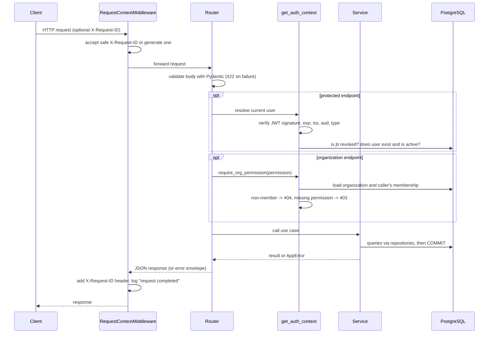

# 05 - System Architecture

> **Scope:** describes what is implemented as of Phase 5. Sections are added as
> later phases add components (reliability engine, frontend). Nothing here is planned-only.

## 1. Current components



**Architecture style:** modular monolith (see [ADR-0001](adr/0001-modular-monolith-with-fastapi.md)).
One codebase, three kinds of process: the **API**, the **outbox relay** and the **Celery
workers**. They share models, services and connectors, and scale independently. PostgreSQL
is the system of record; Redis only carries "process event X" messages. The event pipeline
is described in [docs/09](09-event-driven-architecture.md) and the workflow engine in
[docs/11](11-workflow-engine.md).

## 2. Application layers

| Layer | Folder | Responsibility | Must not |
|---|---|---|---|
| API (routers) | `app/api/` | HTTP: parse/validate input, call a service, shape the response | contain business rules or SQL |
| Schemas | `app/schemas/` | Public request/response contracts (Pydantic) | expose ORM objects or secrets |
| Services | `app/services/` | Business rules and **transaction boundaries** (`commit` / `rollback`) | build HTTP responses |
| Repositories | `app/repositories/` | All database queries | make business decisions |
| Models | `app/models/` | SQLAlchemy table definitions and DB constraints | contain behaviour beyond the data |
| Security | `app/security/` | Password hashing, JWT, role/permission checks and tenant isolation | depend on HTTP |
| Events | `app/events/` | `lifecycle.py`: pure functions that turn a before/after change into lifecycle events. `outbox.py`: stage events and outbox rows in the caller's transaction. `relay.py`: publish outbox rows, recover expired leases | commit on behalf of the caller (`outbox.py`), or contain workflow logic |
| Workflows | `app/workflows/` | `engine.py`: claim an event, plan executions, run steps through `ConnectorService`, record outcomes | build HTTP responses |
| Workers | `app/workers/` | Celery app configuration and thin tasks that open a session and call the engine | contain business rules |
| Connectors | `app/connectors/` | Adapters translating the common interface into each vendor's API; one hardened HTTP client; error normalization | contain business rules or touch the database |
| Core | `app/core/` | Settings, logging, middleware, errors, DB engine | depend on features |

Dependencies point downwards only: routers -> services -> repositories -> models.

## 3. Request lifecycle



## 4. Error handling

All errors share one response shape:

```json
{"error": {"code": "not_found", "message": "Not Found", "details": null, "request_id": "4f0c..."}}
```

| Source | Status | `code` |
|---|---|---|
| `AppError` subclasses raised by services | 400/401/403/404/409/422/502/503 | specific, e.g. `email_taken`, `token_revoked` |
| Request validation (Pydantic) | 422 | `validation_error` - `details` lists `field`, `message`, `type`; submitted values are **never echoed** |
| Unknown route / wrong method | 404 / 405 | `not_found` / `method_not_allowed` |
| Any unexpected exception | 500 | `internal_error` - generic message; full traceback goes to logs only |

Implementation: `app/core/errors.py`.

## 5. Logging and request IDs

- Every log line is one JSON object (`app/core/logging.py`) with `timestamp`, `level`,
  `logger`, `message`, `request_id` and any extra fields.
- Every response carries `X-Request-ID`. A caller-supplied ID is reused only if it matches
  `^[A-Za-z0-9._-]{1,128}$` (prevents log injection); otherwise a UUID is generated.
- Each request produces one `request completed` line with `method`, `path`,
  `status_code` and `duration_ms`.
- Logs contain user and employee IDs, never passwords, password hashes, tokens, names or
  emails. Employee lifecycle events are logged as `employee lifecycle event` lines with
  `event_type`, `employee_id` and `changed_fields` (see [component design](06-component-design.md)).
- Connector calls log connector, organization and employee IDs, operation, outcome,
  error category and latency - never credentials, config values or payloads.
- Workers and the relay write the same JSON format. A worker uses the event's
  **correlation ID** (the request ID of the API call that caused the event) as its
  `request_id`, so one ID links the API request, the event and every worker line.

**Investigating a failed request:** take the `request_id` from the error response and
search the logs for it - every line written while handling that request carries it.

**Investigating a failed synchronization:** find the event (`GET .../events?event_status=failed`),
open it (`GET .../events/{id}`) to see which job failed and why, then search the worker
logs for the event's `correlation_id` or `event_id`.

## 6. Health and readiness

| Endpoint | Purpose | Touches dependencies? |
|---|---|---|
| `GET /health` | Liveness: is the process running? | No - a slow database must not cause restarts |
| `GET /ready` | Readiness: can it serve traffic? | Yes - runs `SELECT 1`; returns `503 not_ready` if the DB is unreachable |

The API's readiness does not depend on Redis or the workers: employee changes are recorded
in the outbox even while they are down, and processed when they return. Worker and relay
health checks are part of the observability work in Phase 9.

## 7. Configuration

Settings are read by `app/core/config.py` (pydantic-settings) from environment variables,
falling back to the repository `.env` file. Environment variables always win, which is how
tests and containers override values. In `APP_ENV=production` the application refuses to
start with the placeholder `JWT_SECRET_KEY` or `POSTGRES_PASSWORD`.
