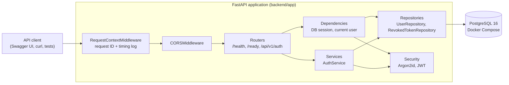
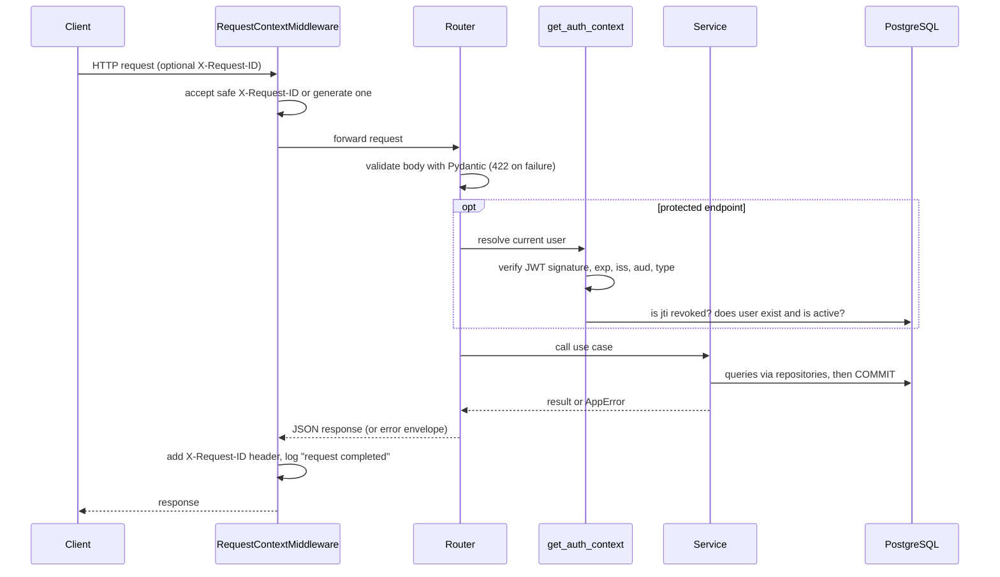

# 05 — System Architecture

> **Scope:** describes what is implemented as of Phase 2. Sections are added as
> later phases add components (workers, connectors, frontend). Nothing here is planned-only.

## 1. Current components



**Architecture style:** modular monolith (see [ADR-0001](adr/0001-modular-monolith-with-fastapi.md)).
One deployable API process with clearly separated layers. Background workers will be
added in Phase 5 as separately scalable processes that share the same codebase.

## 2. Application layers

| Layer | Folder | Responsibility | Must not |
|---|---|---|---|
| API (routers) | `app/api/` | HTTP: parse/validate input, call a service, shape the response | contain business rules or SQL |
| Schemas | `app/schemas/` | Public request/response contracts (Pydantic) | expose ORM objects or secrets |
| Services | `app/services/` | Business rules and **transaction boundaries** (`commit` / `rollback`) | build HTTP responses |
| Repositories | `app/repositories/` | All database queries | make business decisions |
| Models | `app/models/` | SQLAlchemy table definitions and DB constraints | contain behaviour beyond the data |
| Security | `app/security/` | Password hashing, JWT creation/validation | depend on HTTP |
| Core | `app/core/` | Settings, logging, middleware, errors, DB engine | depend on features |

Dependencies point downwards only: routers → services → repositories → models.

## 3. Request lifecycle



## 4. Error handling

All errors share one response shape:

```json
{"error": {"code": "not_found", "message": "Not Found", "details": null, "request_id": "4f0c..."}}
```

| Source | Status | `code` |
|---|---|---|
| `AppError` subclasses raised by services | 400/401/403/404/409/503 | specific, e.g. `email_taken`, `token_revoked` |
| Request validation (Pydantic) | 422 | `validation_error` — `details` lists `field`, `message`, `type`; submitted values are **never echoed** |
| Unknown route / wrong method | 404 / 405 | `not_found` / `method_not_allowed` |
| Any unexpected exception | 500 | `internal_error` — generic message; full traceback goes to logs only |

Implementation: `app/core/errors.py`.

## 5. Logging and request IDs

- Every log line is one JSON object (`app/core/logging.py`) with `timestamp`, `level`,
  `logger`, `message`, `request_id` and any extra fields.
- Every response carries `X-Request-ID`. A caller-supplied ID is reused only if it matches
  `^[A-Za-z0-9._-]{1,128}$` (prevents log injection); otherwise a UUID is generated.
- Each request produces one `request completed` line with `method`, `path`,
  `status_code` and `duration_ms`.
- Logs contain user IDs, never passwords, password hashes, tokens or emails.

**Investigating a failed request:** take the `request_id` from the error response and
search the logs for it — every line written while handling that request carries it.

## 6. Health and readiness

| Endpoint | Purpose | Touches dependencies? |
|---|---|---|
| `GET /health` | Liveness: is the process running? | No — a slow database must not cause restarts |
| `GET /ready` | Readiness: can it serve traffic? | Yes — runs `SELECT 1`; returns `503 not_ready` if the DB is unreachable |

## 7. Configuration

Settings are read by `app/core/config.py` (pydantic-settings) from environment variables,
falling back to the repository `.env` file. Environment variables always win, which is how
tests and containers override values. In `APP_ENV=production` the application refuses to
start with the placeholder `JWT_SECRET_KEY` or `POSTGRES_PASSWORD`.
