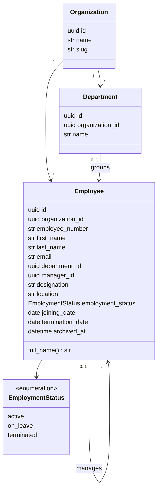
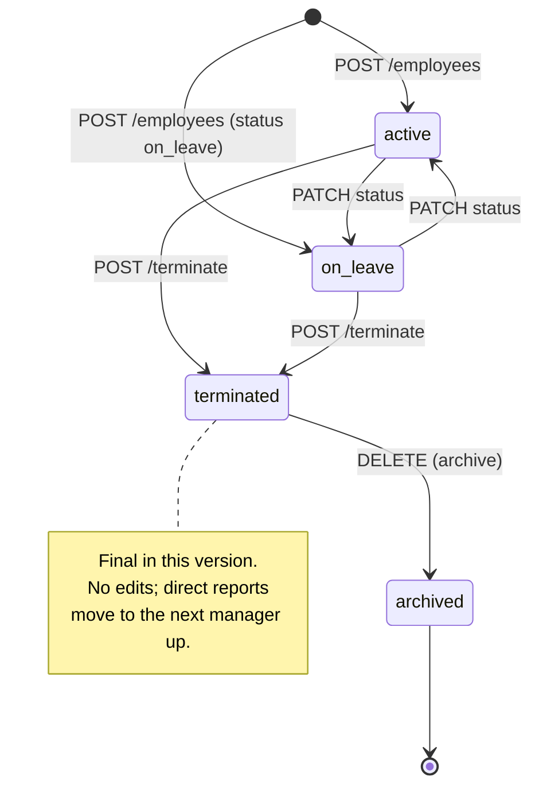
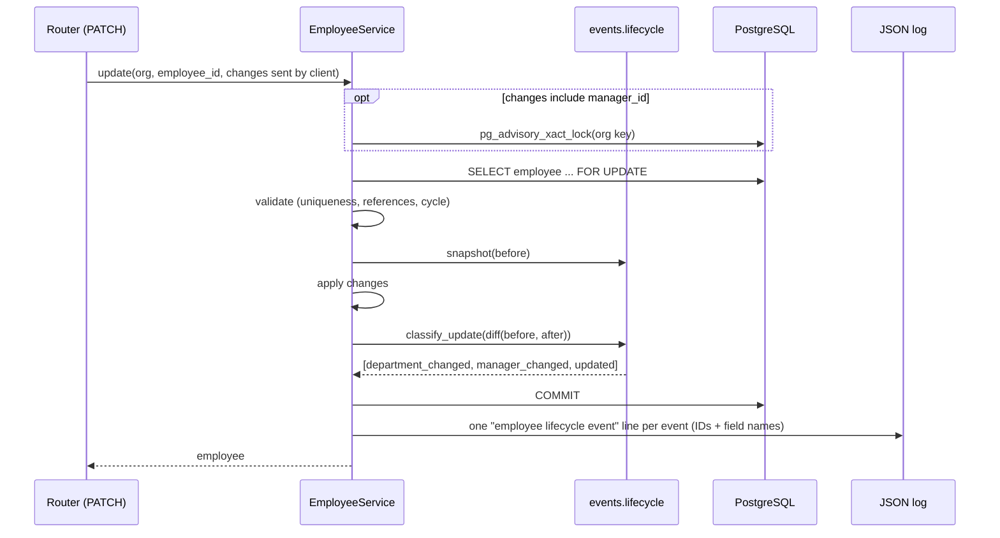
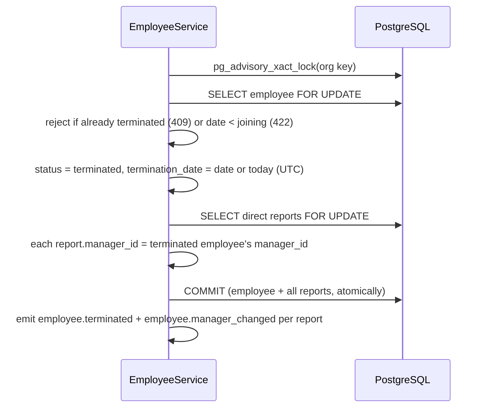

# 06 - Component Design

> **Scope:** modules implemented as of Phase 4. Each later phase adds its module here
> (connectors, workflows, events, reliability). Nothing here is planned-only.

## 1. Modules so far

| Module | Code | Documented in |
|---|---|---|
| Identity and organizations | `models/{user,organization,revoked_token}.py`, `services/{auth,organizations}.py`, `security/` | [Security design](15-security-design.md) |
| **Workforce (employees and departments)** | `models/employee.py`, `repositories/employees.py`, `services/employees.py`, `schemas/employees.py`, `api/v1/{employees,departments}.py`, `events/lifecycle.py` | this document |
| Connectors (external applications) | `connectors/`, `models/connector.py`, `repositories/connectors.py`, `services/connectors.py`, `schemas/connectors.py`, `api/v1/connectors.py`, `security/encryption.py` | [Connector framework](10-connector-framework.md) |

## 2. Workforce module

### 2.1 Domain model

- `employee_number` is the HR system's identifier ("Employee ID" in the requirements); `id`
  is SyncForge's internal UUID. Both are unique per organization, as is `email`.
- Department and manager references are always within the same organization, enforced by
  composite foreign keys ([ADR-0006](adr/0006-composite-foreign-keys-for-tenant-integrity.md)).
- Departments are a table rather than free text so they can be renamed in one place and
  counted, and so later phases can attach source-of-truth policies to them.

### 2.2 Employee lifecycle

"Archived" is not a status value: it is a terminated employee with `archived_at` set. That
keeps the status column about employment and the archive flag about visibility.

Termination is final because downstream systems will deprovision accounts on
`employee.terminated` (Phase 5). Rehiring is modelled as a new employee record; a
dedicated rehire flow is a documented future improvement.

### 2.3 Validation strategy - three layers

| Layer | Where | Checks | Error |
|---|---|---|---|
| Shape | Pydantic schemas (`schemas/employees.py`) | Required fields, types, lengths, trimming, email format and lower-casing, employee number pattern, status values a client may set, no unknown fields on PATCH, no `null` for required fields | `422 validation_error` |
| Business rules | `EmployeeService` / `DepartmentService` | Duplicate number, email or department name; department and manager exist in this organization; manager not terminated; no reporting cycle; terminated employees are read-only; archive only after termination; termination date not before joining | `409` or `422` with a specific code |
| Invariants | PostgreSQL constraints (migration `0003`) | Uniqueness, same-organization references, no self-management, status/termination-date consistency, valid status | `IntegrityError`, mapped to the same `409`/`422` codes by the service |

The database layer is the backstop for races between the service's check and its write:
for example, two requests creating the same email at once both pass the pre-check, the
unique constraint lets one commit, and the other gets `409 email_taken`.

### 2.4 Lifecycle event generation

Event detection is a pure function (`events/lifecycle.py`): no database, no I/O, so the
rules are unit-tested in isolation (`test_lifecycle_events.py`).

Classification rules: termination takes `employment_status` and `termination_date`;
`department_id` and `manager_id` each get their own event; all remaining changed fields
go into one `employee.updated`. No change means no event.

**Phase 3 limitation, by design:** events are logged after the commit. If the process died
between commit and log, the event would be lost. Phase 5 closes this gap with the
transactional outbox: the events are inserted into an outbox table in the *same*
transaction as the employee change, which is why the service already collects them in
`emitted_events` before committing.

### 2.5 Termination

Moving reports up one level keeps the tree connected and guarantees nobody reports to a
terminated person. It cannot create a cycle, because the new manager already sat above
each report.

### 2.6 Concurrency

| Race | Protection |
|---|---|
| Two writes to the same employee | Row lock (`SELECT ... FOR UPDATE`) |
| Two requests creating the same email / employee number / department name | Unique constraints; loser gets `409` |
| Two manager changes that together form a cycle | Per-organization advisory lock ([ADR-0007](adr/0007-advisory-lock-for-reporting-line-changes.md)); proven by `test_simultaneous_manager_changes_cannot_form_a_cycle` |
| Department deleted while an employee is being assigned to it | Foreign key; the delete gets `409 department_in_use`, or the assignment gets `422 department_not_found` |

Partial updates of *different* fields by two admins both apply: each request locks the row,
re-reads it and changes only the fields it sent. Two admins changing the *same* field from
stale screens is last-write-wins in Phase 3; optimistic concurrency with a version column
(reject the stale write with `409`) is part of Phase 7 (data integrity).

### 2.7 Demo data

`python -m app.cli seed-demo --admin-email <registered user>` creates the "Acme Demo"
organization (slug `acme-demo`): 5 departments, 20 fictional employees in a four-level
hierarchy, one on leave and one terminated (whose report moved up). It goes through the
same services as the API, so all rules apply and lifecycle events are emitted. It refuses
to run twice and requires an already registered user, so it never creates passwords.
Tested in `test_seed.py`.
