# 07 - Database Design

> **Scope:** tables implemented as of Phase 7 (migrations `0001`-`0012`). Later phases
> append their tables here when they are built.

Database: **PostgreSQL 16** (see [ADR-0002](adr/0002-postgresql-as-system-of-record.md)),
accessed through synchronous SQLAlchemy 2.x ([ADR-0003](adr/0003-synchronous-sqlalchemy.md)).

## 1. Entity-relationship diagram

```mermaid
erDiagram
    ORGANIZATIONS ||--o{ ORGANIZATION_MEMBERSHIPS : "has members"
    USERS ||--o{ ORGANIZATION_MEMBERSHIPS : "belongs to"
    USERS ||--o{ REVOKED_TOKENS : "logged out"
    ORGANIZATIONS ||--o{ DEPARTMENTS : "has"
    ORGANIZATIONS ||--o{ EMPLOYEES : "employs"
    DEPARTMENTS |o--o{ EMPLOYEES : "groups"
    EMPLOYEES |o--o{ EMPLOYEES : "manages"
    ORGANIZATIONS ||--o{ CONNECTORS : "configures"
    CONNECTORS ||--o| CONNECTOR_CREDENTIALS : "authenticates with"
    CONNECTORS ||--o{ EXTERNAL_ACCOUNTS : "manages"
    EMPLOYEES ||--o{ EXTERNAL_ACCOUNTS : "has"
    ORGANIZATIONS ||--o{ WORKFLOWS : "automates with"
    WORKFLOWS ||--|{ WORKFLOW_STEPS : "runs in order"
    CONNECTORS ||--o{ WORKFLOW_STEPS : "used by"
    EMPLOYEES ||--o{ INTEGRATION_EVENTS : "produces"
    INTEGRATION_EVENTS ||--|| OUTBOX_EVENTS : "published via"
    INTEGRATION_EVENTS ||--o{ WORKFLOW_EXECUTIONS : "triggers"
    WORKFLOWS ||--o{ WORKFLOW_EXECUTIONS : "executed as"
    WORKFLOW_EXECUTIONS ||--|{ SYNCHRONIZATION_JOBS : "one per step"
    SYNCHRONIZATION_JOBS ||--o{ SYNCHRONIZATION_ATTEMPTS : "one per external call"
    INTEGRATION_EVENTS ||--o{ DEAD_LETTER_EVENTS : "parked as"
    SYNCHRONIZATION_JOBS |o--o{ DEAD_LETTER_EVENTS : "failed step"
    USERS |o--o{ DEAD_LETTER_EVENTS : "replayed by"
    ORGANIZATIONS ||--o{ IDEMPOTENCY_RECORDS : "scopes"
    USERS ||--o{ IDEMPOTENCY_RECORDS : "sent"
    CONNECTORS ||--o| CONNECTOR_CIRCUITS : "protected by"
    CONNECTORS ||--o{ CONNECTOR_RATE_WINDOWS : "paced by"
    USERS |o--o{ AUDIT_LOGS : "acted"
    ORGANIZATIONS ||--o{ DATA_SOURCE_POLICIES : "configures"
    CONNECTORS |o--o{ DATA_SOURCE_POLICIES : "authoritative for"
    EMPLOYEES ||--o{ DATA_CONFLICTS : "disagrees about"
    CONNECTORS ||--o{ DATA_CONFLICTS : "reported by"
    DATA_CONFLICTS ||--o{ CONFLICT_RESOLUTIONS : "decided by"
    USERS |o--o{ CONFLICT_RESOLUTIONS : "resolved by"

    ORGANIZATIONS {
        uuid id PK
        varchar name
        varchar slug UK
        boolean is_active
        timestamptz created_at
        timestamptz updated_at
    }
    USERS {
        uuid id PK
        varchar email UK
        varchar full_name
        varchar password_hash
        boolean is_active
        boolean is_superadmin
        timestamptz last_login_at
        timestamptz created_at
        timestamptz updated_at
    }
    ORGANIZATION_MEMBERSHIPS {
        uuid id PK
        uuid organization_id FK
        uuid user_id FK
        varchar role
        timestamptz created_at
        timestamptz updated_at
    }
    REVOKED_TOKENS {
        uuid jti PK
        uuid user_id FK
        timestamptz expires_at
        timestamptz revoked_at
    }
    DEPARTMENTS {
        uuid id PK
        uuid organization_id FK
        varchar name
        timestamptz created_at
        timestamptz updated_at
    }
    EMPLOYEES {
        uuid id PK
        uuid organization_id FK
        varchar employee_number
        varchar first_name
        varchar last_name
        varchar email
        uuid department_id FK
        varchar designation
        uuid manager_id FK
        varchar location
        varchar employment_status
        date joining_date
        date termination_date
        timestamptz archived_at
        timestamptz created_at
        timestamptz updated_at
    }
    CONNECTORS {
        uuid id PK
        uuid organization_id FK
        varchar connector_type
        varchar connector_version
        varchar name
        jsonb config
        varchar status
        timestamptz last_tested_at
        varchar last_error_category
        varchar last_error_message
        timestamptz created_at
        timestamptz updated_at
    }
    CONNECTOR_CREDENTIALS {
        uuid id PK
        uuid organization_id FK
        uuid connector_id FK
        varchar auth_type
        text encrypted_secret
        varchar fingerprint
        timestamptz created_at
        timestamptz updated_at
    }
    EXTERNAL_ACCOUNTS {
        uuid id PK
        uuid organization_id FK
        uuid connector_id FK
        uuid employee_id FK
        varchar external_id
        varchar status
        timestamptz last_synced_at
        timestamptz created_at
        timestamptz updated_at
    }
    WORKFLOWS {
        uuid id PK
        uuid organization_id FK
        varchar name
        varchar description
        varchar trigger_event_type
        boolean is_active
        int version
        timestamptz created_at
        timestamptz updated_at
    }
    WORKFLOW_STEPS {
        uuid id PK
        uuid organization_id FK
        uuid workflow_id FK
        int position
        uuid connector_id FK
        varchar operation
        timestamptz created_at
        timestamptz updated_at
    }
    INTEGRATION_EVENTS {
        uuid id PK
        uuid organization_id FK
        varchar event_type
        uuid employee_id FK
        jsonb payload
        varchar correlation_id
        varchar status
        int attempts
        timestamptz locked_until
        timestamptz next_attempt_at
        timestamptz started_at
        timestamptz completed_at
        varchar last_error
        timestamptz created_at
        timestamptz updated_at
    }
    OUTBOX_EVENTS {
        bigint id PK
        uuid event_id FK
        timestamptz created_at
        timestamptz published_at
        int publish_attempts
        varchar last_error
    }
    WORKFLOW_EXECUTIONS {
        uuid id PK
        uuid organization_id FK
        uuid event_id FK
        uuid workflow_id FK
        int workflow_version
        varchar status
        timestamptz started_at
        timestamptz finished_at
        timestamptz created_at
        timestamptz updated_at
    }
    SYNCHRONIZATION_JOBS {
        uuid id PK
        uuid organization_id FK
        uuid execution_id FK
        int position
        uuid connector_id FK
        varchar operation
        uuid employee_id FK
        varchar status
        int attempts
        int attempts_at_last_replay
        timestamptz next_attempt_at
        varchar external_id
        varchar error_category
        varchar error_message
        timestamptz started_at
        timestamptz finished_at
        timestamptz created_at
        timestamptz updated_at
    }
    SYNCHRONIZATION_ATTEMPTS {
        uuid id PK
        uuid organization_id FK
        uuid job_id FK
        int attempt_number
        timestamptz started_at
        timestamptz finished_at
        float duration_ms
        varchar outcome
        varchar error_category
        varchar error_code
        int http_status
        boolean retryable
        float retry_after_seconds
        timestamptz next_attempt_at
    }
    DEAD_LETTER_EVENTS {
        uuid id PK
        uuid organization_id FK
        uuid event_id FK
        varchar reason
        uuid job_id FK
        uuid connector_id
        varchar operation
        varchar error_category
        varchar error_code
        int http_status
        varchar error_message
        int attempts
        int failed_steps
        timestamptz dead_lettered_at
        varchar status
        timestamptz replayed_at
        uuid replayed_by_user_id FK
    }
    IDEMPOTENCY_RECORDS {
        uuid id PK
        uuid organization_id FK
        uuid user_id FK
        varchar idempotency_key
        varchar endpoint
        varchar request_hash
        int response_status
        jsonb response_body
        uuid resource_id
        timestamptz created_at
        timestamptz expires_at
    }
    CONNECTOR_CIRCUITS {
        uuid connector_id PK
        uuid organization_id FK
        varchar state
        int consecutive_failures
        timestamptz opened_at
        timestamptz open_until
        timestamptz trial_started_at
        timestamptz updated_at
    }
    CONNECTOR_RATE_WINDOWS {
        uuid connector_id PK
        timestamptz window_start PK
        uuid organization_id FK
        int calls
    }
    AUDIT_LOGS {
        bigint id PK
        uuid organization_id
        varchar actor_type
        uuid actor_user_id FK
        varchar action
        varchar resource_type
        varchar resource_id
        varchar outcome
        jsonb details
        varchar request_id
        timestamptz created_at
    }
    DATA_SOURCE_POLICIES {
        uuid id PK
        uuid organization_id FK
        varchar field
        varchar source
        uuid connector_id FK
        varchar resolution_mode
        varchar severity
    }
    DATA_CONFLICTS {
        uuid id PK
        uuid organization_id FK
        uuid employee_id FK
        uuid connector_id FK
        varchar field
        varchar syncforge_value
        varchar external_value
        varchar authoritative_source
        varchar severity
        varchar status
        int employee_version
        timestamptz first_detected_at
        timestamptz last_detected_at
        int times_detected
        timestamptz resolved_at
    }
    CONFLICT_RESOLUTIONS {
        uuid id PK
        uuid organization_id
        uuid conflict_id FK
        varchar resolution
        varchar applied_value
        boolean against_policy
        boolean automatic
        varchar note
        uuid resolved_by_user_id FK
        timestamptz created_at
    }
```



*Users* are people who log in to SyncForge. *Employees* are the workforce records SyncForge
synchronizes to other systems. They are separate tables on purpose: most employees will
never log in, and a SyncForge admin is not necessarily an employee of the organization.

## 2. Conventions

- **Primary keys:** UUID v4 generated by the application. Not guessable or enumerable
  across tenants, and known before insert.
- **Timestamps:** `timestamptz`, defaulted by the database (`now()`); `updated_at` is
  refreshed by SQLAlchemy on update.
- **Constraint names** follow a fixed convention (`pk_`, `uq_`, `ck_`, `fk_`, `ix_` +
  table + columns), so database errors and migrations refer to constraints by stable names.
- **Enumerations** are stored as `VARCHAR` + `CHECK` (not native PostgreSQL enums), so
  adding a value is a constraint change rather than an `ALTER TYPE`.

## 3. Tables

### `organizations` - tenants

| Column | Type | Null | Default | Notes |
|---|---|---|---|---|
| id | uuid | no | app | PK `pk_organizations` |
| name | varchar(200) | no | | Display name |
| slug | varchar(63) | no | | URL-safe identifier; unique |
| is_active | boolean | no | `true` | |
| created_at / updated_at | timestamptz | no | `now()` | |

Constraints: `uq_organizations_slug`; `ck_organizations_slug_format`
(`slug ~ '^[a-z0-9]+(-[a-z0-9]+)*$'` - lowercase, digits, single hyphens).
Retention: kept for the life of the tenant; deleting one cascades to its memberships.

### `users` - people who log in to SyncForge

Platform users are distinct from the *employees* SyncForge synchronizes (see `employees`).

| Column | Type | Null | Default | Notes |
|---|---|---|---|---|
| id | uuid | no | app | PK `pk_users` |
| email | varchar(320) | no | | Stored lowercase; unique |
| full_name | varchar(200) | no | | |
| password_hash | varchar(255) | no | | Argon2id hash only |
| is_active | boolean | no | `true` | Inactive users cannot log in; their tokens stop working |
| is_superadmin | boolean | no | `false` | Platform-wide Super Admin |
| last_login_at | timestamptz | yes | | |
| created_at / updated_at | timestamptz | no | `now()` | |

Constraints: `uq_users_email`; `ck_users_email_lowercase` (`email = lower(email)`),
which makes the unique constraint effectively case-insensitive.
Retention: PII (email, name) - deactivate rather than delete to preserve history;
hard deletion cascades to memberships and revoked tokens.

### `organization_memberships` - user <-> organization with a role

| Column | Type | Null | Notes |
|---|---|---|---|
| id | uuid | no | PK |
| organization_id | uuid | no | FK -> organizations.id **ON DELETE CASCADE** |
| user_id | uuid | no | FK -> users.id **ON DELETE CASCADE** |
| role | varchar(32) | no | `org_admin` \| `integration_manager` \| `viewer` |
| created_at / updated_at | timestamptz | no | |

Constraints: `uq_organization_memberships_organization_id_user_id` (one role per user per
organization); `ck_organization_memberships_organization_role`.
Indexes: the unique constraint serves lookups by organization; `ix_organization_memberships_user_id`
serves "which organizations does this user belong to?".
Super Admin is **not** a membership role - it is `users.is_superadmin`.

### `revoked_tokens` - logout denylist

| Column | Type | Null | Notes |
|---|---|---|---|
| jti | uuid | no | PK - the JWT's unique ID |
| user_id | uuid | no | FK -> users.id ON DELETE CASCADE; indexed |
| expires_at | timestamptz | no | Copied from the token; indexed |
| revoked_at | timestamptz | no | `now()` |

Retention: a row is only useful until `expires_at` (an expired token is rejected anyway),
so rows can be deleted with `DELETE FROM revoked_tokens WHERE expires_at < now()` -
`ix_revoked_tokens_expires_at` supports this. *A scheduled cleanup job is not implemented
yet (it was not part of Phase 5); it is planned as a periodic maintenance task in Phase 6.*

### `departments` - organizational units

| Column | Type | Null | Default | Notes |
|---|---|---|---|---|
| id | uuid | no | app | PK `pk_departments` |
| organization_id | uuid | no | | FK -> organizations.id **ON DELETE CASCADE** |
| name | varchar(100) | no | | Unique per organization, ignoring case |
| created_at / updated_at | timestamptz | no | `now()` | |

Constraints and indexes:
- `uq_departments_organization_id_lower_name` - unique **expression** index on
  `(organization_id, lower(name))`: "Engineering" and "engineering" cannot coexist in one
  organization, but two organizations can each have "Engineering".
- `uq_departments_organization_id_id` - unique `(organization_id, id)`. Redundant as a
  uniqueness rule (id is already the PK) but required as the **target of the composite
  foreign key** from employees (see below).

Retention: a department that still has employees (including archived ones) cannot be
deleted - the foreign key refuses it and the API returns `409 department_in_use`.

### `employees` - workforce records

| Column | Type | Null | Default | Notes |
|---|---|---|---|---|
| id | uuid | no | app | PK `pk_employees` |
| organization_id | uuid | no | | FK -> organizations.id **ON DELETE CASCADE** |
| employee_number | varchar(50) | no | | HR system "Employee ID", unique per organization |
| first_name / last_name | varchar(100) | no | | |
| email | varchar(320) | no | | Stored lowercase; unique per organization |
| department_id | uuid | yes | | Composite FK, see below |
| designation | varchar(150) | yes | | Job title |
| manager_id | uuid | yes | | Composite self-FK, see below |
| location | varchar(150) | yes | | |
| employment_status | varchar(20) | no | `'active'` | `active` \| `on_leave` \| `terminated` |
| joining_date | date | no | | |
| termination_date | date | yes | | Set exactly when status is `terminated` |
| archived_at | timestamptz | yes | | Soft delete; set only for terminated employees |
| created_at / updated_at | timestamptz | no | `now()` | `updated_at` doubles as "last updated" |
| version | int | no | `1` | Optimistic concurrency (migration `0011`): incremented on every UPDATE by SQLAlchemy `version_id_col`; exposed as the `ETag`; `ck_employees_version_positive` ([docs/14](14-data-integrity.md#3-optimistic-concurrency-on-employees)) |

**Tenant integrity through composite foreign keys.** An employee's department and manager
must belong to the *same* organization as the employee. Instead of trusting application
code alone, the foreign keys include `organization_id`:

```sql
FOREIGN KEY (organization_id, department_id) REFERENCES departments (organization_id, id)
FOREIGN KEY (organization_id, manager_id)    REFERENCES employees   (organization_id, id)
```

Because the referencing row's `organization_id` is part of the key, a row pointing at
another organization's department or manager simply has no matching target and PostgreSQL
rejects it. A bug in application code cannot create a cross-tenant reference. (When
`department_id` or `manager_id` is NULL, the constraint is not checked, which is the
intended "no department / no manager" case.) See
[ADR-0006](adr/0006-composite-foreign-keys-for-tenant-integrity.md).

Check constraints (named `ck_employees_...`):

| Constraint | Rule |
|---|---|
| `email_lowercase` | `email = lower(email)` - makes the unique email constraint case-insensitive |
| `not_own_manager` | `manager_id IS NULL OR manager_id <> id` |
| `termination_date_matches_status` | `(employment_status = 'terminated') = (termination_date IS NOT NULL)` |
| `termination_not_before_joining` | `termination_date IS NULL OR termination_date >= joining_date` |
| `employment_status` | value is one of the three statuses |

Longer reporting cycles (A -> B -> C -> A) cannot be expressed as a simple CHECK; they are
prevented by the service layer with a recursive query, serialized by an advisory lock
(section 5).

Unique constraints: `(organization_id, employee_number)`, `(organization_id, email)`,
`(organization_id, id)` (target of the manager foreign key).

Indexes - every query is scoped by organization, so each index leads with `organization_id`:

| Index | Serves |
|---|---|
| `ix_employees_organization_id_name_order` | (organization_id, last_name, first_name, id): the default list order (v1 `sort=last_name`) and v2 keyset pages, read in index order without a sort (migration 0016 replaced the narrower (organization_id, last_name) index; docs/19 section 4) |
| `ix_employees_organization_id_status` | `employment_status` filter |
| `ix_employees_organization_id_department_id` | department filter, department employee counts, "department in use" check |
| `ix_employees_organization_id_manager_id` | manager filter, direct reports on termination, the manager-chain query |
| unique `(organization_id, email)` / `(organization_id, employee_number)` | duplicate checks and exact lookups |

Free-text search (`ILIKE '%term%'`) cannot use a B-tree index and scans the organization's
rows. That is acceptable at the scale of one organization's workforce; a `pg_trgm` GIN index
is the upgrade path if measurements ever show it is needed (not added speculatively).

Retention: employees contain personal data. Terminated employees are **archived** (soft
deleted, `archived_at`) rather than removed, so history stays consistent for the audit log
and synchronization history added in later phases. Hard deletion happens only when the
whole organization is deleted (cascade). A retention policy that purges archived records
after a configurable period is a documented future improvement.

### `connectors` - configured connections to external applications

| Column | Type | Null | Default | Notes |
|---|---|---|---|---|
| id | uuid | no | app | PK `pk_connectors` |
| organization_id | uuid | no | | FK -> organizations.id **ON DELETE CASCADE** |
| connector_type | varchar(50) | no | | Registry key: `slack`, `google_workspace`, `payroll` (validated by the service) |
| connector_version | varchar(20) | no | | Adapter version at configuration time; major mismatch is refused |
| name | varchar(100) | no | | Unique per organization |
| config | jsonb | no | `'{}'` | Non-secret settings (e.g. `base_url`, Google `customer`); never secrets |
| status | varchar(20) | no | `'pending'` | `pending` \| `connected` \| `error` \| `disconnected` |
| last_tested_at | timestamptz | yes | | Time of the last connection test |
| last_error_category / last_error_message | varchar(30) / varchar(500) | yes | | Normalized error of the last failed test |
| created_at / updated_at | timestamptz | no | `now()` | |

Constraints: `uq_connectors_organization_id_name`, `ck_connectors_connector_status`, and
`uq_connectors_organization_id_id` (target of the composite foreign keys below).
Index: `ix_connectors_organization_id_connector_type`. Several connectors of one type are
allowed (for example two Slack workspaces).

### `connector_credentials` - encrypted secrets (one set per connector)

| Column | Type | Null | Notes |
|---|---|---|---|
| id | uuid | no | PK |
| organization_id, connector_id | uuid | no | Composite FK -> connectors (organization_id, id) **ON DELETE CASCADE** (`fk_connector_credentials_connector_same_organization`) |
| auth_type | varchar(40) | no | `bearer_token` \| `oauth2_client_credentials` \| `api_key` |
| encrypted_secret | text | no | Fernet token of the credentials JSON ([ADR-0009](adr/0009-encrypting-connector-credentials.md)) |
| fingerprint | varchar(20) | no | Last 4 characters of the main secret, e.g. `...oken` |
| created_at / updated_at | timestamptz | no | `updated_at` shows when credentials were last rotated |

Constraint: `uq_connector_credentials_connector_id`. Kept in a separate table so list
queries never load ciphertext, and so credentials can be rotated (row updated) or revoked
(row deleted on disconnect) independently. Retention: deleted on disconnect and with the
connector.

### `external_accounts` - employee <-> account in an external application

| Column | Type | Null | Default | Notes |
|---|---|---|---|---|
| id | uuid | no | app | PK |
| organization_id | uuid | no | | Part of both composite FKs |
| connector_id | uuid | no | | Composite FK -> connectors (organization_id, id) **ON DELETE CASCADE** |
| employee_id | uuid | no | | Composite FK -> employees (organization_id, id) **ON DELETE CASCADE** |
| external_id | varchar(255) | no | | ID assigned by the external application (opaque) |
| status | varchar(20) | no | `'active'` | `active` \| `deactivated` |
| last_synced_at | timestamptz | yes | | Last successful write to the external application |
| created_at / updated_at | timestamptz | no | `now()` | |

Constraints: `uq_external_accounts_connector_id_employee_id` (one account per application
per employee - also stops two concurrent `create_user` calls from both linking),
`uq_external_accounts_connector_id_external_id` (one external user maps to one employee),
both composite FKs (`fk_external_accounts_connector_same_organization`,
`fk_external_accounts_employee_same_organization`) so a link can never mix organizations.
Index: `ix_external_accounts_organization_id_employee_id` ("which accounts does this
employee have?").
Why the table exists: email is not a stable identifier (people change it), so updates and
deactivations must address the external user by the ID the application assigned.

### `workflows` - configured automations

| Column | Type | Null | Default | Notes |
|---|---|---|---|---|
| id | uuid | no | app | PK |
| organization_id | uuid | no | | FK -> organizations.id **ON DELETE CASCADE** |
| name | varchar(100) | no | | Unique per organization |
| description | varchar(500) | yes | | |
| trigger_event_type | varchar(50) | no | | One of the five `employee.*` event types (`ck_workflows_trigger`) |
| is_active | boolean | no | `false` | New workflows never run until activated |
| version | int | no | `1` | Incremented when the trigger or steps change (`ck_workflows_version_positive`) |
| created_at / updated_at | timestamptz | no | `now()` | |

Constraints: `uq_workflows_organization_id_name`, `uq_workflows_organization_id_id` (target
of composite FKs). Index: `ix_workflows_organization_id_trigger_event_type` (the worker's
lookup "active workflows of this organization for this event type"). Workflows are
deactivated, not deleted; they go only with their organization.

### `workflow_steps` - ordered connector operations of a workflow

| Column | Type | Null | Notes |
|---|---|---|---|
| id | uuid | no | PK |
| organization_id, workflow_id | uuid | no | Composite FK -> workflows **ON DELETE CASCADE** |
| position | int | no | 1, 2, 3, ... (`ck_workflow_steps_position_positive`); unique per workflow |
| connector_id | uuid | no | Composite FK -> connectors (organization_id, id), **no ON DELETE action, DEFERRABLE INITIALLY DEFERRED** |
| operation | varchar(30) | no | `create_user` \| `update_user` \| `deactivate_user` (`ck_workflow_steps_operation`) |
| created_at / updated_at | timestamptz | no | |

Constraint: `uq_workflow_steps_workflow_id_position`. Index: `ix_workflow_steps_connector_id`.
**Why the connector FK is deferred:** a connector in use must not be deletable, so the FK has
no `ON DELETE` action. But deleting an organization cascades to both its connectors and its
workflow steps in one statement, and an immediate check could fire before the cascade had
removed the steps (found by `test_deleting_an_organization_removes_its_workflows_and_history`).
Checking at commit keeps both behaviours. Steps are replaced as a whole when a workflow's
step list changes.

### `integration_events` - durable employee events and their processing status

| Column | Type | Null | Default | Notes |
|---|---|---|---|---|
| id | uuid | no | app | PK; also the event ID sent through the broker |
| organization_id | uuid | no | | FK -> organizations.id **ON DELETE CASCADE** |
| event_type | varchar(50) | no | | `employee.created`, `.updated`, `.department_changed`, `.manager_changed`, `.terminated` |
| employee_id | uuid | no | | Composite FK -> employees (organization_id, id) **ON DELETE CASCADE** |
| payload | jsonb | no | | `{"type", "organization_id", "employee_id", "changes": {field: {old, new}}}` - may contain personal data; never logged; the API exposes field names only |
| correlation_id | varchar(64) | yes | | Request ID of the API call that caused the event (NULL for CLI-created data) |
| status | varchar(20) | no | `'pending'` | `pending` \| `processing` \| `retrying` \| `completed` \| `dead_letter` (`ck_integration_events_integration_event_status`; `failed` until migration `0007`) |
| attempts | int | no | `0` | Number of claims (redeliveries, recoveries and retries included) |
| locked_until | timestamptz | yes | | Worker lease while `processing`; deadline for being claimed once published |
| next_attempt_at | timestamptz | yes | | While `retrying`: when the earliest waiting step is due |
| started_at / completed_at | timestamptz | yes | | Last claim / finish |
| last_error | varchar(1000) | yes | | Summary such as "1 of 1 workflow execution(s) failed." |
| created_at / updated_at | timestamptz | no | `now()` | |

Indexes: `(organization_id, created_at)` for the newest-first list, `(organization_id,
status)` for the status filter, `employee_id`, and the **partial** index
`ix_integration_events_unfinished_locked_until` on `locked_until WHERE status IN
('pending', 'processing')` - small, because finished events drop out of it - used by the
relay's recovery query, and the partial index `ix_integration_events_retrying_next_attempt_at`
on `next_attempt_at WHERE status = 'retrying'` for the relay's "which retries are due?"
query. `uq_integration_events_organization_id_id` is the target of the dead-letter queue's
composite FK. Events recorded in one transaction share `created_at` (PostgreSQL
`now()` is the transaction start); publication order comes from `outbox_events.id`.

### `outbox_events` - events waiting to be handed to the broker

| Column | Type | Null | Default | Notes |
|---|---|---|---|---|
| id | bigint identity | no | generated | PK; monotonic, gives the publication order |
| event_id | uuid | no | | FK -> integration_events.id **ON DELETE CASCADE** |
| created_at | timestamptz | no | `now()` | |
| published_at | timestamptz | yes | | NULL until the relay published it |
| publish_attempts | int | no | `0` | |
| last_error | varchar(500) | yes | | Last broker error (e.g. connection refused) |

Index: partial `ix_outbox_events_unpublished` on `id WHERE published_at IS NULL`. Written in
the same transaction as the employee change ([ADR-0012](adr/0012-transactional-outbox.md)).

### `workflow_executions` - one run of one workflow for one event

| Column | Type | Null | Default | Notes |
|---|---|---|---|---|
| id | uuid | no | app | PK |
| organization_id | uuid | no | | Part of composite FKs |
| event_id | uuid | no | | FK -> integration_events.id **ON DELETE CASCADE** |
| workflow_id | uuid | no | | Composite FK -> workflows **ON DELETE CASCADE** |
| workflow_version | int | no | | Version of the workflow when the execution started |
| status | varchar(20) | no | `'running'` | `running` \| `succeeded` \| `failed` |
| started_at / finished_at | timestamptz | yes | | |
| created_at / updated_at | timestamptz | no | `now()` | |

Constraints: **`uq_workflow_executions_event_id_workflow_id`** - one execution per (event,
workflow), the core of idempotent redelivery; `uq_workflow_executions_organization_id_id`.
Index: `(organization_id, workflow_id, created_at)` for execution history.

### `synchronization_jobs` - one step of one execution

| Column | Type | Null | Default | Notes |
|---|---|---|---|---|
| id | uuid | no | app | PK |
| organization_id, execution_id | uuid | no | | Composite FK -> workflow_executions **ON DELETE CASCADE** |
| position | int | no | | Copied from the step; unique per execution |
| connector_id | uuid | no | | Copied from the step; composite FK -> connectors **ON DELETE CASCADE** |
| operation | varchar(30) | no | | Copied from the step |
| employee_id | uuid | no | | Composite FK -> employees **ON DELETE CASCADE** |
| status | varchar(20) | no | `'pending'` | `pending` \| `running` \| `retrying` \| `succeeded` \| `failed` \| `skipped` |
| attempts | int | no | `0` | External calls attempted, all rounds (history: `synchronization_attempts`) |
| attempts_at_last_replay | int | no | `0` | `attempts` when last replayed; the retry budget counts attempts since then (`ck_synchronization_jobs_replay_offset_valid`: between 0 and `attempts`) |
| next_attempt_at | timestamptz | yes | | While `retrying`: when the next attempt is due |
| external_id | varchar(255) | yes | | ID in the external application, when known |
| error_category / error_message | varchar(30) / varchar(500) | yes | | Normalized failure, or the reason a job was skipped |
| started_at / finished_at | timestamptz | yes | | |
| created_at / updated_at | timestamptz | no | `now()` | |

Constraints: `uq_synchronization_jobs_execution_id_position`,
`uq_synchronization_jobs_organization_id_id` (target of composite FKs), operation, position
and replay-offset checks. Indexes: `(organization_id, status)`, `connector_id`.

### `synchronization_attempts` - one row per external call made for a job (Phase 6)

| Column | Type | Null | Notes |
|---|---|---|---|
| id | uuid | no | PK |
| organization_id, job_id | uuid | no | Composite FK -> synchronization_jobs **ON DELETE CASCADE** |
| attempt_number | int | no | 1, 2, 3, ... (`ck_..._attempt_number_positive`); unique per job; continues across replays |
| started_at | timestamptz | no | Written before the call |
| finished_at, duration_ms | timestamptz, float | yes | Written after the call |
| outcome | varchar(20) | yes | `succeeded` \| `failed` \| `skipped` \| `interrupted`; NULL while in progress |
| error_category, error_code, error_message | varchar(30/50/500) | yes | Normalized failure |
| http_status | int | yes | NULL for timeouts, network errors and circuit refusals |
| retryable, retry_after_seconds | boolean, float | yes | Classification result |
| next_attempt_at | timestamptz | yes | When this failure scheduled the next attempt |

Index: `(organization_id, started_at)`.

### `dead_letter_events` - events that failed for good (Phase 6)

| Column | Type | Null | Default | Notes |
|---|---|---|---|---|
| id | uuid | no | app | PK |
| organization_id, event_id | uuid | no | | Composite FK -> integration_events **ON DELETE CASCADE** |
| reason | varchar(20) | no | | `retries_exhausted` \| `non_retryable` |
| job_id | uuid | yes | | Composite FK -> synchronization_jobs **ON DELETE CASCADE**: the first step that failed |
| connector_id, operation | uuid, varchar(30) | yes | | Copied from the job |
| error_category, error_code, http_status, error_message | | yes | | **Copied** at dead-lettering time; a replay resets the job, the entry keeps the evidence |
| attempts | int | no | `0` | Attempts of the failed step in this round |
| failed_steps | int | no | `1` | Steps that failed for good in this round |
| dead_lettered_at | timestamptz | no | | |
| status | varchar(20) | no | `'open'` | `open` \| `replayed` |
| replayed_at | timestamptz | yes | | |
| replayed_by_user_id | uuid | yes | | FK -> users.id **ON DELETE SET NULL** (removing a user keeps the history) |
| created_at / updated_at | timestamptz | no | `now()` | |

Indexes: **partial unique** `uq_dead_letter_events_open_event_id` on `event_id WHERE status
= 'open'` (at most one open entry per event; each replay round leaves its own entry);
`(organization_id, status, dead_lettered_at)` for the queue view.

### `idempotency_records` - stored responses for `Idempotency-Key` requests (Phase 6)

| Column | Type | Null | Notes |
|---|---|---|---|
| id | uuid | no | PK |
| organization_id | uuid | no | FK -> organizations.id **ON DELETE CASCADE** |
| user_id | uuid | no | FK -> users.id **ON DELETE CASCADE** |
| idempotency_key | varchar(255) | no | As sent by the client |
| endpoint | varchar(100) | no | e.g. `POST /employees` |
| request_hash | varchar(64) | no | SHA-256 of endpoint + canonical validated body |
| response_status, response_body | int, jsonb | no | The response as first returned |
| resource_id | uuid | yes | e.g. the employee created |
| created_at, expires_at | timestamptz | no | `expires_at` = created + `IDEMPOTENCY_TTL_HOURS` |

Constraint: `uq_idempotency_records_organization_id_user_id_idempotency_key`. Index:
`ix_idempotency_records_expires_at` (purge). Written in the same transaction as the employee
([docs/13](13-idempotency.md)). Retention: deleted by `python -m app.cli purge-expired` once
expired; ignored when expired even before that.

### `connector_circuits` - circuit breaker state per connector (Phase 6)

| Column | Type | Null | Default | Notes |
|---|---|---|---|---|
| connector_id | uuid | no | | PK; with organization_id composite FK -> connectors **ON DELETE CASCADE** |
| organization_id | uuid | no | | |
| state | varchar(20) | no | `'closed'` | `closed` \| `open` \| `half_open` |
| consecutive_failures | int | no | `0` | Outage-type failures in a row |
| opened_at, open_until | timestamptz | yes | | Set when the breaker opens |
| trial_started_at | timestamptz | yes | | Half-open trial call in flight |
| updated_at | timestamptz | no | `now()` | |

Created on first use (`INSERT ... ON CONFLICT DO NOTHING`); locked with `FOR UPDATE` only
while read or written, never during an external call.

### `connector_rate_windows` - calls per connector per minute (Phase 6)

| Column | Type | Null | Notes |
|---|---|---|---|
| connector_id, window_start | uuid, timestamptz | no | Composite PK; window_start is the minute |
| organization_id | uuid | no | With connector_id composite FK -> connectors **ON DELETE CASCADE** |
| calls | int | no | Incremented atomically (`INSERT ... ON CONFLICT DO UPDATE ... RETURNING`) |

Only written for connectors whose config sets `rate_limit_per_minute`; windows older than
an hour are deleted as new ones are used.

Retention (event, execution, job, attempt and dead-letter tables): nothing is deleted today
except with the organization. They are the synchronization history that the audit log
(Phase 7) and the dashboard (Phase 8) read. A retention job removing published outbox rows
and old finished events after a configurable period is a documented future improvement.
Expired `revoked_tokens` and `idempotency_records` rows are deleted by
`python -m app.cli purge-expired`.

### `audit_logs` - append-only record of actions (Phase 7)

| Column | Type | Null | Default | Notes |
|---|---|---|---|---|
| id | bigint identity | no | | PK; monotonic, gives a stable newest-first order |
| organization_id | uuid | no | | **No foreign key**: the history outlives the organization |
| actor_type | varchar(20) | no | | `user` \| `system` |
| actor_user_id | uuid | yes | | FK -> users.id **ON DELETE SET NULL** |
| action | varchar(60) | no | | e.g. `employee.updated`, `member.role_changed`, `conflict.resolved` |
| resource_type, resource_id | varchar(40), varchar(64) | no / yes | | What was acted on |
| outcome | varchar(20) | no | | `success` \| `failure` |
| details | jsonb | no | `'{}'` | IDs, changed field names, error categories; never secrets or personal values |
| request_id | varchar(128) | yes | | API request ID, or the event's correlation ID in a worker |
| created_at | timestamptz | no | `now()` | |

Indexes: `(organization_id, created_at)`, `(organization_id, resource_type, resource_id)`,
`(organization_id, action)`. Trigger `audit_logs_append_only` refuses UPDATE (except the
actor's `ON DELETE SET NULL`) and DELETE (except after `SET LOCAL
syncforge.allow_audit_delete = 'on'`). Retention: kept indefinitely today; a retention job
using the switch above is future work ([docs/14](14-data-integrity.md#2-the-audit-log)).

### `data_source_policies` - which side is authoritative per field (Phase 7)

| Column | Type | Null | Notes |
|---|---|---|---|
| id | uuid | no | PK |
| organization_id | uuid | no | FK -> organizations.id **ON DELETE CASCADE** |
| field | varchar(30) | no | One of the seven compared fields (`ck_..._field`); unique per organization |
| source | varchar(20) | no | `syncforge` \| `connector` |
| connector_id | uuid | yes | With organization_id composite FK -> connectors **ON DELETE CASCADE**; set exactly when `source = 'connector'` (`ck_..._connector_iff_source`) |
| resolution_mode | varchar(20) | no | `manual` \| `auto` |
| severity | varchar(20) | no | `low` \| `medium` \| `high` \| `critical` |
| created_at / updated_at | timestamptz | no | |

Fields without a row use the defaults in `app/integrity/fields.py`.

### `data_conflicts` - one disagreement per employee, connector and field (Phase 7)

| Column | Type | Null | Notes |
|---|---|---|---|
| id | uuid | no | PK |
| organization_id, employee_id | uuid | no | Composite FK -> employees **ON DELETE CASCADE** |
| organization_id, connector_id | uuid | no | Composite FK -> connectors **ON DELETE CASCADE** |
| field | varchar(30) | no | Compared field |
| syncforge_value, external_value | varchar(320) | yes | Both values at the last detection (personal data for names/e-mails: never logged or audited) |
| authoritative_source, severity | varchar(20) | no | From the policy at detection time |
| status | varchar(20) | no | `open` \| `resolved` \| `dismissed` |
| employee_version | int | no | The employee's version at detection; adopting a value is refused if it changed |
| first_detected_at, last_detected_at | timestamptz | no | |
| times_detected | int | no | Repeated detections refresh the open row |
| resolved_at | timestamptz | yes | |

Indexes: **partial unique** `uq_data_conflicts_open_employee_connector_field` on
`(employee_id, connector_id, field) WHERE status = 'open'`; `(organization_id, status)`.

### `conflict_resolutions` - decision history (Phase 7)

| Column | Type | Null | Notes |
|---|---|---|---|
| id | uuid | no | PK |
| organization_id | uuid | no | |
| conflict_id | uuid | no | FK -> data_conflicts.id **ON DELETE CASCADE** (indexed) |
| resolution | varchar(20) | no | `use_syncforge` \| `use_external` \| `dismiss` \| `no_longer_different` |
| applied_value | varchar(320) | yes | The value both sides now hold |
| against_policy, automatic | boolean | no | |
| note | varchar(500) | yes | Required for dismissals and decisions against the policy |
| resolved_by_user_id | uuid | yes | FK -> users.id **ON DELETE SET NULL**; NULL for automatic resolutions |
| created_at | timestamptz | no | |

Retention (conflicts, resolutions): kept with the organization; they are the integrity
history the dashboard shows.

### `auth_rate_windows` - sign-in and registration attempt counters (Phase 9)

| Column | Type | Null | Notes |
|---|---|---|---|
| key | varchar(100) | no | `rule:sha256(subject)` - rule is `login_ip`, `login_failures` or `register_ip`; the subject (IP or normalized email) is stored only as a hash |
| window_start | timestamptz | no | Start of the fixed window; composite PK with `key`; indexed for cleanup |
| hits | int | no | `CHECK (hits >= 0)`; incremented atomically (`INSERT ... ON CONFLICT DO UPDATE ... RETURNING`) |

Not organization-scoped (sign-in happens before an organization is chosen). Rows older
than a day are deleted as new ones are written. Details: docs/15 section 4a.

### `security_events` - sign-in history, append-only (Phase 9)

| Column | Type | Null | Notes |
|---|---|---|---|
| id | bigint identity | no | PK, monotonic |
| event | varchar(30) | no | CHECK: `login_succeeded`, `login_failed`, `login_rate_limited`, `logout`, `registered`, `registration_rate_limited` |
| user_id | uuid | yes | The account, when known; no FK (history outlives accounts) |
| account_hash | char(64) text | yes | SHA-256 of the normalized email, for grouping attempts |
| reason | varchar(30) | yes | Failure reason or the rate-limit rule |
| client_ip | varchar(45) | yes | IPv4 or IPv6 |
| user_agent | varchar(200) | yes | Truncated |
| request_id | varchar(128) | yes | Links to the logs |
| created_at | timestamptz | no | default now() |

Indexes: `(user_id, created_at)` for "my activity", `(created_at)` for the platform list.
Trigger `security_events_append_only` as for `audit_logs`. Not organization-scoped.

### `component_heartbeats` - liveness of workers and the relay (Phase 9)

| Column | Type | Null | Notes |
|---|---|---|---|
| component, instance | varchar(20), varchar(200) | no | Composite PK; component is `worker` or `relay`, instance is `host:pid` |
| started_at | timestamptz | no | When the process started |
| last_seen_at | timestamptz | no | Last heartbeat (upserted every `HEARTBEAT_INTERVAL_SECONDS`) |

Not organization-scoped. Rows not seen for a day are deleted by later heartbeats.
Read by `GET /api/v1/system/status` (docs/18).

## 4. Migration strategy

- Every schema change is an **Alembic migration** in `backend/migrations/versions/`,
  numbered sequentially (`0001`, `0002`, ...). Tables are never created by the app at startup.
- Migrations are generated with `alembic revision --autogenerate`, then **reviewed and
  tidied by hand** before committing.
- Every migration has a working `downgrade()`.
- The test suite enforces two rules:
  - `test_models_and_migrations_are_in_sync` runs `alembic check` - it fails if a model
    changed without a migration.
  - `test_downgrade_to_base_and_upgrade_to_head` applies every downgrade and upgrade.

Commands (from `backend/`): `alembic upgrade head`, `alembic downgrade -1`,
`alembic current`, `alembic history`, `alembic upgrade head --sql` (print SQL only).

## 5. Transaction boundaries

- One SQLAlchemy session per HTTP request (`get_db` dependency), always closed afterwards.
- **Services own commits.** A use case either commits all of its changes or none.
- Concurrency is ultimately enforced by constraints: e.g. two simultaneous registrations
  with the same email - the unique constraint lets one win and the service converts the
  loser's `IntegrityError` into `409 email_taken`. Employee creation does the same for
  duplicate emails and employee numbers.
- **Row locks** (`SELECT ... FOR UPDATE`) serialize changes to the same row: the
  organization's admin memberships (last-admin rule) and the employee being updated,
  terminated or archived.
- **Advisory lock for reporting lines.** Two requests can each lock a *different* employee
  row and together create a cycle ("Alice reports to Bob" and "Bob reports to Alice").
  Any request that changes a manager relationship (a `manager_id` update or a termination,
  which moves direct reports) first takes `pg_advisory_xact_lock(<key derived from the
  organization id>)`. Such requests in one organization run one at a time; other
  organizations are unaffected, and the lock is released automatically at commit or
  rollback. See [ADR-0007](adr/0007-advisory-lock-for-reporting-line-changes.md).
- **No locks across external calls.** Connector operations read what they need, call the
  external API without holding row locks, then write the result in a short transaction.
  A slow vendor therefore cannot block other requests; races on the same link are settled
  by the unique constraint on `(connector_id, employee_id)`.
- **Outbox in the same transaction.** An employee change, its `integration_events` rows and
  its `outbox_events` rows commit together ([ADR-0012](adr/0012-transactional-outbox.md)).
- **Worker transactions are short.** The engine claims an event with one atomic `UPDATE ...
  RETURNING` (commit), plans executions (commit), and for each step commits "running"
  before the external call and the result after it. A crash therefore leaves a precise
  record of how far processing got ([docs/11](11-workflow-engine.md)).
- **Relay locking.** The relay selects unpublished outbox rows, expired events and due
  retries with `FOR UPDATE SKIP LOCKED`, so concurrent relays never block on, or
  double-publish, the same rows in one round.
- **Attempts are written around the call.** The attempt row is committed before the
  external call and completed after it; an attempt left open is closed as `interrupted`
  by the next worker.
- **Dead-lettering is part of the engine's final transaction** (event status and the
  entry commit together). **Replay** locks the entry, then the event, and resets jobs,
  requeues the event (outbox row) and closes the entry in one transaction.
- **Idempotency records** are written in the same transaction as the employee they
  describe (`before_commit` hook).
- **Circuit-breaker and rate-limit rows** are changed in their own short transactions just
  before and after an external call.
- **Audit entries** are added to the session of the change they describe and commit with
  it; a rolled-back change leaves no entry.
- **Optimistic concurrency:** an employee update locks the row, compares the client's
  `If-Match` version, and writes with `WHERE version = <read>` - one transaction.
- **Conflict resolution** locks the conflict row while validating the decision; the push
  to the application (or the employee update) commits on its own, and the conflict is
  locked again before it is closed. Reconciliation commits once per run (and once per
  automatic resolution).

## 6. Test database

Tests use a separate database, `syncforge_test` (created automatically). At the start of
each run the schema is dropped and rebuilt **by running the migrations**; each test then
runs inside a transaction that is rolled back, so tests are isolated and leave no data.
