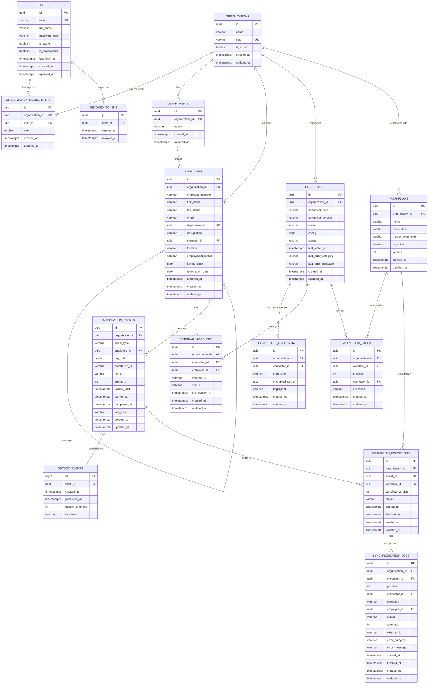

# 07 - Database Design

> **Scope:** tables implemented as of Phase 5 (migrations `0001`-`0005`). Later phases
> append their tables here when they are built.

Database: **PostgreSQL 16** (see [ADR-0002](adr/0002-postgresql-as-system-of-record.md)),
accessed through synchronous SQLAlchemy 2.x ([ADR-0003](adr/0003-synchronous-sqlalchemy.md)).

## 1. Entity-relationship diagram



*Users* are people who log in to SyncForge. *Employees* are the workforce records SyncForge
synchronizes to other systems. They are separate tables on purpose: most employees will
never log in, and a SyncForge admin is not necessarily an employee of the organization.

## 2. Conventions

- **Primary keys:** UUID v4 generated by the application. Not guessable or enumerable
  across tenants, and known before insert.
- **Timestamps:** `timestamptz`, defaulted by the database (`now()`); `updated_at` is
  refreshed by SQLAlchemy on update.
- **Constraint names** follow a fixed convention (`pk_`, `uq_`, `ck_`, `fk_`, `ix_` +
  table + columns), so database errors and migrations refer to constraints by stable names.
- **Enumerations** are stored as `VARCHAR` + `CHECK` (not native PostgreSQL enums), so
  adding a value is a constraint change rather than an `ALTER TYPE`.

## 3. Tables

### `organizations` - tenants

| Column | Type | Null | Default | Notes |
|---|---|---|---|---|
| id | uuid | no | app | PK `pk_organizations` |
| name | varchar(200) | no | | Display name |
| slug | varchar(63) | no | | URL-safe identifier; unique |
| is_active | boolean | no | `true` | |
| created_at / updated_at | timestamptz | no | `now()` | |

Constraints: `uq_organizations_slug`; `ck_organizations_slug_format`
(`slug ~ '^[a-z0-9]+(-[a-z0-9]+)*$'` - lowercase, digits, single hyphens).
Retention: kept for the life of the tenant; deleting one cascades to its memberships.

### `users` - people who log in to SyncForge

Platform users are distinct from the *employees* SyncForge synchronizes (see `employees`).

| Column | Type | Null | Default | Notes |
|---|---|---|---|---|
| id | uuid | no | app | PK `pk_users` |
| email | varchar(320) | no | | Stored lowercase; unique |
| full_name | varchar(200) | no | | |
| password_hash | varchar(255) | no | | Argon2id hash only |
| is_active | boolean | no | `true` | Inactive users cannot log in; their tokens stop working |
| is_superadmin | boolean | no | `false` | Platform-wide Super Admin |
| last_login_at | timestamptz | yes | | |
| created_at / updated_at | timestamptz | no | `now()` | |

Constraints: `uq_users_email`; `ck_users_email_lowercase` (`email = lower(email)`),
which makes the unique constraint effectively case-insensitive.
Retention: PII (email, name) - deactivate rather than delete to preserve history;
hard deletion cascades to memberships and revoked tokens.

### `organization_memberships` - user <-> organization with a role

| Column | Type | Null | Notes |
|---|---|---|---|
| id | uuid | no | PK |
| organization_id | uuid | no | FK -> organizations.id **ON DELETE CASCADE** |
| user_id | uuid | no | FK -> users.id **ON DELETE CASCADE** |
| role | varchar(32) | no | `org_admin` \| `integration_manager` \| `viewer` |
| created_at / updated_at | timestamptz | no | |

Constraints: `uq_organization_memberships_organization_id_user_id` (one role per user per
organization); `ck_organization_memberships_organization_role`.
Indexes: the unique constraint serves lookups by organization; `ix_organization_memberships_user_id`
serves "which organizations does this user belong to?".
Super Admin is **not** a membership role - it is `users.is_superadmin`.

### `revoked_tokens` - logout denylist

| Column | Type | Null | Notes |
|---|---|---|---|
| jti | uuid | no | PK - the JWT's unique ID |
| user_id | uuid | no | FK -> users.id ON DELETE CASCADE; indexed |
| expires_at | timestamptz | no | Copied from the token; indexed |
| revoked_at | timestamptz | no | `now()` |

Retention: a row is only useful until `expires_at` (an expired token is rejected anyway),
so rows can be deleted with `DELETE FROM revoked_tokens WHERE expires_at < now()` -
`ix_revoked_tokens_expires_at` supports this. *A scheduled cleanup job is not implemented
yet (it was not part of Phase 5); it is planned as a periodic maintenance task in Phase 6.*

### `departments` - organizational units

| Column | Type | Null | Default | Notes |
|---|---|---|---|---|
| id | uuid | no | app | PK `pk_departments` |
| organization_id | uuid | no | | FK -> organizations.id **ON DELETE CASCADE** |
| name | varchar(100) | no | | Unique per organization, ignoring case |
| created_at / updated_at | timestamptz | no | `now()` | |

Constraints and indexes:
- `uq_departments_organization_id_lower_name` - unique **expression** index on
  `(organization_id, lower(name))`: "Engineering" and "engineering" cannot coexist in one
  organization, but two organizations can each have "Engineering".
- `uq_departments_organization_id_id` - unique `(organization_id, id)`. Redundant as a
  uniqueness rule (id is already the PK) but required as the **target of the composite
  foreign key** from employees (see below).

Retention: a department that still has employees (including archived ones) cannot be
deleted - the foreign key refuses it and the API returns `409 department_in_use`.

### `employees` - workforce records

| Column | Type | Null | Default | Notes |
|---|---|---|---|---|
| id | uuid | no | app | PK `pk_employees` |
| organization_id | uuid | no | | FK -> organizations.id **ON DELETE CASCADE** |
| employee_number | varchar(50) | no | | HR system "Employee ID", unique per organization |
| first_name / last_name | varchar(100) | no | | |
| email | varchar(320) | no | | Stored lowercase; unique per organization |
| department_id | uuid | yes | | Composite FK, see below |
| designation | varchar(150) | yes | | Job title |
| manager_id | uuid | yes | | Composite self-FK, see below |
| location | varchar(150) | yes | | |
| employment_status | varchar(20) | no | `'active'` | `active` \| `on_leave` \| `terminated` |
| joining_date | date | no | | |
| termination_date | date | yes | | Set exactly when status is `terminated` |
| archived_at | timestamptz | yes | | Soft delete; set only for terminated employees |
| created_at / updated_at | timestamptz | no | `now()` | `updated_at` doubles as "last updated" |

**Tenant integrity through composite foreign keys.** An employee's department and manager
must belong to the *same* organization as the employee. Instead of trusting application
code alone, the foreign keys include `organization_id`:

```sql
FOREIGN KEY (organization_id, department_id) REFERENCES departments (organization_id, id)
FOREIGN KEY (organization_id, manager_id)    REFERENCES employees   (organization_id, id)
```

Because the referencing row's `organization_id` is part of the key, a row pointing at
another organization's department or manager simply has no matching target and PostgreSQL
rejects it. A bug in application code cannot create a cross-tenant reference. (When
`department_id` or `manager_id` is NULL, the constraint is not checked, which is the
intended "no department / no manager" case.) See
[ADR-0006](adr/0006-composite-foreign-keys-for-tenant-integrity.md).

Check constraints (named `ck_employees_...`):

| Constraint | Rule |
|---|---|
| `email_lowercase` | `email = lower(email)` - makes the unique email constraint case-insensitive |
| `not_own_manager` | `manager_id IS NULL OR manager_id <> id` |
| `termination_date_matches_status` | `(employment_status = 'terminated') = (termination_date IS NOT NULL)` |
| `termination_not_before_joining` | `termination_date IS NULL OR termination_date >= joining_date` |
| `employment_status` | value is one of the three statuses |

Longer reporting cycles (A -> B -> C -> A) cannot be expressed as a simple CHECK; they are
prevented by the service layer with a recursive query, serialized by an advisory lock
(section 5).

Unique constraints: `(organization_id, employee_number)`, `(organization_id, email)`,
`(organization_id, id)` (target of the manager foreign key).

Indexes - every query is scoped by organization, so each index leads with `organization_id`:

| Index | Serves |
|---|---|
| `ix_employees_organization_id_last_name` | default list order (`sort=last_name`) |
| `ix_employees_organization_id_status` | `employment_status` filter |
| `ix_employees_organization_id_department_id` | department filter, department employee counts, "department in use" check |
| `ix_employees_organization_id_manager_id` | manager filter, direct reports on termination, the manager-chain query |
| unique `(organization_id, email)` / `(organization_id, employee_number)` | duplicate checks and exact lookups |

Free-text search (`ILIKE '%term%'`) cannot use a B-tree index and scans the organization's
rows. That is acceptable at the scale of one organization's workforce; a `pg_trgm` GIN index
is the upgrade path if measurements ever show it is needed (not added speculatively).

Retention: employees contain personal data. Terminated employees are **archived** (soft
deleted, `archived_at`) rather than removed, so history stays consistent for the audit log
and synchronization history added in later phases. Hard deletion happens only when the
whole organization is deleted (cascade). A retention policy that purges archived records
after a configurable period is a documented future improvement.

### `connectors` - configured connections to external applications

| Column | Type | Null | Default | Notes |
|---|---|---|---|---|
| id | uuid | no | app | PK `pk_connectors` |
| organization_id | uuid | no | | FK -> organizations.id **ON DELETE CASCADE** |
| connector_type | varchar(50) | no | | Registry key: `slack`, `google_workspace`, `payroll` (validated by the service) |
| connector_version | varchar(20) | no | | Adapter version at configuration time; major mismatch is refused |
| name | varchar(100) | no | | Unique per organization |
| config | jsonb | no | `'{}'` | Non-secret settings (e.g. `base_url`, Google `customer`); never secrets |
| status | varchar(20) | no | `'pending'` | `pending` \| `connected` \| `error` \| `disconnected` |
| last_tested_at | timestamptz | yes | | Time of the last connection test |
| last_error_category / last_error_message | varchar(30) / varchar(500) | yes | | Normalized error of the last failed test |
| created_at / updated_at | timestamptz | no | `now()` | |

Constraints: `uq_connectors_organization_id_name`, `ck_connectors_connector_status`, and
`uq_connectors_organization_id_id` (target of the composite foreign keys below).
Index: `ix_connectors_organization_id_connector_type`. Several connectors of one type are
allowed (for example two Slack workspaces).

### `connector_credentials` - encrypted secrets (one set per connector)

| Column | Type | Null | Notes |
|---|---|---|---|
| id | uuid | no | PK |
| organization_id, connector_id | uuid | no | Composite FK -> connectors (organization_id, id) **ON DELETE CASCADE** (`fk_connector_credentials_connector_same_organization`) |
| auth_type | varchar(40) | no | `bearer_token` \| `oauth2_client_credentials` \| `api_key` |
| encrypted_secret | text | no | Fernet token of the credentials JSON ([ADR-0009](adr/0009-encrypting-connector-credentials.md)) |
| fingerprint | varchar(20) | no | Last 4 characters of the main secret, e.g. `...oken` |
| created_at / updated_at | timestamptz | no | `updated_at` shows when credentials were last rotated |

Constraint: `uq_connector_credentials_connector_id`. Kept in a separate table so list
queries never load ciphertext, and so credentials can be rotated (row updated) or revoked
(row deleted on disconnect) independently. Retention: deleted on disconnect and with the
connector.

### `external_accounts` - employee <-> account in an external application

| Column | Type | Null | Default | Notes |
|---|---|---|---|---|
| id | uuid | no | app | PK |
| organization_id | uuid | no | | Part of both composite FKs |
| connector_id | uuid | no | | Composite FK -> connectors (organization_id, id) **ON DELETE CASCADE** |
| employee_id | uuid | no | | Composite FK -> employees (organization_id, id) **ON DELETE CASCADE** |
| external_id | varchar(255) | no | | ID assigned by the external application (opaque) |
| status | varchar(20) | no | `'active'` | `active` \| `deactivated` |
| last_synced_at | timestamptz | yes | | Last successful write to the external application |
| created_at / updated_at | timestamptz | no | `now()` | |

Constraints: `uq_external_accounts_connector_id_employee_id` (one account per application
per employee - also stops two concurrent `create_user` calls from both linking),
`uq_external_accounts_connector_id_external_id` (one external user maps to one employee),
both composite FKs (`fk_external_accounts_connector_same_organization`,
`fk_external_accounts_employee_same_organization`) so a link can never mix organizations.
Index: `ix_external_accounts_organization_id_employee_id` ("which accounts does this
employee have?").
Why the table exists: email is not a stable identifier (people change it), so updates and
deactivations must address the external user by the ID the application assigned.

### `workflows` - configured automations

| Column | Type | Null | Default | Notes |
|---|---|---|---|---|
| id | uuid | no | app | PK |
| organization_id | uuid | no | | FK -> organizations.id **ON DELETE CASCADE** |
| name | varchar(100) | no | | Unique per organization |
| description | varchar(500) | yes | | |
| trigger_event_type | varchar(50) | no | | One of the five `employee.*` event types (`ck_workflows_trigger`) |
| is_active | boolean | no | `false` | New workflows never run until activated |
| version | int | no | `1` | Incremented when the trigger or steps change (`ck_workflows_version_positive`) |
| created_at / updated_at | timestamptz | no | `now()` | |

Constraints: `uq_workflows_organization_id_name`, `uq_workflows_organization_id_id` (target
of composite FKs). Index: `ix_workflows_organization_id_trigger_event_type` (the worker's
lookup "active workflows of this organization for this event type"). Workflows are
deactivated, not deleted; they go only with their organization.

### `workflow_steps` - ordered connector operations of a workflow

| Column | Type | Null | Notes |
|---|---|---|---|
| id | uuid | no | PK |
| organization_id, workflow_id | uuid | no | Composite FK -> workflows **ON DELETE CASCADE** |
| position | int | no | 1, 2, 3, ... (`ck_workflow_steps_position_positive`); unique per workflow |
| connector_id | uuid | no | Composite FK -> connectors (organization_id, id), **no ON DELETE action, DEFERRABLE INITIALLY DEFERRED** |
| operation | varchar(30) | no | `create_user` \| `update_user` \| `deactivate_user` (`ck_workflow_steps_operation`) |
| created_at / updated_at | timestamptz | no | |

Constraint: `uq_workflow_steps_workflow_id_position`. Index: `ix_workflow_steps_connector_id`.
**Why the connector FK is deferred:** a connector in use must not be deletable, so the FK has
no `ON DELETE` action. But deleting an organization cascades to both its connectors and its
workflow steps in one statement, and an immediate check could fire before the cascade had
removed the steps (found by `test_deleting_an_organization_removes_its_workflows_and_history`).
Checking at commit keeps both behaviours. Steps are replaced as a whole when a workflow's
step list changes.

### `integration_events` - durable employee events and their processing status

| Column | Type | Null | Default | Notes |
|---|---|---|---|---|
| id | uuid | no | app | PK; also the event ID sent through the broker |
| organization_id | uuid | no | | FK -> organizations.id **ON DELETE CASCADE** |
| event_type | varchar(50) | no | | `employee.created`, `.updated`, `.department_changed`, `.manager_changed`, `.terminated` |
| employee_id | uuid | no | | Composite FK -> employees (organization_id, id) **ON DELETE CASCADE** |
| payload | jsonb | no | | `{"type", "organization_id", "employee_id", "changes": {field: {old, new}}}` - may contain personal data; never logged; the API exposes field names only |
| correlation_id | varchar(64) | yes | | Request ID of the API call that caused the event (NULL for CLI-created data) |
| status | varchar(20) | no | `'pending'` | `pending` \| `processing` \| `completed` \| `failed` (`ck_integration_events_integration_event_status`) |
| attempts | int | no | `0` | Number of claims (redeliveries and recoveries included) |
| locked_until | timestamptz | yes | | Worker lease while `processing`; deadline for being claimed once published |
| started_at / completed_at | timestamptz | yes | | Last claim / finish |
| last_error | varchar(1000) | yes | | Summary such as "1 of 1 workflow execution(s) failed." |
| created_at / updated_at | timestamptz | no | `now()` | |

Indexes: `(organization_id, created_at)` for the newest-first list, `(organization_id,
status)` for the status filter, `employee_id`, and the **partial** index
`ix_integration_events_unfinished_locked_until` on `locked_until WHERE status IN
('pending', 'processing')` - small, because finished events drop out of it - used by the
relay's recovery query. Events recorded in one transaction share `created_at` (PostgreSQL
`now()` is the transaction start); publication order comes from `outbox_events.id`.

### `outbox_events` - events waiting to be handed to the broker

| Column | Type | Null | Default | Notes |
|---|---|---|---|---|
| id | bigint identity | no | generated | PK; monotonic, gives the publication order |
| event_id | uuid | no | | FK -> integration_events.id **ON DELETE CASCADE** |
| created_at | timestamptz | no | `now()` | |
| published_at | timestamptz | yes | | NULL until the relay published it |
| publish_attempts | int | no | `0` | |
| last_error | varchar(500) | yes | | Last broker error (e.g. connection refused) |

Index: partial `ix_outbox_events_unpublished` on `id WHERE published_at IS NULL`. Written in
the same transaction as the employee change ([ADR-0012](adr/0012-transactional-outbox.md)).

### `workflow_executions` - one run of one workflow for one event

| Column | Type | Null | Default | Notes |
|---|---|---|---|---|
| id | uuid | no | app | PK |
| organization_id | uuid | no | | Part of composite FKs |
| event_id | uuid | no | | FK -> integration_events.id **ON DELETE CASCADE** |
| workflow_id | uuid | no | | Composite FK -> workflows **ON DELETE CASCADE** |
| workflow_version | int | no | | Version of the workflow when the execution started |
| status | varchar(20) | no | `'running'` | `running` \| `succeeded` \| `failed` |
| started_at / finished_at | timestamptz | yes | | |
| created_at / updated_at | timestamptz | no | `now()` | |

Constraints: **`uq_workflow_executions_event_id_workflow_id`** - one execution per (event,
workflow), the core of idempotent redelivery; `uq_workflow_executions_organization_id_id`.
Index: `(organization_id, workflow_id, created_at)` for execution history.

### `synchronization_jobs` - one step of one execution

| Column | Type | Null | Default | Notes |
|---|---|---|---|---|
| id | uuid | no | app | PK |
| organization_id, execution_id | uuid | no | | Composite FK -> workflow_executions **ON DELETE CASCADE** |
| position | int | no | | Copied from the step; unique per execution |
| connector_id | uuid | no | | Copied from the step; composite FK -> connectors **ON DELETE CASCADE** |
| operation | varchar(30) | no | | Copied from the step |
| employee_id | uuid | no | | Composite FK -> employees **ON DELETE CASCADE** |
| status | varchar(20) | no | `'pending'` | `pending` \| `running` \| `succeeded` \| `failed` \| `skipped` |
| attempts | int | no | `0` | External calls attempted (Phase 6 adds per-attempt history) |
| external_id | varchar(255) | yes | | ID in the external application, when known |
| error_category / error_message | varchar(30) / varchar(500) | yes | | Normalized failure, or the reason a job was skipped |
| started_at / finished_at | timestamptz | yes | | |
| created_at / updated_at | timestamptz | no | `now()` | |

Constraints: `uq_synchronization_jobs_execution_id_position`, operation and position checks.
Indexes: `(organization_id, status)`, `connector_id`.

Retention (all event tables): nothing is deleted today except with the organization. Events,
executions and jobs are the synchronization history that the audit log (Phase 7) and the
dashboard (Phase 8) read. A retention job removing published outbox rows and old finished
events after a configurable period is a documented future improvement.

## 4. Migration strategy

- Every schema change is an **Alembic migration** in `backend/migrations/versions/`,
  numbered sequentially (`0001`, `0002`, ...). Tables are never created by the app at startup.
- Migrations are generated with `alembic revision --autogenerate`, then **reviewed and
  tidied by hand** before committing.
- Every migration has a working `downgrade()`.
- The test suite enforces two rules:
  - `test_models_and_migrations_are_in_sync` runs `alembic check` - it fails if a model
    changed without a migration.
  - `test_downgrade_to_base_and_upgrade_to_head` applies every downgrade and upgrade.

Commands (from `backend/`): `alembic upgrade head`, `alembic downgrade -1`,
`alembic current`, `alembic history`, `alembic upgrade head --sql` (print SQL only).

## 5. Transaction boundaries

- One SQLAlchemy session per HTTP request (`get_db` dependency), always closed afterwards.
- **Services own commits.** A use case either commits all of its changes or none.
- Concurrency is ultimately enforced by constraints: e.g. two simultaneous registrations
  with the same email - the unique constraint lets one win and the service converts the
  loser's `IntegrityError` into `409 email_taken`. Employee creation does the same for
  duplicate emails and employee numbers.
- **Row locks** (`SELECT ... FOR UPDATE`) serialize changes to the same row: the
  organization's admin memberships (last-admin rule) and the employee being updated,
  terminated or archived.
- **Advisory lock for reporting lines.** Two requests can each lock a *different* employee
  row and together create a cycle ("Alice reports to Bob" and "Bob reports to Alice").
  Any request that changes a manager relationship (a `manager_id` update or a termination,
  which moves direct reports) first takes `pg_advisory_xact_lock(<key derived from the
  organization id>)`. Such requests in one organization run one at a time; other
  organizations are unaffected, and the lock is released automatically at commit or
  rollback. See [ADR-0007](adr/0007-advisory-lock-for-reporting-line-changes.md).
- **No locks across external calls.** Connector operations read what they need, call the
  external API without holding row locks, then write the result in a short transaction.
  A slow vendor therefore cannot block other requests; races on the same link are settled
  by the unique constraint on `(connector_id, employee_id)`.
- **Outbox in the same transaction.** An employee change, its `integration_events` rows and
  its `outbox_events` rows commit together ([ADR-0012](adr/0012-transactional-outbox.md)).
- **Worker transactions are short.** The engine claims an event with one atomic `UPDATE ...
  RETURNING` (commit), plans executions (commit), and for each step commits "running"
  before the external call and the result after it. A crash therefore leaves a precise
  record of how far processing got ([docs/11](11-workflow-engine.md)).
- **Relay locking.** The relay selects unpublished outbox rows and expired events with
  `FOR UPDATE SKIP LOCKED`, so concurrent relays never block on, or double-publish, the
  same rows in one round.

## 6. Test database

Tests use a separate database, `syncforge_test` (created automatically). At the start of
each run the schema is dropped and rebuilt **by running the migrations**; each test then
runs inside a transaction that is rolled back, so tests are isolated and leave no data.
