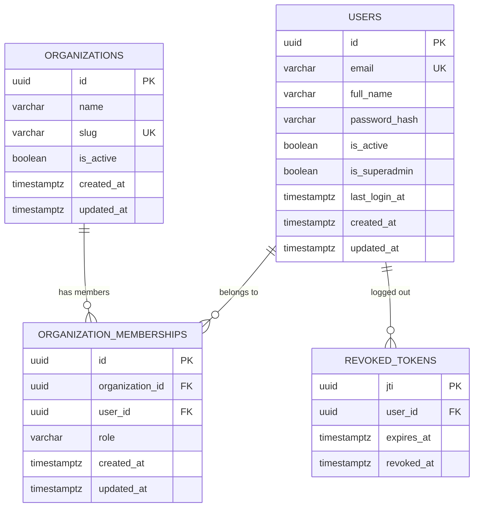

# 07 — Database Design

> **Scope:** tables implemented as of Phase 2 (migrations `0001`, `0002`). Later phases
> append their tables here when they are built.

Database: **PostgreSQL 16** (see [ADR-0002](adr/0002-postgresql-as-system-of-record.md)),
accessed through synchronous SQLAlchemy 2.x ([ADR-0003](adr/0003-synchronous-sqlalchemy.md)).

## 1. Entity-relationship diagram

## 2. Conventions

- **Primary keys:** UUID v4 generated by the application. Not guessable or enumerable
  across tenants, and known before insert.
- **Timestamps:** `timestamptz`, defaulted by the database (`now()`); `updated_at` is
  refreshed by SQLAlchemy on update.
- **Constraint names** follow a fixed convention (`pk_`, `uq_`, `ck_`, `fk_`, `ix_` +
  table + columns), so database errors and migrations refer to constraints by stable names.
- **Enumerations** are stored as `VARCHAR` + `CHECK` (not native PostgreSQL enums), so
  adding a value is a constraint change rather than an `ALTER TYPE`.

## 3. Tables

### `organizations` — tenants

| Column | Type | Null | Default | Notes |
|---|---|---|---|---|
| id | uuid | no | app | PK `pk_organizations` |
| name | varchar(200) | no | | Display name |
| slug | varchar(63) | no | | URL-safe identifier; unique |
| is_active | boolean | no | `true` | |
| created_at / updated_at | timestamptz | no | `now()` | |

Constraints: `uq_organizations_slug`; `ck_organizations_slug_format`
(`slug ~ '^[a-z0-9]+(-[a-z0-9]+)*$'` — lowercase, digits, single hyphens).
Retention: kept for the life of the tenant; deleting one cascades to its memberships.

### `users` — people who log in to SyncForge

Platform users are distinct from the *employees* SyncForge synchronizes (Phase 3).

| Column | Type | Null | Default | Notes |
|---|---|---|---|---|
| id | uuid | no | app | PK `pk_users` |
| email | varchar(320) | no | | Stored lowercase; unique |
| full_name | varchar(200) | no | | |
| password_hash | varchar(255) | no | | Argon2id hash only |
| is_active | boolean | no | `true` | Inactive users cannot log in; their tokens stop working |
| is_superadmin | boolean | no | `false` | Platform-wide Super Admin |
| last_login_at | timestamptz | yes | | |
| created_at / updated_at | timestamptz | no | `now()` | |

Constraints: `uq_users_email`; `ck_users_email_lowercase` (`email = lower(email)`),
which makes the unique constraint effectively case-insensitive.
Retention: PII (email, name) — deactivate rather than delete to preserve history;
hard deletion cascades to memberships and revoked tokens.

### `organization_memberships` — user ↔ organization with a role

| Column | Type | Null | Notes |
|---|---|---|---|
| id | uuid | no | PK |
| organization_id | uuid | no | FK → organizations.id **ON DELETE CASCADE** |
| user_id | uuid | no | FK → users.id **ON DELETE CASCADE** |
| role | varchar(32) | no | `org_admin` \| `integration_manager` \| `viewer` |
| created_at / updated_at | timestamptz | no | |

Constraints: `uq_organization_memberships_organization_id_user_id` (one role per user per
organization); `ck_organization_memberships_organization_role`.
Indexes: the unique constraint serves lookups by organization; `ix_organization_memberships_user_id`
serves "which organizations does this user belong to?".
Super Admin is **not** a membership role — it is `users.is_superadmin`.

### `revoked_tokens` — logout denylist

| Column | Type | Null | Notes |
|---|---|---|---|
| jti | uuid | no | PK — the JWT's unique ID |
| user_id | uuid | no | FK → users.id ON DELETE CASCADE; indexed |
| expires_at | timestamptz | no | Copied from the token; indexed |
| revoked_at | timestamptz | no | `now()` |

Retention: a row is only useful until `expires_at` (an expired token is rejected anyway),
so rows can be deleted with `DELETE FROM revoked_tokens WHERE expires_at < now()` —
`ix_revoked_tokens_expires_at` supports this. *A scheduled cleanup job is not implemented
yet; it will be added with the background workers in Phase 5.*

## 4. Migration strategy

- Every schema change is an **Alembic migration** in `backend/migrations/versions/`,
  numbered sequentially (`0001`, `0002`, …). Tables are never created by the app at startup.
- Migrations are generated with `alembic revision --autogenerate`, then **reviewed and
  tidied by hand** before committing.
- Every migration has a working `downgrade()`.
- The test suite enforces two rules:
  - `test_models_and_migrations_are_in_sync` runs `alembic check` — it fails if a model
    changed without a migration.
  - `test_downgrade_to_base_and_upgrade_to_head` applies every downgrade and upgrade.

Commands (from `backend/`): `alembic upgrade head`, `alembic downgrade -1`,
`alembic current`, `alembic history`, `alembic upgrade head --sql` (print SQL only).

## 5. Transaction boundaries

- One SQLAlchemy session per HTTP request (`get_db` dependency), always closed afterwards.
- **Services own commits.** A use case either commits all of its changes or none.
- Concurrency is ultimately enforced by constraints: e.g. two simultaneous registrations
  with the same email — the unique constraint lets one win and the service converts the
  loser's `IntegrityError` into `409 email_taken`.

## 6. Test database

Tests use a separate database, `syncforge_test` (created automatically). At the start of
each run the schema is dropped and rebuilt **by running the migrations**; each test then
runs inside a transaction that is rolled back, so tests are isolated and leave no data.
