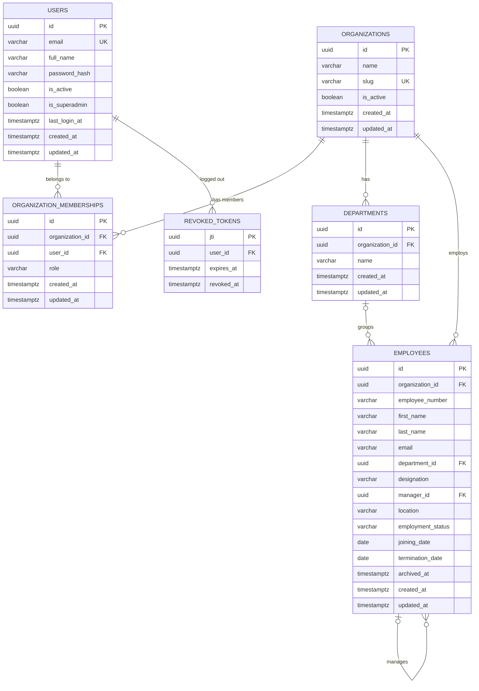

# 07 - Database Design

> **Scope:** tables implemented as of Phase 3 (migrations `0001`-`0003`). Later phases
> append their tables here when they are built.

Database: **PostgreSQL 16** (see [ADR-0002](adr/0002-postgresql-as-system-of-record.md)),
accessed through synchronous SQLAlchemy 2.x ([ADR-0003](adr/0003-synchronous-sqlalchemy.md)).

## 1. Entity-relationship diagram



*Users* are people who log in to SyncForge. *Employees* are the workforce records SyncForge
synchronizes to other systems. They are separate tables on purpose: most employees will
never log in, and a SyncForge admin is not necessarily an employee of the organization.

## 2. Conventions

- **Primary keys:** UUID v4 generated by the application. Not guessable or enumerable
  across tenants, and known before insert.
- **Timestamps:** `timestamptz`, defaulted by the database (`now()`); `updated_at` is
  refreshed by SQLAlchemy on update.
- **Constraint names** follow a fixed convention (`pk_`, `uq_`, `ck_`, `fk_`, `ix_` +
  table + columns), so database errors and migrations refer to constraints by stable names.
- **Enumerations** are stored as `VARCHAR` + `CHECK` (not native PostgreSQL enums), so
  adding a value is a constraint change rather than an `ALTER TYPE`.

## 3. Tables

### `organizations` - tenants

| Column | Type | Null | Default | Notes |
|---|---|---|---|---|
| id | uuid | no | app | PK `pk_organizations` |
| name | varchar(200) | no | | Display name |
| slug | varchar(63) | no | | URL-safe identifier; unique |
| is_active | boolean | no | `true` | |
| created_at / updated_at | timestamptz | no | `now()` | |

Constraints: `uq_organizations_slug`; `ck_organizations_slug_format`
(`slug ~ '^[a-z0-9]+(-[a-z0-9]+)*$'` - lowercase, digits, single hyphens).
Retention: kept for the life of the tenant; deleting one cascades to its memberships.

### `users` - people who log in to SyncForge

Platform users are distinct from the *employees* SyncForge synchronizes (see `employees`).

| Column | Type | Null | Default | Notes |
|---|---|---|---|---|
| id | uuid | no | app | PK `pk_users` |
| email | varchar(320) | no | | Stored lowercase; unique |
| full_name | varchar(200) | no | | |
| password_hash | varchar(255) | no | | Argon2id hash only |
| is_active | boolean | no | `true` | Inactive users cannot log in; their tokens stop working |
| is_superadmin | boolean | no | `false` | Platform-wide Super Admin |
| last_login_at | timestamptz | yes | | |
| created_at / updated_at | timestamptz | no | `now()` | |

Constraints: `uq_users_email`; `ck_users_email_lowercase` (`email = lower(email)`),
which makes the unique constraint effectively case-insensitive.
Retention: PII (email, name) - deactivate rather than delete to preserve history;
hard deletion cascades to memberships and revoked tokens.

### `organization_memberships` - user <-> organization with a role

| Column | Type | Null | Notes |
|---|---|---|---|
| id | uuid | no | PK |
| organization_id | uuid | no | FK -> organizations.id **ON DELETE CASCADE** |
| user_id | uuid | no | FK -> users.id **ON DELETE CASCADE** |
| role | varchar(32) | no | `org_admin` \| `integration_manager` \| `viewer` |
| created_at / updated_at | timestamptz | no | |

Constraints: `uq_organization_memberships_organization_id_user_id` (one role per user per
organization); `ck_organization_memberships_organization_role`.
Indexes: the unique constraint serves lookups by organization; `ix_organization_memberships_user_id`
serves "which organizations does this user belong to?".
Super Admin is **not** a membership role - it is `users.is_superadmin`.

### `revoked_tokens` - logout denylist

| Column | Type | Null | Notes |
|---|---|---|---|
| jti | uuid | no | PK - the JWT's unique ID |
| user_id | uuid | no | FK -> users.id ON DELETE CASCADE; indexed |
| expires_at | timestamptz | no | Copied from the token; indexed |
| revoked_at | timestamptz | no | `now()` |

Retention: a row is only useful until `expires_at` (an expired token is rejected anyway),
so rows can be deleted with `DELETE FROM revoked_tokens WHERE expires_at < now()` -
`ix_revoked_tokens_expires_at` supports this. *A scheduled cleanup job is not implemented
yet; it will be added with the background workers in Phase 5.*

### `departments` - organizational units

| Column | Type | Null | Default | Notes |
|---|---|---|---|---|
| id | uuid | no | app | PK `pk_departments` |
| organization_id | uuid | no | | FK -> organizations.id **ON DELETE CASCADE** |
| name | varchar(100) | no | | Unique per organization, ignoring case |
| created_at / updated_at | timestamptz | no | `now()` | |

Constraints and indexes:
- `uq_departments_organization_id_lower_name` - unique **expression** index on
  `(organization_id, lower(name))`: "Engineering" and "engineering" cannot coexist in one
  organization, but two organizations can each have "Engineering".
- `uq_departments_organization_id_id` - unique `(organization_id, id)`. Redundant as a
  uniqueness rule (id is already the PK) but required as the **target of the composite
  foreign key** from employees (see below).

Retention: a department that still has employees (including archived ones) cannot be
deleted - the foreign key refuses it and the API returns `409 department_in_use`.

### `employees` - workforce records

| Column | Type | Null | Default | Notes |
|---|---|---|---|---|
| id | uuid | no | app | PK `pk_employees` |
| organization_id | uuid | no | | FK -> organizations.id **ON DELETE CASCADE** |
| employee_number | varchar(50) | no | | HR system "Employee ID", unique per organization |
| first_name / last_name | varchar(100) | no | | |
| email | varchar(320) | no | | Stored lowercase; unique per organization |
| department_id | uuid | yes | | Composite FK, see below |
| designation | varchar(150) | yes | | Job title |
| manager_id | uuid | yes | | Composite self-FK, see below |
| location | varchar(150) | yes | | |
| employment_status | varchar(20) | no | `'active'` | `active` \| `on_leave` \| `terminated` |
| joining_date | date | no | | |
| termination_date | date | yes | | Set exactly when status is `terminated` |
| archived_at | timestamptz | yes | | Soft delete; set only for terminated employees |
| created_at / updated_at | timestamptz | no | `now()` | `updated_at` doubles as "last updated" |

**Tenant integrity through composite foreign keys.** An employee's department and manager
must belong to the *same* organization as the employee. Instead of trusting application
code alone, the foreign keys include `organization_id`:

```sql
FOREIGN KEY (organization_id, department_id) REFERENCES departments (organization_id, id)
FOREIGN KEY (organization_id, manager_id)    REFERENCES employees   (organization_id, id)
```

Because the referencing row's `organization_id` is part of the key, a row pointing at
another organization's department or manager simply has no matching target and PostgreSQL
rejects it. A bug in application code cannot create a cross-tenant reference. (When
`department_id` or `manager_id` is NULL, the constraint is not checked, which is the
intended "no department / no manager" case.) See
[ADR-0006](adr/0006-composite-foreign-keys-for-tenant-integrity.md).

Check constraints (named `ck_employees_...`):

| Constraint | Rule |
|---|---|
| `email_lowercase` | `email = lower(email)` - makes the unique email constraint case-insensitive |
| `not_own_manager` | `manager_id IS NULL OR manager_id <> id` |
| `termination_date_matches_status` | `(employment_status = 'terminated') = (termination_date IS NOT NULL)` |
| `termination_not_before_joining` | `termination_date IS NULL OR termination_date >= joining_date` |
| `employment_status` | value is one of the three statuses |

Longer reporting cycles (A -> B -> C -> A) cannot be expressed as a simple CHECK; they are
prevented by the service layer with a recursive query, serialized by an advisory lock
(section 5).

Unique constraints: `(organization_id, employee_number)`, `(organization_id, email)`,
`(organization_id, id)` (target of the manager foreign key).

Indexes - every query is scoped by organization, so each index leads with `organization_id`:

| Index | Serves |
|---|---|
| `ix_employees_organization_id_last_name` | default list order (`sort=last_name`) |
| `ix_employees_organization_id_status` | `employment_status` filter |
| `ix_employees_organization_id_department_id` | department filter, department employee counts, "department in use" check |
| `ix_employees_organization_id_manager_id` | manager filter, direct reports on termination, the manager-chain query |
| unique `(organization_id, email)` / `(organization_id, employee_number)` | duplicate checks and exact lookups |

Free-text search (`ILIKE '%term%'`) cannot use a B-tree index and scans the organization's
rows. That is acceptable at the scale of one organization's workforce; a `pg_trgm` GIN index
is the upgrade path if measurements ever show it is needed (not added speculatively).

Retention: employees contain personal data. Terminated employees are **archived** (soft
deleted, `archived_at`) rather than removed, so history stays consistent for the audit log
and synchronization history added in later phases. Hard deletion happens only when the
whole organization is deleted (cascade). A retention policy that purges archived records
after a configurable period is a documented future improvement.

## 4. Migration strategy

- Every schema change is an **Alembic migration** in `backend/migrations/versions/`,
  numbered sequentially (`0001`, `0002`, ...). Tables are never created by the app at startup.
- Migrations are generated with `alembic revision --autogenerate`, then **reviewed and
  tidied by hand** before committing.
- Every migration has a working `downgrade()`.
- The test suite enforces two rules:
  - `test_models_and_migrations_are_in_sync` runs `alembic check` - it fails if a model
    changed without a migration.
  - `test_downgrade_to_base_and_upgrade_to_head` applies every downgrade and upgrade.

Commands (from `backend/`): `alembic upgrade head`, `alembic downgrade -1`,
`alembic current`, `alembic history`, `alembic upgrade head --sql` (print SQL only).

## 5. Transaction boundaries

- One SQLAlchemy session per HTTP request (`get_db` dependency), always closed afterwards.
- **Services own commits.** A use case either commits all of its changes or none.
- Concurrency is ultimately enforced by constraints: e.g. two simultaneous registrations
  with the same email - the unique constraint lets one win and the service converts the
  loser's `IntegrityError` into `409 email_taken`. Employee creation does the same for
  duplicate emails and employee numbers.
- **Row locks** (`SELECT ... FOR UPDATE`) serialize changes to the same row: the
  organization's admin memberships (last-admin rule) and the employee being updated,
  terminated or archived.
- **Advisory lock for reporting lines.** Two requests can each lock a *different* employee
  row and together create a cycle ("Alice reports to Bob" and "Bob reports to Alice").
  Any request that changes a manager relationship (a `manager_id` update or a termination,
  which moves direct reports) first takes `pg_advisory_xact_lock(<key derived from the
  organization id>)`. Such requests in one organization run one at a time; other
  organizations are unaffected, and the lock is released automatically at commit or
  rollback. See [ADR-0007](adr/0007-advisory-lock-for-reporting-line-changes.md).

## 6. Test database

Tests use a separate database, `syncforge_test` (created automatically). At the start of
each run the schema is dropped and rebuilt **by running the migrations**; each test then
runs inside a transaction that is rolled back, so tests are isolated and leave no data.
