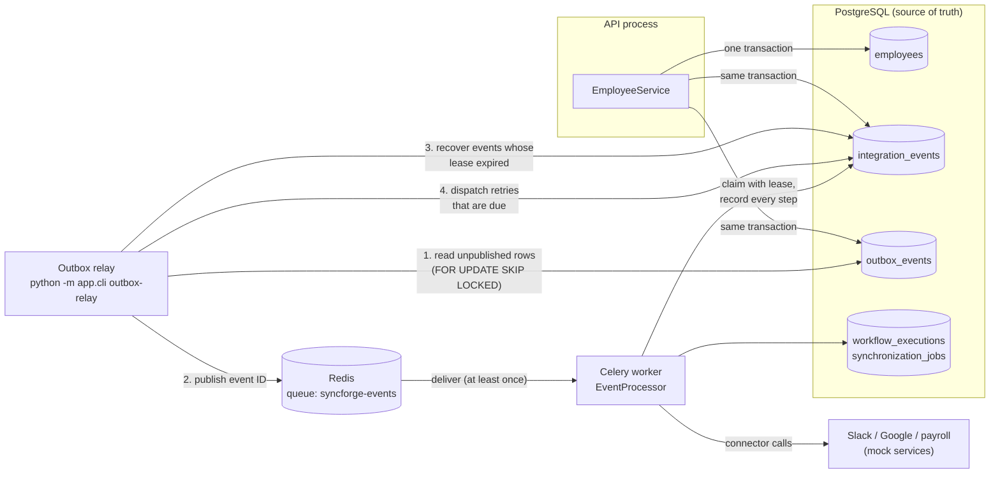
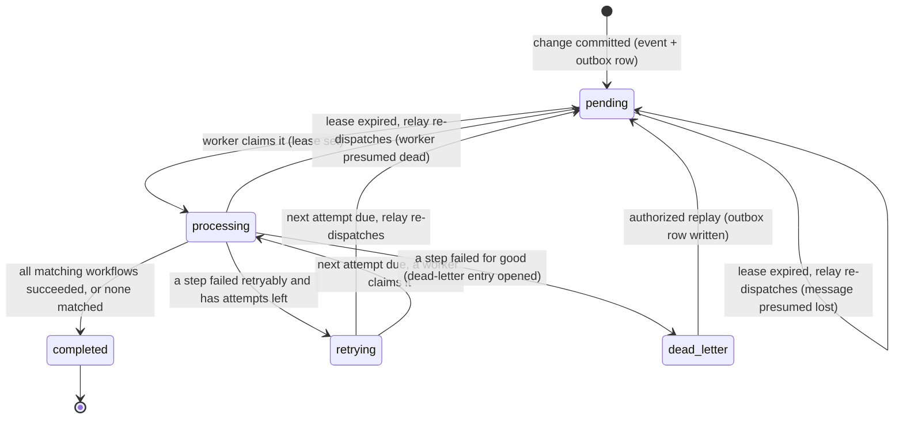
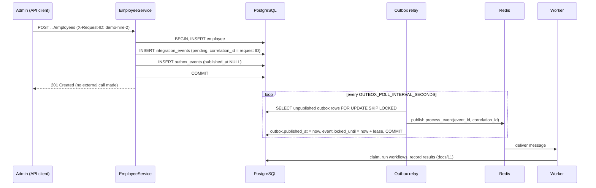

# 09 - Event-Driven Architecture

> **Scope:** the event pipeline as implemented: transactional outbox, outbox relay, Redis,
> Celery workers and the worker lease (Phase 5), with the retry and dead-letter states added
> in Phase 6. Retries, the dead-letter queue, replay, the circuit breaker and rate limits
> are described in [docs/12](12-reliability-and-retries.md), idempotency in
> [docs/13](13-idempotency.md). The workflow engine that runs inside the worker is in
> [docs/11](11-workflow-engine.md).

## 1. Why events, and why asynchronous

An employee change (hire, transfer, termination) has to reach several external
applications. Doing that inside the API request would mean:

- the admin waits for Slack, Google and payroll on every save;
- one slow or broken vendor makes the HR change itself fail or time out;
- a crash halfway leaves some applications updated and others not, with no record.

So the API only **records what happened**, durably, and returns. Background workers do the
external work afterwards, record every step, and can be scaled, restarted or crash
without losing anything. See [ADR-0011](adr/0011-asynchronous-event-processing.md).

## 2. The pipeline



| Component | Code | Runs as |
|---|---|---|
| Event recording | `app/events/outbox.py` (`record_events`) | inside the API request |
| Outbox relay | `app/events/relay.py` (`OutboxRelay`), `app/cli.py` (`outbox-relay`) | its own process; one or more |
| Broker | Redis 7 (`docker-compose.yml`, service `redis`) | container |
| Worker | `app/workers/celery_app.py`, `app/workers/tasks.py` | Celery worker processes; one or more |
| Workflow engine | `app/workflows/engine.py` (`EventProcessor`) | inside the worker task |

**The database is the source of truth. Redis is only a doorbell.** A message says nothing
more than "please process event X". Whether X is pending, being processed, finished or
failed, and what each step did, lives in PostgreSQL. A lost or duplicated message
therefore cannot corrupt state; at worst it causes a delay or a harmless second look.

## 3. Event lifecycle



| Status | Meaning | `locked_until` | `next_attempt_at` |
|---|---|---|---|
| `pending` | Recorded, not claimed. Published or about to be. | `NULL` until published; then the time by which a worker should have claimed it | `NULL` |
| `processing` | Owned by one worker | end of the worker's lease, renewed before every step | `NULL` |
| `retrying` | A step waits for its next attempt; no worker holds it | `NULL` | earliest waiting step's next attempt |
| `completed` | All matching workflows succeeded, or none matched | `NULL` | `NULL` |
| `dead_letter` | A step failed for good; details in its `dead_letter_events` entry ([docs/12](12-reliability-and-retries.md#5-the-dead-letter-queue)) | `NULL` | `NULL` |

`attempts` counts claims, so a value above 1 shows the event was redelivered, recovered or
retried. Phase 5's `failed` status was replaced by `dead_letter` in migration `0007`.

## 4. Transactional outbox

**The problem it solves.** If the service committed the employee and *then* published to
Redis, a crash (or Redis being down) between the two would lose the event: the employee is
hired, no accounts are ever created, and nothing records that anything was missed. Publishing
*before* committing is worse: workers could act on a change that is then rolled back.

**The pattern.** The employee row, one `integration_events` row per lifecycle event, and
one `outbox_events` row per event are written in **one database transaction**
(`EmployeeService` calls `record_events` before `commit`). Either all of them exist or none
do. Publishing happens later, from the outbox, by a separate process.



`test_employee_change_and_its_events_share_one_transaction` proves the atomicity: it makes
the outbox write fail and checks that the employee was not saved either.

**Correlation ID.** The API request ID is stored on the event (`correlation_id`) and sent
with the message. The worker uses it as its log context, so the API's `request completed`
line, the `employee lifecycle event` line and every worker line for that event share one
ID. Searching the logs for it shows the whole story of a hire.

Full decision record: [ADR-0012](adr/0012-transactional-outbox.md).

## 5. The outbox relay

`OutboxRelay.run_once()` does three things per poll (default every 1 s):

1. **Publish.** Up to `OUTBOX_BATCH_SIZE` unpublished rows, oldest first (`outbox_events.id`
   is an identity column, so this is commit order within the relay's view). Rows are locked
   with `FOR UPDATE SKIP LOCKED`, so several relays can run side by side without publishing
   the same row in parallel. If publishing fails (Redis down), the relay records
   `publish_attempts` and `last_error` on the row, stops this round, and tries again on the
   next poll. Nothing is lost; the row simply stays unpublished.
2. **Recover.** Re-publish `pending` or `processing` events whose `locked_until` has passed:
   - a `processing` event with an expired lease means its worker stopped renewing it - it
     crashed or was killed. The relay sets it back to **`pending`** so the next worker can
     claim it, then publishes it again;
   - a `pending` event with an expired deadline was published but never claimed - the message
     was lost (for example Redis restarted; it runs without persistence on purpose).
3. **Dispatch due retries** (Phase 6). `retrying` events whose `next_attempt_at` has
   passed are published again and set to `pending` (`FOR UPDATE SKIP LOCKED`). A retry is
   data in the database, not a sleeping worker ([docs/12, section 3](12-reliability-and-retries.md#3-retries-exponential-backoff-with-jitter)).

A relay crash between "published" and "marked published" means that row is published again
on the next poll. That is intended: delivery is at-least-once, and the worker's claim step
makes the duplicate harmless.

**Bug found during the live crash demonstration (fixed before commit).** The first version
of the recovery step renewed the lease of the `processing` event when re-dispatching it.
The next worker then saw a valid lease, treated the event as owned by a live worker, and
skipped it - every 10 seconds, forever. The unit tests had called the engine directly with
an already-expired lease, so they missed it. The fix resets recovered events to `pending`;
`test_relay_recovery_hands_a_crashed_workers_event_to_the_next_worker` runs the relay and the
engine together and fails without the fix.

## 6. Broker and worker

Celery settings (`app/workers/celery_app.py`) chosen for at-least-once processing:

| Setting | Value | Why |
|---|---|---|
| `task_acks_late` | `True` | A message is acknowledged after the task finishes, so a worker that dies mid-task does not lose it |
| `task_reject_on_worker_lost` | `True` | Such a message is returned to the queue |
| `worker_prefetch_multiplier` | `1` | A worker reserves one message at a time; a slow event does not hold others hostage |
| `task_ignore_result` | `True` | Results live in PostgreSQL; no result backend |
| `visibility_timeout` | 2 x `WORKER_LEASE_SECONDS` | Redis redelivers an unacknowledged message after this; kept above the longest event |
| serializer | JSON | Messages carry only an event ID and a correlation ID; no pickle |

Even if the broker loses a message despite these settings, the relay's recovery step
re-sends the event. Reliability does not depend on Redis keeping messages; Redis runs with
persistence switched off (`--save "" --appendonly no`).

**Windows.** Celery's default process pool is not supported on Windows, so workers run with
`--pool=solo` (one task at a time per process); scale by starting more worker processes.
Start it as `python -m celery ...` with the project's virtual environment Python, not a bare
`celery` command - see [docs/21](21-troubleshooting.md).

Why Redis and Celery rather than alternatives: [ADR-0010](adr/0010-redis-and-celery-for-background-work.md).

## 7. Delivery guarantees - what is and is not promised

| Promise | How |
|---|---|
| A committed employee change always gets its events | Same transaction (outbox) |
| A rolled-back change never produces an event | Same transaction |
| Every event is eventually delivered to a worker, if Redis and a worker eventually run | Outbox relay publishes until it succeeds; recovery re-sends lost or abandoned events |
| An event delivered twice does not run its workflows twice | Atomic claim; one execution per (event, workflow) by unique constraint; finished steps are skipped |
| A worker crash does not lose or repeat finished work | Lease expiry, recovery to `pending`, resume from the first unfinished step |
| A transient external failure does not fail the event | Retries with backoff ([docs/12](12-reliability-and-retries.md)) |
| A step that fails for good is kept, visible and recoverable | Dead-letter queue and replay ([docs/12](12-reliability-and-retries.md#5-the-dead-letter-queue)) |
| A repeated `create_user` does not create a second account | Account link, plus idempotency keys where the application honours them ([docs/13](13-idempotency.md)) |

**Not promised: exactly-once delivery.** A message can arrive more than once and a step can
be interrupted mid-call; the system is designed around **at-least-once delivery with
idempotent processing**, never exactly-once. The crash window that Phase 5 left open (an
external account created, SyncForge's link not yet stored) is closed by idempotency keys
for applications that honour them - the three mock services do; for the real Slack and
Google APIs, which do not document such a header, the window produces a visible conflict
and a dead-letter entry, not a duplicate ([docs/13, section 3](13-idempotency.md#3-outgoing-idempotency-keys-on-external-create-calls)).

**Ordering.** One worker processes messages in publication order. With several workers, two
events for the same employee could run concurrently; this is acceptable in Phase 5 because
each step reads the employee's **current** state (section 8). Per-employee ordering is a
documented future improvement.

## 8. Design rule: workers act on current state

A worker does not replay the values stored in the event. Each step loads the employee as it
is now and applies the connector operation to that. Consequences:

- **A stale event never grants access.** In the Windows live run, Grace #1 was hired and
  terminated while no worker was running. When the worker started, it processed the hire
  first - and skipped all three `create_user` steps, because she was already terminated
  ("Accounts are not created for terminated employees"). The termination then skipped
  `deactivate_user` ("The employee has no account in this application"). Both events ended
  `completed`; no access was ever created for a terminated person.
- An update processed late sends the latest data, not an intermediate version.
- The event payload (old and new values) is kept for audit and the conflict handling of
  Phase 7, not for driving the external writes.

## 9. Configuration

| Variable | Default | Meaning |
|---|---|---|
| `REDIS_URL` | `redis://localhost:6379/0` | Broker used by the relay (publish) and workers (consume) |
| `WORKER_LEASE_SECONDS` | `300` | How long a claimed event belongs to a worker; renewed before every step. Also how long a published event may wait unclaimed before it is re-sent. Must exceed the longest single step (connector timeouts: 3 s connect + 10 s read by default) |
| `OUTBOX_BATCH_SIZE` | `100` | Rows published (and events recovered) per poll |
| `OUTBOX_POLL_INTERVAL_SECONDS` | `1` | Pause between relay polls |

Retry, circuit-breaker and timeout settings: [docs/12, section 11](12-reliability-and-retries.md#11-configuration).

## 10. Running it locally

From the repository root, one terminal each (Windows; see the README for the full setup):

```powershell
docker compose up -d postgres redis
Set-Location mock-services; & ..\backend\.venv\Scripts\python.exe -m mockservices.run_all
Set-Location backend; & .\.venv\Scripts\python.exe -m uvicorn app.main:app --port 8000
Set-Location backend; & .\.venv\Scripts\python.exe -m celery -A app.workers.celery_app worker --loglevel=INFO --pool=solo
Set-Location backend; & .\.venv\Scripts\python.exe -m app.cli outbox-relay
```

## 11. Tests

| Concern | Tests |
|---|---|
| Change, events and outbox rows commit together | `test_event_outbox.py` (`..._share_one_transaction`, rejected and no-op changes record nothing) |
| Relay publishes in order, respects batch size, survives broker outage, recovers expired leases | `test_outbox_relay.py` |
| Relay recovery and engine together | `test_relay_recovery_hands_a_crashed_workers_event_to_the_next_worker` |
| Real Celery worker: relay -> broker -> worker -> engine -> mocks, then duplicate delivery skipped | `test_celery_worker.py` (in-memory broker, worker thread) |
| Claim, duplicate delivery, live lease, crash resume | `test_workflow_engine.py` |
| Due retries dispatched by the relay; a due retry claimed while the relay holds the row | `test_retries.py`, `test_concurrency.py` |
| Dead-letter and replay through the outbox | `test_dead_letters.py` |
