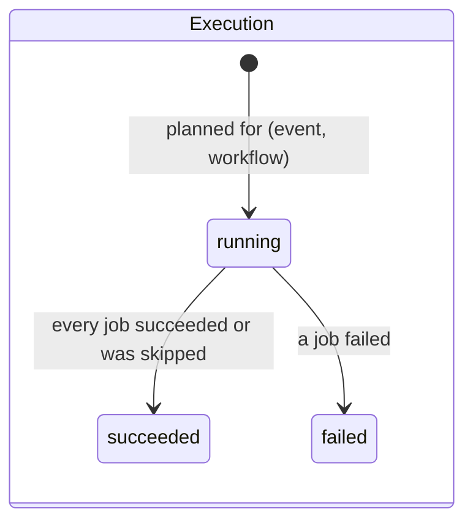
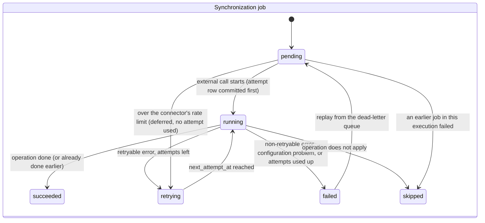

# 11 - Workflow Engine

> **Scope:** workflow configuration and the engine that executes workflows for integration
> events, as implemented (Phase 5), including the retry, rate-limit and dead-letter steps
> added in Phase 6. Steps run sequentially. The reliability mechanisms themselves are
> described in [docs/12](12-reliability-and-retries.md) and [docs/13](13-idempotency.md);
> how events reach the engine is in [docs/09](09-event-driven-architecture.md).

## 1. Concepts

| Term | Table | What it is |
|---|---|---|
| **Workflow** | `workflows` | An automation an administrator configures: a **trigger** (an employee event type) and an ordered list of **steps**. Data, not code: new automations need no deployment |
| **Step** | `workflow_steps` | One connector operation at a position: "create the user in *this* Slack connector" |
| **Execution** | `workflow_executions` | One run of one workflow for one event. Exactly one per (event, workflow) |
| **Synchronization job** | `synchronization_jobs` | One step of one execution, with its own status, attempts, external ID and error |
| **Attempt** | `synchronization_attempts` | One external call made for a job (Phase 6): timing, outcome, normalized error |

Example onboarding workflow (trigger `employee.created`):

| Position | Connector | Operation |
|---|---|---|
| 1 | Slack | `create_user` |
| 2 | Google Workspace | `create_user` |
| 3 | Payroll | `create_user` |

Example offboarding workflow (trigger `employee.terminated`): the same three connectors with
`deactivate_user` (Slack deactivates, Google suspends, payroll sets the record inactive).

Triggers: `employee.created`, `employee.updated`, `employee.department_changed`,
`employee.manager_changed`, `employee.terminated`. Step operations: `create_user`,
`update_user`, `deactivate_user` (`get_user` is read-only and therefore not a workflow action).

## 2. Configuration rules

Enforced by `WorkflowService` and, as a backstop, by the database:

| Rule | Where |
|---|---|
| 1 to 20 steps; positions 1, 2, 3, ... in the order given | schema + `ck_workflow_steps_position_positive`, `uq_workflow_steps_workflow_id_position` |
| Each step uses one of the organization's own connectors; another organization's connector ID is answered exactly like an unknown one (`422 connector_not_found`) | service + composite FK `fk_workflow_steps_connector_same_organization` |
| The same connector + operation pair appears at most once (`422 duplicate_step`) | service |
| Names unique per organization (`409 workflow_name_taken`) | service + `uq_workflows_organization_id_name` |
| New workflows start **inactive**, so a half-configured workflow never runs | `is_active` default `false` |
| Activation is refused while a step uses a disconnected connector (`409 connector_disconnected`) | service |
| A connector used by a workflow cannot be deleted | FK without `ON DELETE`, checked at commit (deferred) so deleting a whole organization still cascades |
| Changing the trigger or the steps increments `version`; renaming does not; sending an identical step list does not | service |
| Workflows are deactivated, never deleted, so execution history stays readable | API (no delete endpoint) |

**History is never rewritten.** When an execution starts it copies each step's connector
and operation into its jobs and records `workflow_version`. Editing the workflow later
changes future executions only (`test_executions_keep_the_steps_they_ran_with`).

## 3. Execution state machines





| Job outcome | When | Example `error_category` / `error_message` |
|---|---|---|
| `succeeded` | The connector call worked, or `create_user` finds the employee already linked (done by an earlier, interrupted run) | external ID stored |
| `retrying` | A retryable error (`server`, `timeout`, `network`, `rate_limited`, `in_progress`, `circuit_open`) with attempts left; or deferred by the connector's rate limit (`throttled`) | `next_attempt_at` set ([docs/12](12-reliability-and-retries.md#3-retries-exponential-backoff-with-jitter)) |
| `failed` | A non-retryable error (`authentication`, `authorization`, `validation`, `conflict`, ...), or retryable errors until the attempts ran out | category from the connector framework; "Gave up after N attempts: ..." when exhausted |
| `failed` | Configuration problem: disconnected connector, unsupported adapter version | `configuration` |
| `skipped` | `update_user` / `deactivate_user` for an employee who has no account in that application | "The employee has no account in this application." |
| `skipped` | `create_user` for an employee who is terminated by the time the step runs | "Accounts are not created for terminated employees." |
| `skipped` | An earlier job in the same execution failed | "Not attempted: an earlier step failed." |

Skipped is a decision, not an error: an execution whose jobs are all succeeded or skipped
is `succeeded`, and its event `completed`.

## 4. Processing an event

```mermaid
sequenceDiagram
    participant T as Celery task
    participant P as EventProcessor
    participant DB as PostgreSQL
    participant CS as ConnectorService
    participant X as External application

    T->>P: process(event_id) (log context = correlation ID)
    P->>DB: UPDATE event SET status=processing, locked_until=now+lease, attempts+1<br/>WHERE id=? AND (pending OR (processing AND lease expired)<br/>OR (retrying AND next attempt due)) RETURNING id
    alt nothing claimed (finished, or owned by a live worker)
        P-->>T: skipped
    end
    P->>DB: active workflows of the organization with trigger = event type
    loop each workflow (by name)
        P->>DB: existing execution for (event, workflow)? else INSERT execution + jobs (copied steps)
    end
    loop each running execution, each job in position order
        alt job already succeeded or skipped
            P->>P: skip (resume after a crash)
        else job retrying and not due yet
            P->>P: stop this execution (sequential steps wait)
        else over the connector's rate limit
            P->>DB: job=retrying (throttled), next minute, no attempt used, COMMIT
        else
            P->>DB: close interrupted attempts, renew lease, job=running,<br/>attempts+1, INSERT attempt (open), COMMIT
            P->>CS: run_operation(..., idempotency_key = syncforge-job-<id>)
            CS->>DB: current employee, account link, preconditions
            CS->>DB: circuit breaker check (may refuse: circuit_open)
            CS->>X: create_user / update_user / deactivate_user (no DB lock held)
            CS->>DB: record result in the breaker; store or update the account link, COMMIT
            CS-->>P: result, or error (normalized)
            P->>DB: close attempt; job=succeeded / skipped / retrying (next_attempt_at) / failed, COMMIT
        end
    end
    P->>DB: event completed / retrying (earliest next_attempt_at) / dead_letter<br/>(+ dead_letter_events entry), locked_until=NULL, COMMIT
```

Key properties:

- **No duplicate executions.** `uq_workflow_executions_event_id_workflow_id` guarantees one
  execution per (event, workflow); a redelivered or recovered event resumes the existing one.
  If two workers race to plan it, the loser's insert fails and it loads the winner's.
- **No repeated work.** Succeeded and skipped jobs are never run again. A job recorded as
  `failed` stays failed until someone replays its dead-letter entry.
- **Bounded retries.** A job is attempted at most `RETRY_MAX_ATTEMPTS` times per round;
  every attempt is recorded ([docs/12](12-reliability-and-retries.md)).
- **No locks across external calls.** The job is marked `running` and committed before the
  call; the result is written afterwards in a short transaction.
- **One code path for manual and automatic operations.** The engine calls the same
  `ConnectorService.run_operation` as the `POST .../connectors/{id}/operations` endpoint, so
  permissions-independent business rules (account links, "no account for terminated
  employees", tenant checks) exist once.
- **Current state, not event snapshot.** Each step reads the employee as they are now
  ([docs/09, section 8](09-event-driven-architecture.md#8-design-rule-workers-act-on-current-state)).

## 5. Failure boundaries

| Failure | Effect | Recovery |
|---|---|---|
| External application returns a retryable error | Job `retrying`; later jobs wait; event `retrying` | Retried with backoff; after the last attempt as below |
| External application returns a non-retryable error, or retries run out | That job `failed`; later jobs `skipped`; execution `failed`; event `dead_letter` with an entry | Fix the cause, then replay the entry |
| External application is slow | Read timeout (10 s) or operation deadline (30 s) fires; category `timeout`, retried | Retries; if the application acted anyway, the idempotency key prevents a duplicate |
| External application is down | After 5 consecutive outage failures its circuit opens; calls refused without a request | One trial call after the open period; replay what dead-lettered meanwhile |
| Worker crashes between steps | Event stays `processing`; lease expires; relay resets it to `pending` and re-sends | Next worker resumes from the first unfinished job |
| Worker crashes during a call, before the account link was stored | Job stays `running` with an open attempt; resumed like above; the open attempt is closed as `interrupted`; the call is made again with the same idempotency key | An application that honours the key returns the account it already created (the mocks do); one that does not answers "already exists" - a visible dead-letter entry, not a duplicate ([docs/13](13-idempotency.md)) |
| Worker crashes after the link was stored, before the job was marked | Job stays `running`; resumed | `create_user` finds the link and is marked `succeeded` with that external ID - no second account |
| Database unavailable | Task raises; message not acknowledged; event stays `processing` | Lease expiry and recovery once the database is back |
| Unexpected exception in the engine | Logged by Celery; event stays `processing` | Lease expiry and recovery (and the bug shows up in the logs) |

## 6. Sequential now, parallel later

Phase 5 runs the steps of an execution one after another, and the workflows of an event one
after another. This keeps the semantics simple ("a failed step stops the rest") and matches
the dependency that real onboarding often has (create the identity account before the
others). Parallel execution could be introduced later without changing the data model:

- add an optional `depends_on` (or a "stage" number) to steps; jobs of the same stage run
  concurrently, the next stage starts when the previous one finished;
- dispatch each job as its own Celery task (a chord: group of jobs plus a callback that
  finishes the execution), keeping the per-job claim and lease;
- a failure policy per workflow: stop the stage, or continue and report.

## 7. Monitoring the engine

- `GET .../dead-letter-events?entry_status=open` - work that needs attention, with the
  preserved error; `GET .../events?event_status=retrying` - work waiting for a retry.
- `GET .../events/{id}` - every execution and job of one event, with errors;
  `GET .../events/{id}/attempts` - every external call made for it.
- `GET .../workflows/{id}/executions` - history of one workflow, newest first.
- Worker logs: `event processing started`, `synchronization job finished` (position,
  operation, connector, status, error category, attempt, next attempt time),
  `synchronization job deferred by rate limit`, `event dead-lettered`, `circuit opened` /
  `circuit closed`, `event processing finished` (outcome) -
  IDs only, never names or emails (`test_engine_logs_carry_ids_but_no_personal_data`), all
  with the originating request ID.

## 8. Tests

`test_workflow_engine.py` runs the engine against the mock services over real HTTP:

| Scenario | Test |
|---|---|
| Onboarding creates accounts in all three applications | `test_onboarding_creates_accounts_in_every_application` |
| Offboarding deactivates them | `test_offboarding_deactivates_the_accounts` |
| No active workflow -> completed, nothing to do; inactive workflows ignored | `test_events_without_an_active_workflow_complete_with_nothing_to_do` |
| Google returns 400 (not retryable) -> job failed, rest skipped, event dead-lettered | `test_a_failed_step_fails_the_execution_and_skips_the_rest` |
| Not linked -> skipped, not failed | `test_steps_that_do_not_apply_are_skipped_not_failed` |
| Disconnected connector -> configuration failure | `test_a_disconnected_connector_fails_its_step_as_configuration` |
| Duplicate delivery -> skipped, nothing created twice | `test_duplicate_delivery_is_skipped_and_creates_nothing_twice` |
| Event owned by a live worker is not claimed | `test_an_event_owned_by_a_live_worker_is_not_claimed_twice` |
| Crash after Slack created the account -> resumed, Slack not called again | `test_a_crashed_worker_is_resumed_without_repeating_finished_work` |
| Executions keep the steps they ran with | `test_executions_keep_the_steps_they_ran_with` |
| Logs carry IDs, no personal data | `test_engine_logs_carry_ids_but_no_personal_data` |

Configuration and API: `test_workflows_api.py`, `test_events_api.py`,
`test_workflow_models.py`. Retries, dead-letter, idempotency, circuit breaker and rate
limits in the engine: `test_retries.py`, `test_dead_letters.py`, `test_idempotency.py`,
`test_circuit_breaker.py` ([docs/12, section 12](12-reliability-and-retries.md#12-tests)).
