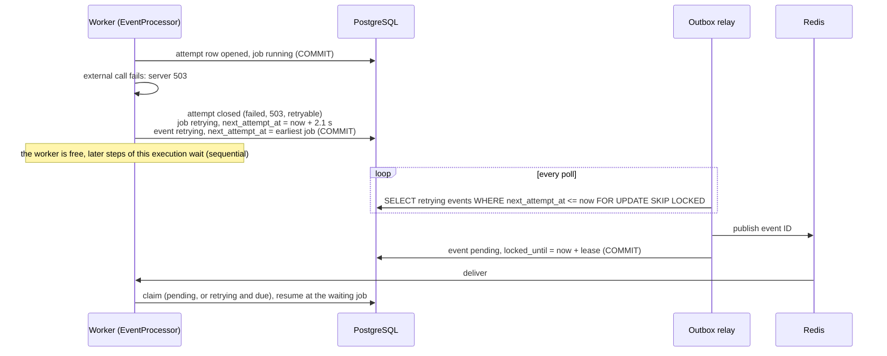
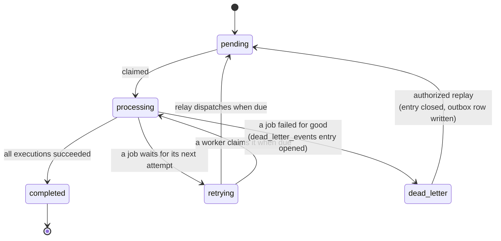

# 12 - Reliability and Retries

> **Scope:** the reliability engine built in Phase 6, as implemented: failure
> classification, retries with exponential backoff and jitter, the attempt history, the
> dead-letter queue and replay, the circuit breaker, per-connector rate limits and
> timeouts. Idempotency (no duplicate side effects) has its own document,
> [docs/13](13-idempotency.md). The pipeline these build on is in
> [docs/09](09-event-driven-architecture.md) and [docs/11](11-workflow-engine.md).

## 1. The goal

External applications fail all the time: Slack has an incident, Google answers 429 during
a burst, a payroll vendor's API is slow for a minute. SyncForge must turn that into a
delay, never into lost work or duplicated work, and it must not make the outage worse.
The parts, in the order a failing call meets them:

| Concern | Mechanism | Code |
|---|---|---|
| Never hang | Connect, read and per-operation timeouts | `app/connectors/http.py` |
| Know what failed | Failure classification into categories | `app/connectors/errors.py` |
| Don't hammer a broken application | Circuit breaker per connector | `app/reliability/circuit_breaker.py` |
| Stay under published API limits | Rate limit per connector | `app/reliability/rate_limit.py` |
| Recover from blips | Retries, exponential backoff with jitter, `Retry-After` | `app/reliability/retry.py`, `app/workflows/engine.py` |
| See what happened | One `synchronization_attempts` row per external call | `app/models/workflow.py` |
| Give up safely, recover deliberately | Dead-letter queue and authorized replay | `app/reliability/dead_letter.py`, `app/services/dead_letters.py` |
| Never do it twice | Idempotency keys | [docs/13](13-idempotency.md) |

## 2. Failure classification

Every connector translates its application's errors into one `ConnectorError` with a
`category` ([docs/10, section 4](10-connector-framework.md#4-error-normalization)). The
category decides what happens next:

| Category | Typical cause | Retried? | Counts towards opening the circuit? |
|---|---|---|---|
| `server` | 5xx | **yes** | yes |
| `timeout` | connect, read or operation timeout; 408 | **yes** | yes |
| `network` | connection refused, DNS failure, reset | **yes** | yes |
| `rate_limited` | 429 (`Retry-After` honoured) | **yes** | no - the application answered |
| `in_progress` | 409 `idempotency_key_in_use`: an earlier attempt with the same key is still running ([docs/13](13-idempotency.md)) | **yes** | no |
| `circuit_open` | our own breaker refused the call (no request sent) | **yes**, not before the breaker may let a call through | - |
| `authentication` | 401 (after Google's one token refresh) | no | no |
| `authorization` | 403 | no | no |
| `validation` | 400, 422 | no | no |
| `not_found` | 404 | no | no |
| `conflict` | 409 (e.g. the user already exists) | no | no |
| `permanent` | any other 4xx, unexpected redirect | no | no |
| `configuration` | our side: connector disconnected, host not allowed, unsupported adapter version, credentials that cannot be decrypted | no | no |

**Why not retry everything.** Retrying a wrong password, a 403 or an invalid payload
fails again in exactly the same way: it wastes the retry budget, delays the dead-letter
entry that a person needs to see, and, for 401s, can trip an account lockout at the
vendor. Only failures that can plausibly succeed later are retried.

## 3. Retries: exponential backoff with jitter

`RetryPolicy` (`app/reliability/retry.py`) decides whether and when a failed job is tried
again. It is pure code with no I/O, so it is unit-tested exhaustively.

```
backoff(n)  = min(RETRY_MAX_DELAY_SECONDS, RETRY_BASE_DELAY_SECONDS * 2^(n-1))
delay(n)    = min(RETRY_MAX_DELAY_SECONDS,
                  max(backoff(n) * uniform(1 - jitter, 1 + jitter),  Retry-After))
```

With the defaults (base 2 s, jitter 0.2, maximum 300 s, 5 attempts including the first):

| After attempt | Base delay | With +/-20 % jitter |
|---|---|---|
| 1 | 2 s | 1.6 - 2.4 s |
| 2 | 4 s | 3.2 - 4.8 s |
| 3 | 8 s | 6.4 - 9.6 s |
| 4 | 16 s | 12.8 - 19.2 s |
| 5 | - | no more attempts: dead-letter |

- **Exponential** so a short blip is retried quickly while a longer outage is not hit
  every two seconds.
- **Jitter** so that fifty jobs that failed in the same second (one Slack incident) do
  not all retry in the same second and knock the recovering service over again. Jitter
  is proportional (+/-20 %), so ordering between attempt numbers is kept.
- **`Retry-After` wins when it is longer** than the backoff (`max`). A server that says
  "wait 60 s" is never called earlier. A shorter `Retry-After` does not shorten the
  backoff.
- **Capped** at `RETRY_MAX_DELAY_SECONDS`, so a misbehaving `Retry-After: 86400` cannot
  park a job for a day. (The connector framework already caps `Retry-After` at one hour.)
- **Bounded**: `RETRY_MAX_ATTEMPTS` counts every attempt including the first. There are no
  unbounded retries anywhere in SyncForge.

`decide()` returns `retry` with a delay, or a reason not to: `not_retryable` or
`attempts_exhausted`. Decision record: [ADR-0013](adr/0013-retries-with-exponential-backoff-and-jitter.md).

### How a retry is scheduled

A retry is **data, not a sleeping worker**. Nothing waits in memory, so a worker restart
loses nothing and a worker is never tied up by a job that is waiting.



Rules:

- **Sequential steps wait.** While a job is `retrying`, the later jobs of the same
  execution stay `pending`: onboarding does not create the payroll record before the
  Google account exists if the workflow says Google comes first.
- **Other executions of the same event** are not blocked by it, and the event's
  `next_attempt_at` is the earliest of its waiting jobs.
- **The claim accepts due retries.** A worker may claim an event that is `pending`,
  `processing` with an expired lease, or `retrying` with `next_attempt_at <= now`. The
  last clause is needed for correctness, not convenience - see section 9.

## 4. The attempt history

Every external call made for a job is a row in `synchronization_attempts`, **opened before
the call and closed after it**:

| Field | Meaning |
|---|---|
| `attempt_number` | 1, 2, 3, ... per job (unique); never reused, even across replays |
| `started_at`, `finished_at`, `duration_ms` | timing of the call |
| `outcome` | `succeeded`, `failed`, `skipped`, or `interrupted`; NULL while the call is in progress |
| `error_category`, `error_code`, `http_status`, `error_message` | the normalized failure |
| `retryable`, `retry_after_seconds` | what the classification said |
| `next_attempt_at` | when this failure scheduled the next attempt (NULL if it did not) |

An attempt left open (outcome NULL) means the worker stopped during the call (crash,
kill, deployment). The next worker to resume the job closes it as **`interrupted`**
before making its own attempt, so the history shows exactly what happened.

`GET /api/v1/organizations/{org}/events/{event_id}/attempts` returns the history of every
job of an event, ordered by execution, step and attempt number. This is what an engineer
reads when asking "why did this onboarding take ten minutes?".

## 5. The dead-letter queue

When a job fails and will not be retried - the error is not retryable, or the attempts
are used up - the execution fails, later jobs are skipped, and the event ends in status
**`dead_letter`** (this status replaces Phase 5's `failed`). In the same transaction one
`dead_letter_events` entry is written.



**The entry copies the error** - connector, operation, category, code, HTTP status,
message, the number of attempts in this round, the number of failed steps, and a reason:

- `retries_exhausted` - a retryable error outlasted the retry budget (an outage);
- `non_retryable` - retrying would not help (credentials, permissions, invalid data,
  configuration).

It is a copy, not a pointer to the job's fields, because replaying resets the job: without
the copy, a replay would erase the evidence of why the work failed.

**At most one open entry per event** (partial unique index `uq_dead_letter_events_open_event_id`).
An event can be dead-lettered, replayed and dead-lettered again; each round leaves its own
entry, and the detail endpoint lists the whole history.

Endpoints (organization-scoped, like every other resource):

| Method and path | Permission | Purpose |
|---|---|---|
| `GET .../dead-letter-events?entry_status=open&connector_id=` | `events:read` (all roles) | the queue, newest first |
| `GET .../dead-letter-events/{id}` | `events:read` | the preserved error, the event's current state, every round |
| `POST .../dead-letter-events/{id}/replay` | **`events:replay`** (Integration Manager, Org Admin) | send the event back for processing |

Decision record: [ADR-0014](adr/0014-dead-letter-queue-and-replay.md).

## 6. Replay

Replay sends a dead-lettered event back through the **normal pipeline**: it does not call
any external application itself.

1. **Lock** the entry and then the event (`SELECT ... FOR UPDATE`). Two people pressing
   "Replay" at the same moment cannot both replay: the second waits for the first
   transaction, re-reads the entry, sees `replayed` and gets **`409 already_replayed`**
   (`test_simultaneous_replays_of_one_entry_replay_it_once` uses two real database
   sessions).
2. **Reset only what failed.** In each failed execution whose workflow is still active,
   the failed jobs, and the jobs skipped *because of* them (never attempted), go back to
   `pending`. Jobs that succeeded stay succeeded - a replay never creates a second Slack
   account. Jobs skipped for a business reason (already attempted, e.g. "no account in
   this application") are not touched.
3. **Fresh retry budget, kept history.** Each reset job records
   `attempts_at_last_replay = attempts`. The retry policy counts only the attempts since
   then, so the replay gets the full five attempts, while attempt numbers keep increasing
   (#6, #7, ...) and the old attempts stay in the history.
4. **Requeue through the outbox.** The event goes back to `pending` and an `outbox_events`
   row is written - in the same transaction as the reset and as closing the entry
   (`status = replayed`, `replayed_at`, `replayed_by_user_id`). The relay publishes it and a
   worker processes it like any new event.
5. **Refused if nothing can run:** if none of the failed workflows is active any more, the
   replay is refused with `409 workflow_inactive` and nothing changes. (Activating a
   workflow re-checks its connectors, so fix the configuration first.)

The response is `202 Accepted`: accepted, not finished. Progress is visible on
`GET .../events/{event_id}`; if the replay fails again, a new open entry appears.

Like every worker step, the replayed steps act on the employee's **current** state: if the
person was terminated in the meantime, the replayed `create_user` is skipped rather than
granting access.

## 7. The circuit breaker

Retries protect one job from a blip. They do nothing for the external application: if
Slack is down and fifty onboarding jobs each retry five times, Slack receives 250 calls it
cannot answer, and each holds a worker for up to the read timeout. The breaker stops that.

```mermaid
stateDiagram-v2
    [*] --> closed
    closed --> closed: success or any real answer<br/>(count reset)
    closed --> open: CIRCUIT_FAILURE_THRESHOLD consecutive<br/>server / timeout / network failures
    open --> open: calls refused (circuit_open)<br/>until open_until
    open --> half_open: open period over;<br/>the next caller is the single trial
    half_open --> closed: trial succeeds (or the app answers anything real)
    half_open --> open: trial fails (another open period)
    open --> closed: successful manual connection test
```



| State | Behaviour |
|---|---|
| **closed** | Normal. Outage-type failures (`server`, `timeout`, `network`) are counted. **Any real answer resets the count** - success, but also 400, 401, 404, 409 and 429, because they prove the application is reachable. |
| **open** | Calls are refused without a network request, with `circuit_open` and `retry_after` = the time left. The refused job is retried no earlier than that. |
| **half_open** | After `CIRCUIT_OPEN_SECONDS` the next caller becomes the **single trial call**; everyone else is still refused. A trial whose worker died (older than the operation timeout + 5 s) is abandoned and the next caller becomes the trial. |

Design choices:

- **Shared state in PostgreSQL** (`connector_circuits`, one row per connector, created on
  first use): when Slack is down, the first worker to notice protects all the others.
  In-process breakers would each have to learn about the outage separately. The row is
  locked only while its state is read or written, never during the external call.
- **A refused call counts as an attempt** of that job (recorded with no HTTP status). This
  keeps the retry budget finite: a long outage ends in the dead-letter queue, from where
  one replay restarts the work, instead of jobs waiting forever. The alternative (refusals
  are free) would make waiting unbounded.
- **A successful connection test closes the breaker** (`POST .../connectors/{id}/test`): an
  administrator who has fixed something does not have to wait out the open period.
- Connector responses include `circuit: {state, consecutive_failures, open_until}` for the
  dashboard (Phase 8). State changes are logged (`circuit opened`, `circuit half-open:
  trial call`, `circuit closed`).

Decision record: [ADR-0016](adr/0016-shared-circuit-breaker-and-rate-limits.md).

## 8. Rate limits and timeouts

### Per-connector rate limit

External APIs publish limits, and a burst of fifty hires would otherwise spend its retry
budget on 429s. A connector's config may set `rate_limit_per_minute` (1-10000, validated).
All workers share one counter per connector per minute (`connector_rate_windows`,
incremented atomically with `INSERT ... ON CONFLICT DO UPDATE ... RETURNING`). A job over
the limit is **deferred** to the next minute (plus up to 1 s of spread) and **uses no
attempt** - waiting for our own limit is not a failure. Its job shows `error_category =
throttled` while it waits. 429s that still happen (the application's limit is lower, or
shared with other clients) go through the retry engine with `Retry-After` as usual.

A fixed window allows a burst of up to twice the limit across a minute boundary; that is
acceptable for pacing provisioning calls and much simpler than a sliding window or a token
bucket. Windows older than an hour are deleted as new ones are used.

### Timeouts

| Timeout | Setting (default) | Applies to |
|---|---|---|
| Connect | `CONNECTOR_CONNECT_TIMEOUT_SECONDS` (3 s) | each request |
| Read | `CONNECTOR_READ_TIMEOUT_SECONDS` (10 s) | each request |
| Operation | `CONNECTOR_OPERATION_TIMEOUT_SECONDS` (30 s) | one whole operation, across all its requests |

Some operations make several requests (Google: token + API call, retried once on 401;
Slack deactivate: DELETE + GET). The HTTP client starts a deadline when it is built for an
operation and cuts each request's timeouts down to the time left. Past the deadline it
raises `operation_timeout` (category `timeout`, retryable) without sending the request.
The worker lease (`WORKER_LEASE_SECONDS`, 300 s) is renewed before each step and must stay
well above the operation timeout.

## 9. Concurrency details

- **Bug found by the live retry demonstration (fixed before commit).** The relay publishes
  a due retry while holding the event row and commits `pending` afterwards. A fast worker
  could receive the message first. Under PostgreSQL's READ COMMITTED isolation an `UPDATE`
  whose `WHERE` does not match the last committed row version neither waits nor
  re-checks, so the worker's claim (`WHERE status = 'pending'`) saw `retrying`, matched
  nothing and skipped the event - the third attempt never ran. The fix lets the claim
  accept `retrying` events whose `next_attempt_at` has passed; then the claim's `WHERE`
  matches the committed row, so the `UPDATE` waits for the relay's lock and proceeds.
  `test_a_worker_claims_a_due_retry_even_while_the_relay_holds_the_row` reproduces the
  race with two real sessions and fails without the fix.
- **Replay** locks entry then event, always in that order (no deadlock between replays).
- **Circuit and rate-limit rows** are locked for milliseconds by single statements or
  `FOR UPDATE`, never across an external call.
- **Duplicate finishes**: if a worker whose lease raced out finishes the same event twice,
  the dead-letter step finds the open entry and does not create a second one (and the
  partial unique index would refuse it anyway).

## 10. Seeing it work

`infrastructure/scripts/demo_reliability.py` runs scenarios against a locally running
stack and prints what the API and the mocks report: a transient outage, idempotency in
both directions, retry exhaustion with dead-letter and replay, the circuit breaker, and a
rate limit (scenarios 1-5, below); scenarios 6 and 7 (a data conflict, concurrent edits,
the audit trail) are described in [docs/14, section 9](14-data-integrity.md#9-seeing-it-work). Start PostgreSQL, Redis, the mock services, the API, a worker and the relay
([docs/09, section 10](09-event-driven-architecture.md#10-running-it-locally)), then from the
repository root:

```powershell
& .\backend\.venv\Scripts\python.exe infrastructure\scripts\demo_reliability.py
```

Output of a run in the development workspace (Linux, default settings, 2026-11-12
09:32 UTC), abridged to the result lines of each scenario:

```
1. Transient outage: payroll answers 503 twice
     9.8 s  payroll attempts: #1 failed (server 503), #2 failed (server 503), #3 succeeded
2a. Idempotency, incoming: POST /employees twice with the same key
     9.9 s  first 201, second 201; same employee: True; second replayed: true
     9.9 s  events recorded: 1 (one onboarding, not two)
     9.9 s  same key, different body: 422 idempotency_key_reused
2b. Idempotency, outgoing: payroll answers only after our read timeout
    27.7 s  payroll attempts: #1 failed (timeout), #2 failed (in_progress 409), #3 succeeded
    27.7 s  payroll records actually created: 1
3. Retries exhausted -> dead-letter queue -> replay
    62.9 s  dead-letter entry: retries_exhausted, create_user server 503, 5 attempts
    63.0 s  replay: 202; replay again: 409 already_replayed
    64.1 s  payroll attempts: #1..#5 failed (server 503), #6 succeeded
4. Circuit breaker: Google is down while three people are hired
    68.0 s  circuit open      Google requests  5  events processing, retrying, retrying
    71.5 s  circuit open      Google requests  5  events retrying, retrying, retrying
   128.6 s  circuit closed    Google requests  8  events completed, completed, completed
   128.6 s  hire 2 Google attempts: #1 failed (server 503), #2 failed (server 503),
            #3 failed (circuit_open), #4 succeeded
   128.6 s  Google accounts created: 3
5. Rate limit: Slack limited to 2 calls per minute, three hires
   129.7 s  events: completed, completed, retrying
   150.8 s  events: completed, completed, completed
   150.8 s  hire 3 Slack attempts: #1 succeeded
```

Reading it: in scenario 4 Google received 5 requests before the breaker opened (the
threshold) and none while it was open; after the 60 s open period one trial call
succeeded, the breaker closed, and the remaining hires completed - 8 requests and exactly
3 accounts in total. In scenario 5 the third hire's Slack step was deferred to the next
minute and then made a single attempt. The whole run took about two and a half minutes,
most of it the breaker's open period and the 2+4+8+16 s backoff of scenario 3. These are
wall-clock timings of a demonstration, not performance measurements.

## 11. Configuration

| Variable | Default | Meaning |
|---|---|---|
| `RETRY_MAX_ATTEMPTS` | `5` | Attempts per job per round, the first included (1-20) |
| `RETRY_BASE_DELAY_SECONDS` | `2` | Delay after the first failure; doubles each time |
| `RETRY_MAX_DELAY_SECONDS` | `300` | Upper bound for any delay, `Retry-After` included |
| `RETRY_JITTER_RATIO` | `0.2` | Proportional jitter (0 = none) |
| `CIRCUIT_FAILURE_THRESHOLD` | `5` | Consecutive outage failures that open a connector's breaker |
| `CIRCUIT_OPEN_SECONDS` | `60` | Open period before one trial call |
| `CONNECTOR_CONNECT_TIMEOUT_SECONDS` / `CONNECTOR_READ_TIMEOUT_SECONDS` | `3` / `10` | Per request |
| `CONNECTOR_OPERATION_TIMEOUT_SECONDS` | `30` | Per operation, all requests together |
| connector config `rate_limit_per_minute` | unset | Optional pacing per connector |

## 12. Tests

| Concern | Tests |
|---|---|
| Backoff sequence, cap, jitter bounds and spread, `Retry-After` honoured and capped, `decide()` | `test_retries.py` (policy section) |
| 503 retried after ~2 s and succeeds; exhaustion after the configured maximum; 403/400 not retried; 429 waits >= `Retry-After`; timeouts retried; waiting events not claimable early; attempts API | `test_retries.py` |
| Interrupted attempts closed on resume | `test_workflow_engine.py` (crash test) |
| Due retry claimed while the relay holds the row | `test_concurrency.py` |
| Dead-lettering (exhausted, permanent, configuration); evidence kept; replay reruns only what failed; fresh budget and a new entry if it fails again; once only; inactive workflow; permission; isolation | `test_dead_letters.py` |
| Simultaneous replays | `test_concurrency.py` |
| Breaker state machine; real answers reset; trial and failed trial; abandoned trial; refusals across jobs in the engine; connection test closes it; API shows it | `test_circuit_breaker.py` |
| Rate limiter counting; deferral without using an attempt; invalid limit rejected | `test_circuit_breaker.py` |
| Operation deadline across requests; no request after the deadline | `test_circuit_breaker.py` |
| Migration of Phase 5 `failed` events into the queue | `test_migrations.py` (upgrade/downgrade), checked live on the development database |
