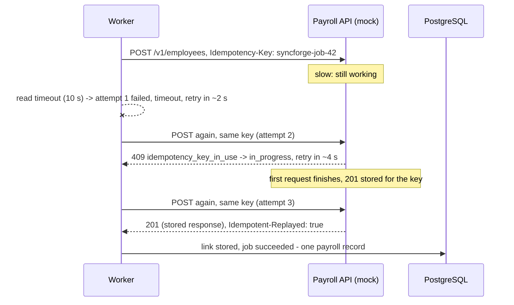

# 13 - Idempotency

> **Scope:** how SyncForge avoids duplicate side effects when work is repeated, as
> implemented through Phase 6. Retries, dead-lettering and replay are in
> [docs/12](12-reliability-and-retries.md).

## 1. Why it is needed

SyncForge is built on **at-least-once** delivery ([docs/09](09-event-driven-architecture.md#7-delivery-guarantees---what-is-and-is-not-promised)):
a message can arrive twice, a worker can die halfway, a call can time out after the other
side acted, a client can resend a request whose response it never received. Exactly-once
delivery is not available across a database, a broker and third-party HTTP APIs, so the
system makes **repeating safe** instead. An operation is idempotent when doing it twice
has the same effect as doing it once.

The duplicates that matter here are expensive ones: a second Slack account for one
person, a second payroll record (two salaries), a second onboarding run because an HR
client retried a request.

## 2. Where duplicates could come from, and what stops each

| Repetition | Protection | Where |
|---|---|---|
| The same event message delivered twice | Atomic claim: only a `pending` (or due `retrying`, or abandoned `processing`) event can be claimed; a second delivery claims nothing | `EventProcessor._claim` |
| Two workers plan the same event | One execution per (event, workflow): unique constraint `uq_workflow_executions_event_id_workflow_id` | `EventProcessor._plan` |
| A resumed execution | Succeeded and skipped jobs are never run again | `EventProcessor._run` |
| Worker dies after the external create, **after** the account link was stored | `create_user` finds the link (`already_linked`) and the job is marked succeeded with that external ID | `ConnectorService.run_operation` |
| Worker dies, or the call times out, after the external create but **before** the link was stored | **Idempotency key** on the external call (section 3) | engine + adapters |
| Replay of a dead-lettered event | Only failed (and dependent never-attempted) jobs are reset; succeeded jobs stay succeeded; the job keeps its idempotency key | `DeadLetterService.replay` |
| Two people replay the same entry | Row lock; the second gets `409 already_replayed` | `DeadLetterService.replay` |
| A client resends `POST /employees` | **`Idempotency-Key` header** (section 4) | `app/api/v1/employees.py`, `app/reliability/idempotency.py` |
| Two link records for one employee and connector | Unique `(connector_id, employee_id)` on `external_accounts` | database |
| `update_user`, `deactivate_user` repeated | Naturally idempotent: they set state ("department = Finance", "active = false"), they do not add | adapters |

## 3. Outgoing: idempotency keys on external create calls

**The gap.** Phase 5 closed most crash windows with the account link, but one remained:
the external application creates the user and answers, and the worker dies (or our read
timeout fires) before SyncForge commits the link. The next attempt cannot know the
account exists and calls `create_user` again. Without protection the result is either a
second account or a `409 user_already_exists` that ends in the dead-letter queue.

**The key.** The engine sends

```
Idempotency-Key: syncforge-job-<synchronization job id>
```

on `create_user` - the one operation that is not naturally idempotent. The key is derived
from the job, so it is **the same on every attempt and every replay** of that step (one
intended effect, one key) and different for every other step, connector and employee.
`ConnectorService.run_operation(..., idempotency_key=...)` passes it to the adapter;
`Connector.create_user(profile, *, idempotency_key=None)` adds the header. The manual
operations endpoint sends no key.

**What an API that honours the key does** (the mock services implement this, following
the convention popularised by payment APIs and the IETF "Idempotency-Key" HTTP header
draft):

| Request | Mock's answer |
|---|---|
| First POST with key K | executed; a 2xx response is stored for (path, K) |
| Same key and same body again | the stored response, header `Idempotent-Replayed: true`; **not executed again** |
| Same key, different body | `422 idempotency_key_reused` (category `validation`, not retried) |
| Same key while the first request is still running | `409 idempotency_key_in_use` -> category **`in_progress`, retryable** |
| A failed request (non-2xx) | not stored: it may be repeated with the same key |



This is exactly what `test_a_timed_out_create_is_retried_safely` and scenario 2b of the
demo script show: three attempts, one payroll record. The crash variant
(`test_a_worker_crash_after_the_external_create_does_not_create_a_second_account`) makes
the worker die after Google created the user and before the link was stored; the resumed
job sends the same key, receives the stored response and links the account that already
exists - attempts `interrupted, succeeded`, one Google user.

### What is real and what is not

**The real Slack SCIM API and Google Directory API do not document an `Idempotency-Key`
header.** SyncForge sends it to every connector, and the local mock services honour it;
against the real services the header would be ignored. For those APIs the protection is:

- the account link, which closes every crash window except the one-commit gap above;
- the external application's own uniqueness rules: both refuse a second user with the
  same email (`409`), so the gap produces a `conflict` failure and a dead-letter entry -
  visible and recoverable by a person - never a silent duplicate.

Closing the gap for such APIs would need a "find before create" step (look the user up by
email after an interrupted or timed-out attempt and adopt it if it matches). It is not
implemented; it is listed under known limitations in `PROJECT_STATUS.md`. A payroll
vendor with a modern API is likely to support idempotency keys; the mock payroll service
does.

## 4. Incoming: `Idempotency-Key` on `POST /employees`

A client (an HR system, a script, the Phase 8 UI) that does not get an answer - timeout,
dropped connection - cannot know whether its POST was executed. If it sent a key, it simply
sends the same request again.

```
POST /api/v1/organizations/{org}/employees
Idempotency-Key: 6f1c2d3e-...        (optional; 1-255 printable ASCII characters)
```

| Situation | Response |
|---|---|
| No key | normal behaviour; nothing stored |
| First request with key K | executed; the response is stored **in the same transaction as the employee** |
| Same key, same body, same user, within `IDEMPOTENCY_TTL_HOURS` | the stored `201` and body, header `Idempotent-Replayed: true`; no second employee, no second event |
| Same key, different body (or endpoint) | `422 idempotency_key_reused` |
| A request that failed (409 duplicate, 422 validation, ...) | not stored; the corrected request may reuse the key |
| Two identical requests at the same moment | both execute up to the commit; the unique constraints let one win; the other then finds the winner's record and returns **its** response (`Idempotent-Replayed: true`) |
| Key older than the TTL | treated as new (the expired record is deleted) |
| Malformed key (spaces, > 255 characters, empty) | `422` validation error |

**Atomicity.** `EmployeeService.create(..., before_commit=...)` lets the endpoint add the
`idempotency_records` row inside the service's transaction, after the employee (and its
outbox rows) were flushed. A crash can therefore never leave "employee created, no record"
(the retry would create a duplicate) or "record stored, no employee".

**Scope.** Keys are unique per (organization, user). Two users cannot collide, and one user
cannot obtain another user's stored response by guessing a key. The stored body is the
same employee data the caller was already allowed to see; it is deleted with the record.

**Request fingerprint.** SHA-256 of the endpoint and the canonical JSON of the *validated*
request body (sorted keys), so formatting differences do not matter but any change in
content does.

**Retention.** Records expire after `IDEMPOTENCY_TTL_HOURS` (default 24, maximum 720).
`python -m app.cli purge-expired` deletes expired rows (index on `expires_at`);
run it daily from a scheduler. Expired records are ignored even if not yet purged.

Decision record: [ADR-0015](adr/0015-idempotency-keys.md).

## 5. What is not covered

- **Other write endpoints** (`PATCH`, terminate, archive) do not take keys: they set state
  and are safe to repeat, or refuse the repeat (`409 employee_terminated`). `POST` on
  connectors, workflows and departments could take keys the same way; not done, because
  their uniqueness rules (names) already turn a repeat into a visible `409`.
- **Exactly-once** remains impossible to promise end to end; SyncForge promises
  at-least-once processing with idempotent effects, and records every attempt so that any
  surprise can be investigated.

## 6. Tests

`test_idempotency.py`:

| Scenario | Test |
|---|---|
| Each mock returns the same user for a repeated create with the same key, and logs the replay | `test_a_repeated_create_with_the_same_key_returns_the_same_user` (x3 connectors) |
| Without a key the repeat is a conflict | `test_without_a_key_a_repeated_create_is_a_conflict` (x3) |
| A key reused for a different user is refused | `test_a_key_reused_for_a_different_user_is_refused` |
| Worker crash after the external create, before the link | `test_a_worker_crash_after_the_external_create_does_not_create_a_second_account` |
| Timeout after the API acted, retry while still in progress, then success | `test_a_timed_out_create_is_retried_safely` |
| Retried `POST /employees`: same response, one employee, one event | `test_a_retried_create_returns_the_first_response_and_creates_nothing` |
| Same key, different request | `test_the_same_key_for_a_different_request_is_refused` |
| Keys belong to one user | `test_keys_belong_to_one_user` |
| Failed requests are not stored | `test_a_failed_request_is_not_remembered` |
| Identical concurrent request gets the winner's response | `test_an_identical_concurrent_request_gets_the_winners_response` |
| Expired records ignored and purged | `test_expired_records_are_ignored_and_purged` |
| Malformed keys rejected; no key, nothing stored | `test_malformed_keys_are_rejected`, `test_requests_without_a_key_store_nothing` |

Engine-level duplicate delivery and crash resume: `test_workflow_engine.py`; replay
idempotence: `test_dead_letters.py`.
