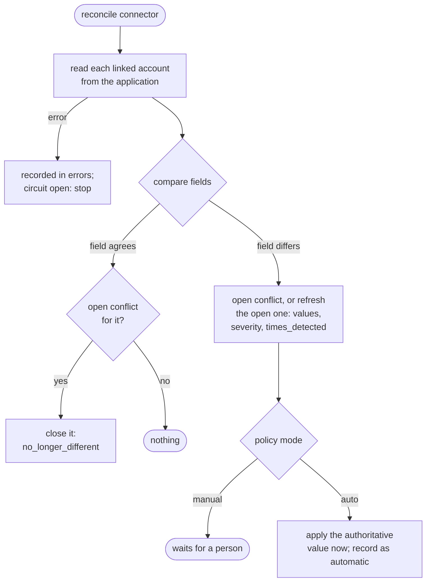

# 14 - Data Integrity, Conflict Resolution and Audit Logging

> **Scope:** Phase 7, as implemented: the append-only audit log, optimistic concurrency
> on employees, field-level source-of-truth policies, conflict detection
> (reconciliation) and conflict resolution. Reliability (retries, dead letters) is in
> [docs/12](12-reliability-and-retries.md), idempotency in [docs/13](13-idempotency.md).

## 1. The three problems

| Problem | Example | Mechanism |
|---|---|---|
| Nobody can tell who changed what | "Why does Ada have no Slack account?" | **Audit log** (section 2) |
| Two people overwrite each other | Two admins edit the same employee from the same screen state; the second save silently undoes the first | **Optimistic concurrency** (section 3) |
| Systems disagree | HR says Engineering, someone set Finance in the payroll system | **Source-of-truth policies + reconciliation + resolution** (sections 4-7) |

## 2. The audit log

### What it is

`audit_logs` - one row per important action: **who** (a user, or the system), **what**
(`action`), **on what** (`resource_type`, `resource_id`), **with what result**
(`outcome`), **details**, **when**, and the **request ID** that links the entry to the API
and worker logs. `GET /api/v1/organizations/{org}/audit-logs` reads it (newest first;
filters: `action` exact or prefix such as `employee.`, `resource_type`, `resource_id`,
`actor_user_id`, `outcome`, `since`, `until`). Permission `audit:read`: Organization Admin
and Integration Manager - not Viewers, because the log shows other people's actions and
permission changes.

### What is recorded

| Area | Actions | Actor |
|---|---|---|
| Employees, departments | `employee.created`, `.updated`, `.terminated`, `.archived`; `department.created`, `.renamed`, `.deleted` | user |
| Organization and **permissions** | `organization.created`, `.renamed`; `member.added`, `member.role_changed` (from/to role), `member.removed` | user |
| Connectors | `connector.created`, `.updated` (which parts changed; credentials only as "rotated"), `.tested` (outcome, error category), `.disconnected`, `.operation_run` (manual operations), `.reconciled` | user |
| Workflows | `workflow.created`, `.updated`, `.activated`, `.deactivated` | user |
| Synchronization | `workflow.executed` (success/failure, step counts, first failure), `sync.retry_scheduled` (attempt, category, next time), `event.dead_lettered` | system |
| Recovery | `dead_letter.replayed`; `connector.circuit_opened`, `.circuit_closed` | user or system |
| Data integrity | `conflict.detected`, `conflict.resolved`, `conflict.dismissed`, `data_source_policy.updated` | user or system |

Not recorded: registration, login and logout (they belong to no organization); they
are in the structured logs. Sign-ins, failed sign-ins and sign-outs are recorded in the separate, platform-level
`security_events` table (Phase 9; docs/15 section 4b).

### How it is written - atomically, with the change

`app/audit.py` `record()` adds the entry to the **same session and transaction** as the
change it describes; the service's commit makes both durable together. A change that
fails or rolls back leaves no entry (`test_a_failed_change_leaves_no_entry`), and an audited
change can never commit without its entry. The engine's entries are written in the
engine's transactions in the same way.

**The actor.** The authentication dependency stores the user's ID in
`session.info["actor_user_id"]` (a per-session dictionary: FastAPI runs sync endpoints in
a thread pool, where context variables set in a dependency would not reach the
endpoint). Sessions without it - Celery workers, the relay, CLI commands - record the
**system**. The engine resets it explicitly, so worker entries are always the system's.
Worker entries carry the event's correlation ID as `request_id`: one ID links the API
request that hired someone, the event, and the `workflow.executed` entry.

### What is never recorded

Passwords, tokens, credentials, connector configuration values, request payloads. For
employees, `details` lists every changed field **by name**, with old/new values **only
for non-personal fields** (department, designation, manager, location, status, dates).
Names, e-mail addresses and employee numbers never appear as values
(`test_employee_lifecycle_is_audited_without_personal_values`,
`test_connector_changes_are_audited_without_secrets`). Conflict entries include values
only for department, designation, location and account status.

### Append-only, twice

1. **Application:** there is no code path that updates or deletes entries;
   `AuditRepository` only reads.
2. **Database:** a trigger (`audit_logs_append_only`, migration `0010`) refuses every
   `UPDATE` and every `DELETE` - also from `psql` or a buggy future migration - with two
   exceptions:
   - deleting a user account runs the foreign key's `ON DELETE SET NULL`, which may clear
     `actor_user_id` and change nothing else (the history stays; the actor becomes
     "unknown user");
   - a future retention job may delete after `SET LOCAL syncforge.allow_audit_delete = 'on'`
     in its own transaction.

No foreign key to `organizations`: an organization's history must outlive the
organization. Tests: `test_entries_cannot_be_updated`,
`test_entries_cannot_be_deleted_except_by_an_explicit_retention_transaction`,
`test_deleting_a_user_keeps_their_history`.

Decision record: [ADR-0017](adr/0017-append-only-audit-log.md).

## 3. Optimistic concurrency on employees

### The lost update

Admin A and admin B open Ada's record (version 1). A changes the location and saves. B,
still looking at the old screen, changes the designation and saves the whole form -
including the old location. Without protection B silently undoes A's change. Row locks
do not help: the two saves are seconds apart, not simultaneous.

### ETag / If-Match

- `employees.version` starts at 1 and is incremented on every UPDATE of the row by
  SQLAlchemy's `version_id_col` (migration `0011`).
- Every employee response carries it as `version` and as the `ETag` header (`"3"`).
- `PATCH`, `POST .../terminate` and `DELETE` (archive) accept `If-Match: "<version>"`
  (`W/"3"`, `3` and `*` are accepted too; anything else is `422 invalid_if_match`).
- If the employee's version differs: **`412 version_conflict`** with
  `{"expected_version": 1, "current_version": 2}`; nothing changes - no event, no audit
  entry.
- Without `If-Match` the behaviour is unchanged (last write wins), so existing clients keep
  working. The Phase 8 UI always sends it.

```mermaid
sequenceDiagram
    participant A as Admin A
    participant B as Admin B
    participant API
    participant DB as PostgreSQL
    A->>API: GET employee -> ETag "1"
    B->>API: GET employee -> ETag "1"
    A->>API: PATCH location=Pune, If-Match "1"
    API->>DB: SELECT ... FOR UPDATE; version 1 = 1; UPDATE ... SET version=2 WHERE version=1
    API-->>A: 200, ETag "2"
    B->>API: PATCH location=Chennai, If-Match "1"
    API->>DB: SELECT ... FOR UPDATE; version 2 != 1
    API-->>B: 412 version_conflict (expected 1, current 2) - reload and re-apply
```

**Atomic check.** The service locks the row (`SELECT ... FOR UPDATE`) before comparing
versions, so check and write are one step; two saves arriving at the same moment from the
same version serialize on the lock and exactly one wins
(`test_simultaneous_saves_from_the_same_version_let_exactly_one_win`, two real sessions).
The UPDATE additionally carries `WHERE version = <read version>` as a database-level guard.

**Indirect changes count.** Terminating a manager moves the direct reports; each report's
version increases, so an admin editing a report from a stale screen gets 412 instead of
silently reverting the move.

Decision record: [ADR-0018](adr/0018-optimistic-concurrency-with-etags.md).

## 4. Source of truth, per field

SyncForge's employee record is fed by HR. Each connected application keeps its own copy of
some of the same facts, and the copies drift (someone edits a department in the Google
Admin console; a security team suspends a Slack account; a payroll clerk fixes a typo).
**There is no universal source of truth**: which side is right depends on the field and
the organization. So it is configured per field:

| Setting | Values |
|---|---|
| `source` | `syncforge` (the employee record, i.e. HR) or `connector` + `connector_id` (that application) |
| `severity` | `low`, `medium`, `high`, `critical` |
| `resolution_mode` | `manual` (record; a person decides) or `auto` (apply the authoritative value at once) |

Compared fields and defaults (used while a field is not configured; `configured: false`
in the API):

| Field | Default authority | Default severity | Notes |
|---|---|---|---|
| `first_name`, `last_name` | SyncForge (HR) | low | personal: values never audited |
| `email` | SyncForge (HR) | high | case-insensitive |
| `department` | SyncForge (HR) | medium | compared by department name, case-insensitive |
| `designation` | SyncForge (HR) | low | case-insensitive |
| `location` | SyncForge (HR) | low | case-insensitive |
| `account_active` | SyncForge (HR) | high | SyncForge expects active unless terminated; **a terminated person with an active account is always `critical`** |

Typical configurations: "the identity provider (Google) is authoritative for
`account_active`", "fix department differences automatically", "payroll is authoritative
for ... (payroll-specific fields, when SyncForge stores them)". `PUT
.../data-source-policies/{field}` (Organization Admins only, `policies:manage`; audited).
A policy names one connector; against every *other* application, SyncForge's record is the
reference.

Decision record: [ADR-0019](adr/0019-field-level-source-of-truth-and-reconciliation.md).

## 5. Conflict detection (reconciliation)

`POST .../connectors/{connector_id}/reconcile` (`conflicts:resolve`) reads every account
linked to that connector from the application (`get_user`, through the circuit breaker; up
to 500 per run) and compares it with the employee record:



Rules:

- **Nothing is overwritten by detection.** A difference opens a `data_conflicts` row with
  both values, the authoritative side and the severity *at detection time*.
- **Fields the application does not report are not compared** (Slack stores no location;
  an empty department in Google is not a claim).
- **Normalization:** e-mail, department, designation and location compare
  case-insensitively, ignoring surrounding spaces.
- **No duplicates:** a partial unique index allows one open conflict per (employee,
  connector, field); a repeated detection refreshes it (`times_detected`).
- **Self-healing:** a field that agrees again closes its open conflict
  (`no_longer_different`, automatic).
- **Partial failures:** an account that cannot be read (deleted in the application:
  `not_found`) is listed in `errors`; the run continues. An open circuit stops the run.
- **Concurrent modifications:** the conflict records the employee's `version`; a later
  decision is checked against it (section 6).

Result: `{accounts_checked, conflicts_opened, conflicts_refreshed, conflicts_closed,
auto_resolved, errors}`; audited as `connector.reconciled`, each new conflict as
`conflict.detected`.

## 6. Conflict resolution

`POST .../conflicts/{id}/resolve` with `{"resolution": ..., "note": ..., "override": ...}`
(`conflicts:resolve`: Integration Manager, Organization Admin):

| Resolution | Effect |
|---|---|
| `use_syncforge` | Push SyncForge's value to the application: `update_user` (the whole profile), or `deactivate_user` for an account that should not be active. Reactivating an account is not supported by the connectors (`422 reactivation_not_supported`). |
| `use_external` | Adopt the application's value in SyncForge through the **normal employee update** - versioned, audited, and emitting lifecycle events, so the workflows push the value to the other applications. Needs `employees:write` too (Integration Managers cannot change employee records). For `account_active`, only SyncForge's record of the account changes; the employee record does not. |
| `dismiss` | Accept the difference (e.g. a shared mailbox); nothing changes. Note required. |

Protection against wrong or outdated decisions:

| Situation | Response |
|---|---|
| Choosing the side the policy does not name as authoritative | `422 resolution_against_policy` - unless `override: true` **and** a note; recorded as `against_policy` |
| `dismiss` without a note | `422 note_required` |
| SyncForge's value for the field changed since detection | `409 conflict_stale` - run reconciliation again |
| Adopting a value when the employee changed in any way since detection | `409 conflict_stale` (the recorded version no longer matches) |
| Adopting a department SyncForge does not have | `422 department_not_found` - departments are not invented |
| The conflict is already resolved or dismissed | `409 conflict_not_open` |
| The application refuses the push | `502` with the normalized error; the conflict stays open |

Every decision is a `conflict_resolutions` row (resolution, applied value, against
policy, automatic, note, who) - the conflict's history, shown by
`GET .../conflicts/{id}`. **Concurrency:** the conflict row is locked while the decision
is validated. The external push (or the employee update) commits, so the row is locked
again before closing it; if another person closed it in between, their outcome stands
(both applied the same value).

## 7. API summary

| Method and path | Permission |
|---|---|
| `GET .../audit-logs` | `audit:read` |
| `GET .../data-source-policies` | `conflicts:read` (all roles) |
| `PUT .../data-source-policies/{field}` | `policies:manage` (Organization Admin) |
| `POST .../connectors/{id}/reconcile` | `conflicts:resolve` |
| `GET .../conflicts` (filters `conflict_status`, `severity`, `field`, `employee_id`, `connector_id`) | `conflicts:read` |
| `GET .../conflicts/{id}` (with resolutions) | `conflicts:read` |
| `POST .../conflicts/{id}/resolve` | `conflicts:resolve` (+ `employees:write` for `use_external`) |
| `If-Match` / `ETag` on employee endpoints | as before (`employees:read` / `employees:write`) |

Conflict values include names and e-mails for the members who may see employees anyway;
they are never logged and never audited.

## 8. Consistency guarantees and limitations

- **Guaranteed:** an audited change and its entry commit together; an employee save with
  `If-Match` never overwrites a newer version; a difference between SyncForge and an
  application is recorded, not silently overwritten; a decision is never applied to values
  that changed since it was shown.
- **Eventually consistent:** applications are compared when reconciliation runs, not
  continuously. Running it on a schedule (e.g. nightly per connector) is an operator
  decision - SyncForge has no built-in scheduler; Celery beat is a future option.
- **Limits:** 500 accounts per run (larger tenants need paging - future work); seven
  fields; reactivating accounts and creating departments from an application's value are
  deliberately not automatic.

## 9. Seeing it work

Scenarios 6 and 7 of `infrastructure/scripts/demo_reliability.py`
([docs/12, section 10](12-reliability-and-retries.md#10-seeing-it-work) for how to run it).
Output of a run in the development workspace (Linux, default settings, 2026-11-12
10:28 UTC), abridged:

```
6. Data conflict: someone changes a department directly in payroll
   168.7 s  a payroll clerk set the department to Finance in the payroll system
   168.9 s  reconcile: 11 accounts checked, 1 conflict opened
   168.9 s  conflict: department - SyncForge 'Engineering', payroll 'Finance'; authority syncforge, severity medium
   168.9 s  SyncForge still says 'Engineering': nothing was overwritten
   168.9 s  adopt payroll's value without override: 422 resolution_against_policy
   168.9 s  HR wins: conflict resolved; payroll now says 'Engineering'
   169.0 s  reconcile again: 0 conflicts opened

7. Optimistic concurrency: two admins edit the same employee
   169.1 s  both loaded version "1"; first save 200 (new ETag "2")
   169.1 s  second save: 412 version_conflict {'expected_version': 1, 'current_version': 2}
   169.1 s  location is 'Pune': the first change was not overwritten
   169.1 s  audit log of this run: 61 entries; the newest 61: conflict.detected x1,
            conflict.resolved x1, connector.circuit_closed x2, connector.circuit_opened x2,
            connector.created x3, connector.reconciled x2, connector.tested x1,
            connector.updated x1, dead_letter.replayed x1, department.created x2,
            employee.created x12, employee.updated x1, event.dead_lettered x1,
            organization.created x1, sync.retry_scheduled x16, workflow.activated x1,
            workflow.created x1, workflow.executed x12
```

The audit summary covers the whole run. Two `connector.circuit_opened` entries: Google's
breaker in scenario 4, and payroll's in scenario 3 - its five consecutive 503s reached the
threshold - which the connection test before the replay closed again (one of the two
`connector.circuit_closed` entries, with `reason: connection_test`).

## 10. Tests

| Concern | Tests |
|---|---|
| Audit: lifecycle without personal values; failed change leaves none; permission changes; connector changes without secrets; worker actions as the system; replay as the user; circuit transitions | `test_audit.py` |
| Audit: append-only (UPDATE and DELETE refused; retention switch; user deletion keeps history); API filters, order, `audit:read`, isolation | `test_audit.py` |
| ETag / If-Match: 412 on stale edit with nothing changed; forms of If-Match; no-op keeps the version; terminate and archive; report versions bump on termination | `test_optimistic_concurrency.py` |
| Simultaneous saves from the same version | `test_concurrency.py` |
| Comparison rules, critical escalation, defaults | `test_conflicts.py` (pure section) |
| Detection without overwrite; refresh; self-healing; HR wins; application authoritative (versioned update + event); override and note; `employees:write`; unknown department; stale values; stale version; dismiss; closed stays closed; auto mode; terminated-but-active (critical) deactivation; identity provider authoritative for account status; no personal values audited; deleted account reported | `test_conflicts.py` |
| API: reconcile, list, detail, resolve, permissions, policies (admin only, validation, foreign connector), isolation | `test_conflicts.py` |
