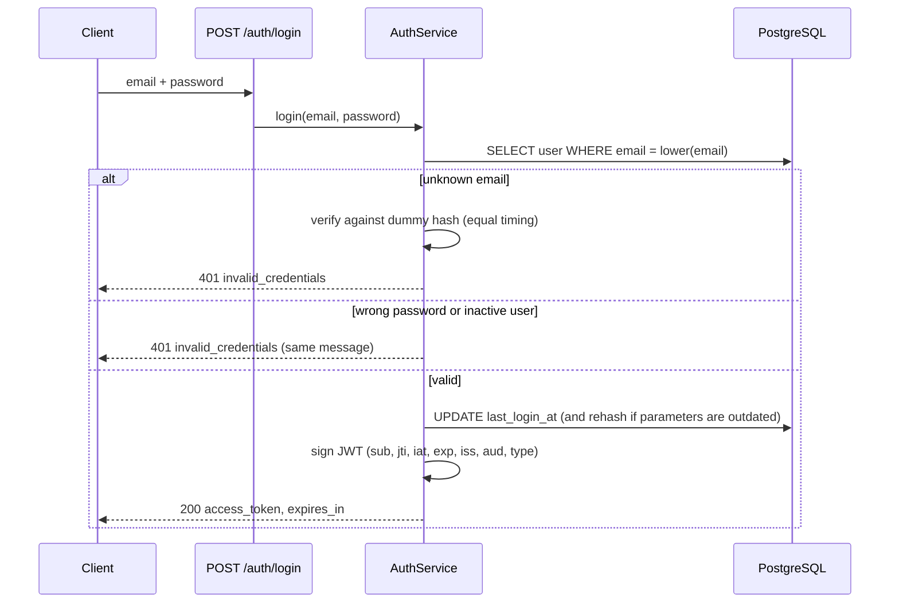

# 15 — Security Design

> **Scope:** controls implemented as of Phase 2. The "Not yet implemented" table at the
> end lists what later phases add — those items are not claimed as done.

## 1. Authentication flow

## 2. JWT lifecycle

| Stage | Behaviour |
|---|---|
| Issue | HS256, signed with `JWT_SECRET_KEY` (≥ 32 chars). Lifetime `ACCESS_TOKEN_EXPIRE_MINUTES` (default 30). Each token gets a random `jti`. |
| Use | Sent as `Authorization: Bearer`. On every protected request `get_auth_context` checks: present → signature → `exp` → `iss` = `syncforge` → `aud` = `syncforge-api` → `type` = `access` → required claims present → `jti` not revoked → user exists and `is_active`. |
| Revoke | `POST /auth/logout` stores the `jti` in `revoked_tokens`. Only that token is revoked. |
| Expire | After `exp` the token is rejected with `token_expired`; its denylist row is no longer needed. |

Algorithm pinning: decoding accepts only `HS256`, so unsigned (`alg: none`) or
algorithm-swapped tokens are rejected (covered by `test_invalid_tokens_are_rejected`).

**Why a denylist and not stateless-only JWTs?** See
[ADR-0004](adr/0004-jwt-access-tokens-with-revocation-denylist.md): logout must actually
end a session; the cost is one primary-key lookup per request.

## 3. Passwords

- **Argon2id** via `pwdlib` (memory-hard; random salt per hash). Plain passwords are never stored.
- Length 12–128. The upper bound limits CPU cost per hashing request.
- Hashes with outdated parameters are transparently upgraded at next successful login.
- Passwords are Pydantic `SecretStr`: they do not appear in reprs, logs, or validation errors.

## 4. Account enumeration defences

| Endpoint | Defence |
|---|---|
| Login | One message and code for unknown email, wrong password and inactive account; unknown emails still pay the cost of a hash verification. |
| Register | **Accepted trade-off:** `409 email_taken` reveals that an email is registered. This is normal for self-service sign-up; it will be mitigated by rate limiting (Phase 9). |

## 5. Secrets and configuration

- Real values live in `.env`, which is git-ignored; `.env.example` holds placeholders only.
- Tests use a fixed test-only JWT key set in `tests/conftest.py`, never the developer's `.env`.
- In `APP_ENV=production` the app refuses to start with the placeholder `JWT_SECRET_KEY` or
  `POSTGRES_PASSWORD` (`test_placeholder_jwt_secret_is_rejected_in_production`).
- Generate a secret: `python -c "import secrets; print(secrets.token_urlsafe(64))"`.
  Rotating it invalidates all existing tokens (everyone must log in again).

## 6. Data exposure

- Response schemas list fields explicitly; `password_hash` cannot be serialized.
- Validation errors report field names and reasons, never submitted values.
- Unexpected errors return a generic `internal_error`; tracebacks go to logs only.
- Logs record user IDs and token IDs (`jti`), never passwords, hashes, tokens or emails.
- `User.__repr__` omits the email so PII does not leak into tracebacks.

## 7. Transport and browser access

- CORS allows only configured origins (`CORS_ORIGINS`, default `http://localhost:4200`
  for the future Angular app), with `allow_credentials=False` because tokens travel in
  the `Authorization` header, not cookies.
- TLS termination is a deployment concern (documented in the Phase 10 deployment guide).

## 8. Not yet implemented

| Control | Planned phase |
|---|---|
| Role-based authorization and organization isolation on endpoints | Phase 2, Part 4 |
| Rate limiting on login/register | Phase 9 |
| Request body size limits | Phase 9 |
| Encrypted storage of connector credentials (OAuth secrets) | Phase 4 |
| Scheduled cleanup of expired `revoked_tokens` rows | Phase 5 |
| Audit log of security-relevant actions | Phase 7 |
