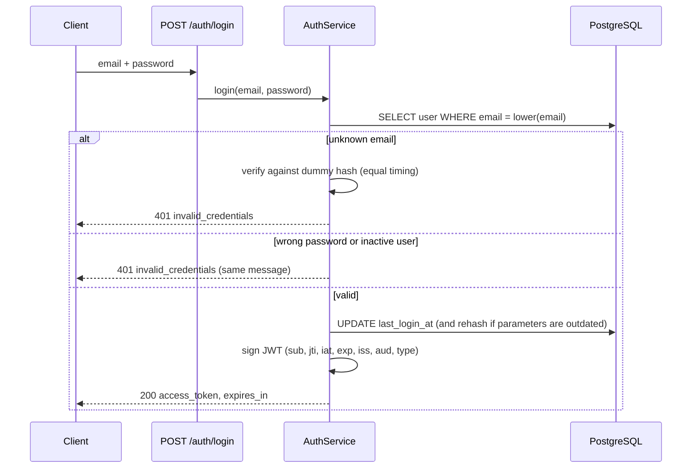
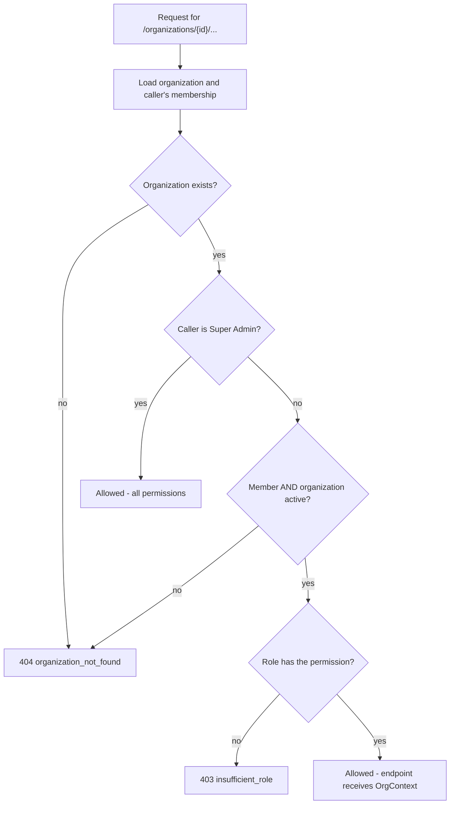

# 15 - Security Design

> **Scope:** controls implemented as of Phase 4. The "Not yet implemented" table at the
> end lists what later phases add - those items are not claimed as done.

## 1. Authentication flow



## 2. JWT lifecycle

| Stage | Behaviour |
|---|---|
| Issue | HS256, signed with `JWT_SECRET_KEY` (>= 32 chars). Lifetime `ACCESS_TOKEN_EXPIRE_MINUTES` (default 30). Each token gets a random `jti`. |
| Use | Sent as `Authorization: Bearer`. On every protected request `get_auth_context` checks: present -> signature -> `exp` -> `iss` = `syncforge` -> `aud` = `syncforge-api` -> `type` = `access` -> required claims present -> `jti` not revoked -> user exists and `is_active`. |
| Revoke | `POST /auth/logout` stores the `jti` in `revoked_tokens`. Only that token is revoked. |
| Expire | After `exp` the token is rejected with `token_expired`; its denylist row is no longer needed. |

Algorithm pinning: decoding accepts only `HS256`, so unsigned (`alg: none`) or
algorithm-swapped tokens are rejected (covered by `test_invalid_tokens_are_rejected`).

**Why a denylist and not stateless-only JWTs?** See
[ADR-0004](adr/0004-jwt-access-tokens-with-revocation-denylist.md): logout must actually
end a session; the cost is one primary-key lookup per request.

## 3. Passwords

- **Argon2id** via `pwdlib` (memory-hard; random salt per hash). Plain passwords are never stored.
- Length 12-128. The upper bound limits CPU cost per hashing request.
- Hashes with outdated parameters are transparently upgraded at next successful login.
- Passwords are Pydantic `SecretStr`: they do not appear in reprs, logs, or validation errors.

## 4. Account enumeration defences

| Endpoint | Defence |
|---|---|
| Login | One message and code for unknown email, wrong password and inactive account; unknown emails still pay the cost of a hash verification. |
| Register | **Accepted trade-off:** `409 email_taken` reveals that an email is registered. This is normal for self-service sign-up; it will be mitigated by rate limiting (Phase 9). |

## 5. Secrets and configuration

- Real values live in `.env`, which is git-ignored; `.env.example` holds placeholders only.
- Tests use a fixed test-only JWT key set in `tests/conftest.py`, never the developer's `.env`.
- In `APP_ENV=production` the app refuses to start with the placeholder `JWT_SECRET_KEY` or
  `POSTGRES_PASSWORD` (`test_placeholder_jwt_secret_is_rejected_in_production`).
- Generate a secret: `python -c "import secrets; print(secrets.token_urlsafe(64))"`.
  Rotating it invalidates all existing tokens (everyone must log in again).

## 6. Data exposure

- Response schemas list fields explicitly; `password_hash` cannot be serialized.
- Validation errors report field names and reasons, never submitted values.
- Unexpected errors return a generic `internal_error`; tracebacks go to logs only.
- Logs record user IDs and token IDs (`jti`), never passwords, hashes, tokens or emails.
- `User.__repr__` omits the email so PII does not leak into tracebacks.
- Employee lifecycle events are logged with employee IDs and changed **field names** only,
  never the values (names, emails). `test_create_employee` asserts that no captured log
  record contains the employee's name; `Employee.__repr__` likewise shows only the ID.
- The employee API exposes work-related fields only (no salary, personal address or
  government IDs are stored in Phase 3).
- Integration events store the old and new values of changed fields in
  `integration_events.payload` (needed for audit and conflict handling). They are never
  logged, and the events API returns only the **names** of changed fields
  (`test_events_are_listed_without_personal_data`). Worker logs carry event, execution,
  connector and employee IDs only (`test_engine_logs_carry_ids_but_no_personal_data`).
- Broker messages carry only an event ID and a correlation ID - no personal data, no
  credentials - and use JSON serialization (never pickle).

## 7. Connector credentials and outbound calls

Details: [connector framework, sections 5 and 7](10-connector-framework.md#5-the-http-client-connectorhttpclient).

- **Encrypted at rest** with Fernet (AES-128-CBC + HMAC-SHA256), key from
  `CONNECTOR_ENCRYPTION_KEY` - never stored in the database
  ([ADR-0009](adr/0009-encrypting-connector-credentials.md)). Several comma-separated keys
  allow rotation. No key: connectors cannot be created (`503`); production refuses to start
  (a blank value counts as no key).
- **Never returned, logged or echoed**: the API shows `auth_type` and a 4-character
  fingerprint; validation errors name fields only; logs carry IDs and outcomes only
  (`test_logs_never_contain_credentials`, and every adapter test asserts the rejected secret
  is absent from errors).
- **Revocation**: disconnecting deletes the credentials row immediately.
- **Server-side request forgery**: a connector's base URL must use http(s), contain no
  embedded credentials, and point at a host in `CONNECTOR_ALLOWED_HOSTS` - checked when it
  is saved and on every call. Redirects are not followed and environment proxies are ignored.
  Limitation: the check is by host name, not resolved IP; production should allow only vendor
  host names and restrict egress at the network level.
- **Timeouts** on every outbound call (connect 3 s, read 10 s by default).
- **Tenant isolation**: connectors, credentials and external accounts are scoped by
  organization and linked through composite foreign keys, so a credential or account link
  can never point at another organization's connector or employee.
- **Mock services** have unauthenticated control endpoints (`/_mock/*`) and default fake
  credentials - local use only, never exposed.

## 8. Transport and browser access

- CORS allows only configured origins (`CORS_ORIGINS`, default `http://localhost:4200`
  for the future Angular app), with `allow_credentials=False` because tokens travel in
  the `Authorization` header, not cookies.
- TLS termination is a deployment concern (documented in the Phase 10 deployment guide).

## 9. Authorization model

### Roles and permissions

Endpoints check a **permission**, never a role name. The mapping lives in one place,
`ROLE_PERMISSIONS` in `app/security/authorization.py`, and is covered by
`test_role_permission_matrix`.

| Permission | Viewer | Integration Manager | Organization Admin | Super Admin |
|---|---|---|---|---|
| `org:read` - view the organization | yes | yes | yes | yes |
| `members:read` - list members | yes | yes | yes | yes |
| `org:update` - rename the organization | no | no | yes | yes |
| `members:manage` - add, re-role, remove members | no | no | yes | yes |
| `employees:read` - list, search and view employees | yes | yes | yes | yes |
| `departments:read` - list departments | yes | yes | yes | yes |
| `employees:write` - create, update, terminate, archive employees | no | no | yes | yes |
| `departments:manage` - create, rename, delete departments | no | no | yes | yes |
| `connectors:read` - list and view connectors and linked accounts | yes | yes | yes | yes |
| `connectors:manage` - configure, test, disconnect connectors; run operations | no | **yes** | yes | yes |
| `workflows:read` - list and view workflows and their execution history | yes | yes | yes | yes |
| `workflows:manage` - create, edit, activate, deactivate workflows | no | **yes** | yes | yes |
| `events:read` - list and view integration events with their executions | yes | yes | yes | yes |

Integration Managers operate integrations (connectors and workflows) but do not manage
people, departments or the organization itself; `test_role_permission_matrix` pins that
they cannot write employees.

**Super Admin** is a platform-wide flag (`users.is_superadmin`), not a membership role. It
grants every permission in every organization. It cannot be obtained through the API; an
operator with shell access creates one:

```powershell
python -m app.cli create-superadmin --email admin@example.com --name "Platform Admin"
```

The password is prompted for (never passed as an argument, so it stays out of shell history).
Running it for an existing email promotes that user.

### Organization isolation

Every route under `/api/v1/organizations/{organization_id}` depends on
`require_org_permission(permission)`, which calls `resolve_org_access`:



- **404, not 403, for outsiders:** a non-member cannot tell whether an organization ID exists.
- **403 for members** whose role lacks the permission; `details.required_permission` says which.
- Listing (`GET /api/v1/organizations`) is filtered in SQL by the caller's memberships, so an
  outsider's organizations never appear.
- Endpoints receive the already-loaded organization via `OrgContext`, and every repository
  query filters by that organization's ID. The employee and department repositories have
  no "get by ID" without an organization, so a foreign ID behaves like an unknown one
  (`404 employee_not_found`) - covered by `test_cross_organization_access_is_404_everywhere`.
- **Database backstop:** an employee's department and manager are referenced through
  composite foreign keys that include `organization_id`, so PostgreSQL itself rejects a
  cross-tenant reference ([ADR-0006](adr/0006-composite-foreign-keys-for-tenant-integrity.md)).
- `PATCH` bodies cannot move an employee to another organization: unknown fields such as
  `organization_id` are rejected with `422`.
- Covered by `test_admin_of_one_org_cannot_touch_another` (six cross-organization requests,
  all `404`, data unchanged) and `test_member_lost_access_after_removal`.

See [ADR-0005](adr/0005-organization-level-data-isolation.md) for the design decision.

### The "last Organization Admin" rule

An organization must always keep at least one Organization Admin; demoting or removing the
last one returns `409 last_admin`. Before the check, the service locks the organization's admin
rows with `SELECT ... FOR UPDATE`. If two admins try to demote each other at the same moment,
the second request waits for the first to commit, then re-counts and is refused.
`tests/test_concurrency.py` proves this with two real database sessions; the test fails if the
lock is removed.

## 10. Not yet implemented

| Control | Planned phase |
|---|---|
| Rate limiting on login/register | Phase 9 |
| Request body size limits | Phase 9 |
| Scheduled cleanup of expired `revoked_tokens` rows | Phase 6 (periodic maintenance task; not done in Phase 5) |
| Audit log of security-relevant actions (including Super Admin actions) | Phase 7 |
| Field-level masking of employee personal data for low-privilege roles | Future improvement |
| Invitations for people who are not registered yet | Future improvement |
| Secrets manager / envelope encryption for the connector key; bulk re-encryption command | Future improvement |
| OAuth authorization-code ("Connect with Google") flow | Future improvement |
| Authentication between workers and Redis (Redis password / TLS). Locally Redis has no password and Docker publishes its port on the host (as for PostgreSQL), which is acceptable on a development machine only | Phase 10 deployment guide |
