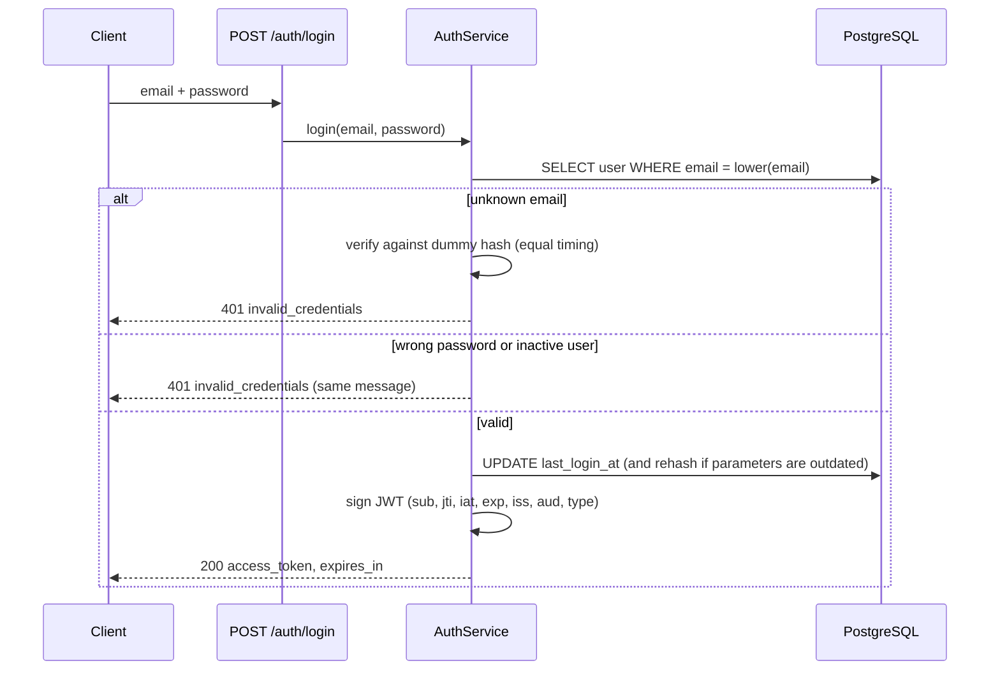
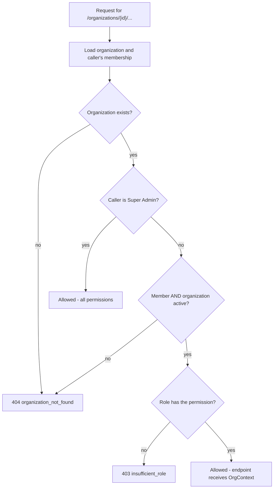

# 15 - Security Design

> **Scope:** controls implemented as of Phase 7. The "Not yet implemented" table at the
> end lists what later phases add - those items are not claimed as done.

## 1. Authentication flow



## 2. JWT lifecycle

| Stage | Behaviour |
|---|---|
| Issue | HS256, signed with `JWT_SECRET_KEY` (>= 32 chars). Lifetime `ACCESS_TOKEN_EXPIRE_MINUTES` (default 30). Each token gets a random `jti`. |
| Use | Sent as `Authorization: Bearer`. On every protected request `get_auth_context` checks: present -> signature -> `exp` -> `iss` = `syncforge` -> `aud` = `syncforge-api` -> `type` = `access` -> required claims present -> `jti` not revoked -> user exists and `is_active`. |
| Revoke | `POST /auth/logout` stores the `jti` in `revoked_tokens`. Only that token is revoked. |
| Expire | After `exp` the token is rejected with `token_expired`; its denylist row is no longer needed and is deleted by `python -m app.cli purge-expired` (run it daily from a scheduler). |

Algorithm pinning: decoding accepts only `HS256`, so unsigned (`alg: none`) or
algorithm-swapped tokens are rejected (covered by `test_invalid_tokens_are_rejected`).

**Why a denylist and not stateless-only JWTs?** See
[ADR-0004](adr/0004-jwt-access-tokens-with-revocation-denylist.md): logout must actually
end a session; the cost is one primary-key lookup per request.

## 3. Passwords

- **Argon2id** via `pwdlib` (memory-hard; random salt per hash). Plain passwords are never stored.
- Length 8-128, any characters including spaces, no composition rules (NIST SP 800-63B,
  OWASP ASVS minimum of 8). The upper bound limits CPU cost per hashing request. The
  registration form shows a strength hint and encourages longer passphrases.
- **Guessable passwords are refused** (NIST SP 800-63B blocklist check), offline:
  `app/security/password_policy.py` checks the bundled list of the 10,000 most common
  passwords (SecLists, MIT licence; only its 2,087 entries of 8+ characters are needed),
  a single repeated character, the service name, and the email's name. Registration
  returns `422` on the `password` field with the reason; `create-superadmin` applies the
  same check. Nothing is sent to a third-party breach service; the trade-off is a smaller
  list than a full breach corpus.
- Hashes with outdated parameters are transparently upgraded at next successful login.
- Passwords are Pydantic `SecretStr`: they do not appear in reprs, logs, or validation errors.

## 4. Account enumeration defences

| Endpoint | Defence |
|---|---|
| Login | One message and code for unknown email, wrong password and inactive account; unknown emails still pay the cost of a hash verification. |
| Register | **Accepted trade-off:** `409 email_taken` reveals that an email is registered. This is normal for self-service sign-up; registrations are limited per client IP (section 4a), which makes bulk discovery slow. |
| Login rate limits | The per-account limit counts unknown emails exactly like real ones, so a 429 reveals nothing either. |

## 4a. Rate limiting of sign-in and registration

`app/security/rate_limit.py`, counters in PostgreSQL (`auth_rate_windows`, migration 0013).

| Rule | Subject | Counts | Default | Setting |
|---|---|---|---|---|
| `login_ip` | client IP | every login attempt | 60 / 60 s | `AUTH_LOGIN_IP_LIMIT`, `AUTH_LOGIN_IP_WINDOW_SECONDS` |
| `login_failures` | normalized email | failed logins (unknown emails too) | 10 / 15 min | `AUTH_LOGIN_FAILURES_LIMIT`, `AUTH_LOGIN_FAILURES_WINDOW_SECONDS` |
| `register_ip` | client IP | registrations | 50 / hour | `AUTH_REGISTER_IP_LIMIT`, `AUTH_REGISTER_IP_WINDOW_SECONDS` |

- Checked **before** any password hashing, so refused attempts are cheap.
- Refusal: `429 rate_limited`, `Retry-After` and `details.retry_after_seconds`; the UI shows
  the API's message ("Try again in 7 minutes").
- **PostgreSQL, not Redis:** signing in must not depend on the message broker; every API
  process shares the counters. Cost: one small upsert per attempt.
- **Hashed subjects:** keys are `rule:sha256(subject)`; the table holds no IP addresses or
  emails. Rows older than a day are deleted as new ones are written.
- **Client IP:** the ASGI client address. Behind a reverse proxy, run Uvicorn with
  `--proxy-headers --forwarded-allow-ips=<proxy address>`; `X-Forwarded-For` from anyone
  else is ignored. Without that, every user would share the proxy's address.
- **Trade-offs:** fixed windows allow up to twice a limit across a boundary. The
  per-account rule lets someone who knows an email delay that user's sign-in until the
  window ends; the window is short and every refusal is logged (`login rate limited`).
- Tests: `tests/test_security_hardening.py`.

## 5. Secrets and configuration

- Real values live in `.env`, which is git-ignored; `.env.example` holds placeholders only.
- Tests use a fixed test-only JWT key set in `tests/conftest.py`, never the developer's `.env`.
- In `APP_ENV=production` the app refuses to start with the placeholder `JWT_SECRET_KEY` or
  `POSTGRES_PASSWORD` (`test_placeholder_jwt_secret_is_rejected_in_production`).
- Generate a secret: `python -c "import secrets; print(secrets.token_urlsafe(64))"`.
  Rotating it invalidates all existing tokens (everyone must log in again).

## 6. Data exposure

- Response schemas list fields explicitly; `password_hash` cannot be serialized.
- Validation errors report field names and reasons, never submitted values.
- Data conflicts store both sides' values (names and e-mails included) because a person
  must see them to decide; they are shown to members who may see employees anyway, and
  are never logged or written to the audit log (only department, designation, location
  and account status values are audited).
- Unexpected errors return a generic `internal_error`; tracebacks go to logs only.
- Logs record user IDs and token IDs (`jti`), never passwords, hashes, tokens or emails.
- `User.__repr__` omits the email so PII does not leak into tracebacks.
- Employee lifecycle events are logged with employee IDs and changed **field names** only,
  never the values (names, emails). `test_create_employee` asserts that no captured log
  record contains the employee's name; `Employee.__repr__` likewise shows only the ID.
- The employee API exposes work-related fields only (no salary, personal address or
  government IDs are stored in Phase 3).
- Integration events store the old and new values of changed fields in
  `integration_events.payload` (needed for audit and conflict handling). They are never
  logged, and the events API returns only the **names** of changed fields
  (`test_events_are_listed_without_personal_data`). Worker logs carry event, execution,
  connector and employee IDs only (`test_engine_logs_carry_ids_but_no_personal_data`).
- Broker messages carry only an event ID and a correlation ID - no personal data, no
  credentials - and use JSON serialization (never pickle).
- Attempt history and dead-letter entries store normalized error categories, codes, HTTP
  statuses and short messages from the external application's error body - never request
  or response payloads (`test_api_lists_and_shows_entries_without_personal_data`).
- Idempotency records store the `POST /employees` response (work data the caller was
  allowed to see) for `IDEMPOTENCY_TTL_HOURS`; keys are scoped to (organization, user), so
  one user cannot obtain another's stored response by guessing a key; expired records are
  deleted by `python -m app.cli purge-expired`.

## 7. Connector credentials and outbound calls

Details: [connector framework, sections 5 and 7](10-connector-framework.md#5-the-http-client-connectorhttpclient).

- **Encrypted at rest** with Fernet (AES-128-CBC + HMAC-SHA256), key from
  `CONNECTOR_ENCRYPTION_KEY` - never stored in the database
  ([ADR-0009](adr/0009-encrypting-connector-credentials.md)). Several comma-separated keys
  allow rotation. No key: connectors cannot be created (`503`); production refuses to start
  (a blank value counts as no key).
- **Never returned, logged or echoed**: the API shows `auth_type` and a 4-character
  fingerprint; validation errors name fields only; logs carry IDs and outcomes only
  (`test_logs_never_contain_credentials`, and every adapter test asserts the rejected secret
  is absent from errors).
- **Revocation**: disconnecting deletes the credentials row immediately.
- **Server-side request forgery**: a connector's base URL must use http(s), contain no
  embedded credentials, and point at a host in `CONNECTOR_ALLOWED_HOSTS` - checked when it
  is saved and on every call. Redirects are not followed and environment proxies are ignored.
  Limitation: the check is by host name, not resolved IP; production should allow only vendor
  host names and restrict egress at the network level.
- **Timeouts** on every outbound call (connect 3 s, read 10 s by default) and a deadline
  for each whole operation (30 s), so a slow or hostile endpoint cannot hold a worker.
- **Bounded load on external applications**: retries are limited and spread by jitter, a
  per-connector circuit breaker stops calls to an application that is down, and an optional
  per-connector rate limit paces calls ([docs/12](12-reliability-and-retries.md)).
- **Tenant isolation**: connectors, credentials and external accounts are scoped by
  organization and linked through composite foreign keys, so a credential or account link
  can never point at another organization's connector or employee.
- **Mock services** have unauthenticated control endpoints (`/_mock/*`) and default fake
  credentials - local use only, never exposed.

## 8. Transport and browser access

- CORS allows only configured origins (`CORS_ORIGINS`, default `http://localhost:4200`
  for the future Angular app), with `allow_credentials=False` because tokens travel in
  the `Authorization` header, not cookies.
- Preflight allows the headers the API uses (`Authorization`, `Content-Type`,
  `X-Request-ID`, `If-Match`, `Idempotency-Key`) and exposes `X-Request-ID`, `ETag` and
  `Retry-After`. (The Angular app is served from the same origin through a proxy, so it
  does not depend on CORS.)
- Response headers on every response: `X-Content-Type-Options: nosniff`,
  `X-Frame-Options: DENY`, `Referrer-Policy: no-referrer`. On `/api/*` also
  `Cache-Control: no-store` (responses contain personal data) and
  `Content-Security-Policy: default-src 'none'; frame-ancestors 'none'` (JSON never needs
  to load anything). `/docs` is excluded from the CSP because Swagger UI loads scripts.
- Request bodies are limited to `MAX_REQUEST_BODY_BYTES` (default 1 MiB): a larger
  `Content-Length` gets `413 payload_too_large` before the body is read; a chunked body is
  counted while it streams and refused when it passes the limit.
- TLS termination is a deployment concern (documented in the Phase 10 deployment guide).

## 9. Authorization model

### Roles and permissions

Endpoints check a **permission**, never a role name. The mapping lives in one place,
`ROLE_PERMISSIONS` in `app/security/authorization.py`, and is covered by
`test_role_permission_matrix`.

| Permission | Viewer | Integration Manager | Organization Admin | Super Admin |
|---|---|---|---|---|
| `org:read` - view the organization | yes | yes | yes | yes |
| `members:read` - list members | yes | yes | yes | yes |
| `org:update` - rename the organization | no | no | yes | yes |
| `members:manage` - add, re-role, remove members | no | no | yes | yes |
| `employees:read` - list, search and view employees | yes | yes | yes | yes |
| `departments:read` - list departments | yes | yes | yes | yes |
| `employees:write` - create, update, terminate, archive employees | no | no | yes | yes |
| `departments:manage` - create, rename, delete departments | no | no | yes | yes |
| `connectors:read` - list and view connectors and linked accounts | yes | yes | yes | yes |
| `connectors:manage` - configure, test, disconnect connectors; run operations | no | **yes** | yes | yes |
| `workflows:read` - list and view workflows and their execution history | yes | yes | yes | yes |
| `workflows:manage` - create, edit, activate, deactivate workflows | no | **yes** | yes | yes |
| `events:read` - list and view integration events with their executions, attempts and the dead-letter queue | yes | yes | yes | yes |
| `events:replay` - replay a dead-lettered event (causes real calls to external applications) | no | **yes** | yes | yes |
| `audit:read` - read the organization's audit log (shows other people's actions and permission changes) | no | **yes** | yes | yes |
| `conflicts:read` - view data conflicts and source-of-truth policies | yes | yes | yes | yes |
| `conflicts:resolve` - run reconciliation, resolve conflicts (adopting a value into an employee record also needs `employees:write`) | no | **yes** | yes | yes |
| `policies:manage` - decide which system is authoritative per field | no | no | yes | yes |

Integration Managers operate integrations (connectors, workflows, replays, conflicts) but do
not manage people, departments, policies or the organization itself; `test_role_permission_matrix` pins that
they cannot write employees.

**Super Admin** is a platform-wide flag (`users.is_superadmin`), not a membership role. It
grants every permission in every organization. It cannot be obtained through the API; an
operator with shell access creates one:

```powershell
python -m app.cli create-superadmin --email admin@example.com --name "Platform Admin"
```

The password is prompted for (never passed as an argument, so it stays out of shell history).
Running it for an existing email promotes that user.

### Organization isolation

Every route under `/api/v1/organizations/{organization_id}` depends on
`require_org_permission(permission)`, which calls `resolve_org_access`:



- **404, not 403, for outsiders:** a non-member cannot tell whether an organization ID exists.
- **403 for members** whose role lacks the permission; `details.required_permission` says which.
- Listing (`GET /api/v1/organizations`) is filtered in SQL by the caller's memberships, so an
  outsider's organizations never appear.
- Endpoints receive the already-loaded organization via `OrgContext`, and every repository
  query filters by that organization's ID. The employee and department repositories have
  no "get by ID" without an organization, so a foreign ID behaves like an unknown one
  (`404 employee_not_found`) - covered by `test_cross_organization_access_is_404_everywhere`.
- **Database backstop:** an employee's department and manager are referenced through
  composite foreign keys that include `organization_id`, so PostgreSQL itself rejects a
  cross-tenant reference ([ADR-0006](adr/0006-composite-foreign-keys-for-tenant-integrity.md)).
- `PATCH` bodies cannot move an employee to another organization: unknown fields such as
  `organization_id` are rejected with `422`.
- Covered by `test_admin_of_one_org_cannot_touch_another` (six cross-organization requests,
  all `404`, data unchanged) and `test_member_lost_access_after_removal`.

See [ADR-0005](adr/0005-organization-level-data-isolation.md) for the design decision.

### Audit log

Implemented in Phase 7 ([docs/14, section 2](14-data-integrity.md#2-the-audit-log)): every
permission change (`member.added`, `member.role_changed` with from/to role,
`member.removed`), connector change (credentials only as "rotated"), employee change,
workflow change, replay, conflict decision and policy change is written to `audit_logs`
in the same transaction as the change, with the acting user (or the system) and the
request ID. Super Admins acting in an organization are recorded like any user. Entries
never contain secrets or personal values, and a database trigger makes the table
append-only - `UPDATE` and `DELETE` are refused even from SQL.

### Concurrent edits

Employee updates accept `If-Match`; a save based on an outdated version is refused with
`412` instead of silently overwriting another person's change
([docs/14, section 3](14-data-integrity.md#3-optimistic-concurrency-on-employees)).

### The "last Organization Admin" rule

An organization must always keep at least one Organization Admin; demoting or removing the
last one returns `409 last_admin`. Before the check, the service locks the organization's admin
rows with `SELECT ... FOR UPDATE`. If two admins try to demote each other at the same moment,
the second request waits for the first to commit, then re-counts and is refused.
`tests/test_concurrency.py` proves this with two real database sessions; the test fails if the
lock is removed.

## 10. Not yet implemented

| Control | Planned phase |
|---|---|
| Multi-factor authentication (with password-only sign-in, NIST SP 800-63B-4 recommends 15 or more characters) | Future improvement |
| Audit entries for login, logout and failed logins (not organization-scoped; today in the structured logs only) | Phase 9 |
| Audit log retention job (the trigger already provides the switch for it) | Future improvement |
| Field-level masking of employee personal data for low-privilege roles | Future improvement |
| Invitations for people who are not registered yet | Future improvement |
| Secrets manager / envelope encryption for the connector key; bulk re-encryption command | Future improvement |
| OAuth authorization-code ("Connect with Google") flow | Future improvement |
| Authentication between workers and Redis (Redis password / TLS). Locally Redis has no password and Docker publishes its port on the host (as for PostgreSQL), which is acceptable on a development machine only | Phase 10 deployment guide |
