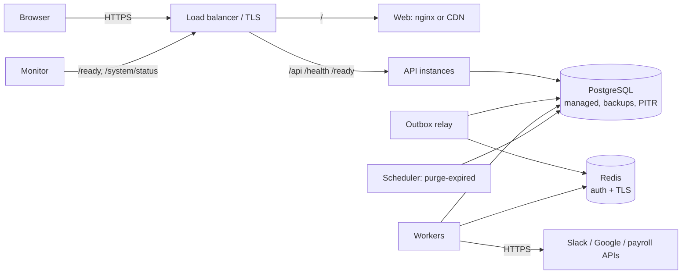

# 17 - Deployment guide

How to run SyncForge outside a developer's laptop. Read section 1 first: the Docker
Compose setup in this repository is for local development and demonstration, and this
guide describes what a production deployment needs on top of it. SyncForge has not been
deployed to a production environment as part of this project; nothing here is claimed as
tested in production.

## 1. Local Docker versus production

| | Local (`docker compose --profile full`) | Production |
|---|---|---|
| Machines | One computer | API, workers, database and broker on separate, redundant infrastructure |
| PostgreSQL | A container with a named volume | A managed or replicated PostgreSQL with backups and point-in-time recovery |
| Redis | A container, no password, port published on the host | A managed Redis with authentication and TLS, reachable only from the application network |
| Secrets | `.env` file on disk | A secrets manager or the platform's secret store, injected as environment variables |
| TLS | None (http://localhost) | TLS at a load balancer or reverse proxy, HTTP redirected to HTTPS |
| Connectors | Simulated mock services | Real Slack / Google tenants, which need connector work first (docs/10 section 1) |
| Scaling | One of each process | Several API instances, workers sized to the event rate |
| Updates | `docker compose up --build` | A release procedure with migrations first (section 7) |

The images (`backend/Dockerfile`, `frontend/Dockerfile`) are the deployable units in both
cases. Nothing in this repository provisions infrastructure (no Terraform, Kubernetes
manifests or cloud templates); section 3 describes what to provision.

## 2. Components to run

| Component | Image and command | Instances | Needs |
|---|---|---|---|
| Migration job | backend image, `alembic upgrade head` | One-off, per release, before anything else | PostgreSQL (owner of the schema) |
| API | backend image, default command (Uvicorn on port 8000) | 2+ behind a load balancer | PostgreSQL only: the API writes events to the outbox table and never talks to Redis |
| Worker | backend image, `celery -A app.workers.celery_app worker --concurrency=N` | 1+ (scale with the event rate, docs/19) | PostgreSQL, Redis, outbound HTTPS to the connected applications |
| Outbox relay | backend image, `python -m app.cli outbox-relay` | 1 (a second is safe: rows are claimed with `SKIP LOCKED`) | PostgreSQL, Redis |
| Web | frontend image (nginx on 8080) or the built files on a CDN | 2+ or a CDN | Routes `/api` to the API (same origin) |
| Scheduled maintenance | backend image, `python -m app.cli purge-expired` | Daily, from the platform's scheduler | PostgreSQL |

The API, worker and relay are stateless; all state is in PostgreSQL. Redis carries only
"process event X" messages and can be lost without losing work (the relay re-publishes
from the outbox).

## 3. Reference architecture

Only the load balancer is reachable from the internet. PostgreSQL and Redis accept
connections only from the application network. Workers need outbound internet access to
the connected applications and nothing else.

## 4. Configuration

All settings are environment variables (`app/core/config.py`); `.env.example` lists them
with local values. In production set at least the following.

### Required and security-relevant

| Variable | Production value |
|---|---|
| `APP_ENV` | `production`. The application then refuses to start with the placeholder JWT secret, the placeholder database password or no connector encryption key |
| `JWT_SECRET_KEY` | 64+ random characters from the secrets manager (`python -c "import secrets; print(secrets.token_urlsafe(64))"`) |
| `CONNECTOR_ENCRYPTION_KEY` | A Fernet key from the secrets manager (`python -c "from cryptography.fernet import Fernet; print(Fernet.generate_key().decode())"`); comma-separated list during rotation (section 5) |
| `POSTGRES_HOST`, `POSTGRES_PORT`, `POSTGRES_DB`, `POSTGRES_USER`, `POSTGRES_PASSWORD` | The managed database; or `DATABASE_URL` with the full URL (for example with `?sslmode=require`) |
| `REDIS_URL` | `rediss://:<password>@<host>:6380/0` (TLS and a password) |
| `CORS_ORIGINS` | `[]` when the web app is served from the same origin (recommended); otherwise the exact web origin(s) |
| `CONNECTOR_ALLOWED_HOSTS` | Only the hosts of the applications you connect (SSRF protection, docs/10) |
| `SLACK_BASE_URL`, `GOOGLE_WORKSPACE_BASE_URL`, `PAYROLL_BASE_URL` | The real service URLs once real connectors exist; the defaults point at the local mocks |
| `FORWARDED_ALLOW_IPS` (API container) | The address range of your load balancer or proxy, so sign-in limits and security events see real client addresses (docs/15 section 4a). Never `*` if anything other than the proxy can reach the API |

### Tuning (defaults are reasonable)

| Area | Variables |
|---|---|
| Logging | `LOG_LEVEL` (`INFO`) |
| Sessions | `ACCESS_TOKEN_EXPIRE_MINUTES` (30) |
| Abuse protection | `AUTH_LOGIN_IP_LIMIT`, `AUTH_LOGIN_FAILURES_LIMIT`, `AUTH_REGISTER_IP_LIMIT` and their `_WINDOW_SECONDS`; `MAX_REQUEST_BODY_BYTES` |
| Processing | `WORKER_LEASE_SECONDS`, `OUTBOX_BATCH_SIZE`, `OUTBOX_POLL_INTERVAL_SECONDS` |
| Reliability | `RETRY_MAX_ATTEMPTS`, `RETRY_BASE_DELAY_SECONDS`, `RETRY_MAX_DELAY_SECONDS`, `RETRY_JITTER_RATIO`, `CIRCUIT_FAILURE_THRESHOLD`, `CIRCUIT_OPEN_SECONDS`, `CONNECTOR_*_TIMEOUT_SECONDS` |
| Observability | `HEARTBEAT_INTERVAL_SECONDS`, `HEARTBEAT_STALE_AFTER_SECONDS` |
| Retention | `IDEMPOTENCY_TTL_HOURS` |

## 5. Secrets

- Keep `JWT_SECRET_KEY`, `CONNECTOR_ENCRYPTION_KEY`, `POSTGRES_PASSWORD` and the Redis
  password in a secrets manager (cloud secret store, Vault, or the container platform's
  secrets) and inject them as environment variables. Never bake them into images; the
  images contain no secrets and the `.dockerignore` files exclude `.env`.
- **JWT secret rotation:** replacing the value signs new tokens with the new key and makes
  existing tokens invalid, so everyone signs in again (sessions last at most 30 minutes).
  Rotate during a quiet period.
- **Connector key rotation:** set `CONNECTOR_ENCRYPTION_KEY=<new>,<old>`. New credentials
  are encrypted with the first key and both keys decrypt (MultiFernet). Replace each
  connector's credentials (or re-save them) so they are encrypted with the new key, then
  remove the old key. A bulk re-encryption command does not exist yet (docs/15 section 10).
- Losing the connector key makes stored credentials unreadable; connectors then need their
  credentials entered again. Back the key up like the database.

## 6. Database

- **Create** a database and a login role for SyncForge. The migration job needs to create
  and alter tables; the application roles only need to read and write. If you separate
  them, run migrations as the schema owner and grant the application role `SELECT,
  INSERT, UPDATE, DELETE` on the tables and `USAGE` on sequences. (The append-only
  triggers on `audit_logs` and `security_events` still refuse updates and deletes.)
- **Connections:** each process has a pool of 5 plus up to 10 overflow connections
  (`app/core/database.py`). (API instances + workers + relay) x 15 must stay below the
  server's `max_connections`; with many instances use PgBouncer in transaction mode.
- **TLS:** use `DATABASE_URL` with `sslmode=require` (or `verify-full` with the CA).
- **Backups:** enable automated backups with point-in-time recovery; keep at least 7 days.
  Test a restore regularly. A logical dump for a one-off copy:
  `pg_dump --format=custom --no-owner -d syncforge -f syncforge.dump`, restored with
  `pg_restore -d <new database> syncforge.dump`.
- **Retention:** events, attempts, executions, audit and security events grow without
  bound today (no retention job; docs/15 section 10). Plan storage accordingly and
  schedule `python -m app.cli purge-expired` daily for revoked tokens and idempotency
  records.

## 7. Releases

1. Build the images in CI from the release commit and tag them with the commit SHA.
2. **Run the migration job** with the new image. Migrations must be backward compatible
   with the running code (expand first, contract in a later release): add columns as
   nullable or with defaults, create indexes `CONCURRENTLY` on large tables, never rename
   or drop a column that the previous release still reads.
3. Roll out the API, workers and relay. Old and new workers can run side by side: event
   claims and leases keep each event with one worker.
4. Roll out the web build.
5. Watch `/ready`, `/api/v1/system/status` and the error rate.

**Rollback:** redeploy the previous images. Downgrade migrations only if the previous
code cannot run on the new schema (which the expand-and-contract rule avoids); every
migration has a tested downgrade, but downgrading can drop data in new columns.

**Workers during a deploy:** Celery finishes the current task on a warm shutdown
(SIGTERM) within the platform's grace period. If a worker is killed mid-event, its lease
expires (`WORKER_LEASE_SECONDS`) and the relay hands the event to another worker; steps
already done are not repeated (docs/09).

## 8. Health checks and probes

| Probe | Endpoint | Use |
|---|---|---|
| Liveness (API) | `GET /health` | Process is up; never touches dependencies |
| Readiness (API) | `GET /ready` | Database reachable; take the instance out of rotation on `503` |
| Background processing | `GET /api/v1/system/status` (Super Admin token) | Alert when `healthy` is false: no worker or relay heartbeat, or events past their lease (docs/18) |
| Web | `GET /healthz` on the nginx container | Liveness of the web server |

Do not make `/ready` depend on workers: a worker outage must not take the API offline
(docs/18 section 3).

## 9. Logging and monitoring

- Every process logs one JSON object per line to stdout; collect stdout with the
  platform's log agent and index `request_id`, `correlation_id`, `event_id`,
  `logger` and `level`.
- Suggested alerts: `/ready` failing; `system/status` unhealthy for more than 2 minutes;
  `dead_letters_open` increasing; `outbox_oldest_unpublished_seconds` above a few minutes;
  HTTP 5xx rate; repeated `rate limited` warnings (possible attack).
- There is no metrics exporter; the JSON endpoints and log lines are the signals
  (docs/18 section 7).

## 10. Scaling

See docs/19 section 6. In short: add API instances behind the load balancer, add workers
for event throughput (measured: 2 workers -> 1.7x on 2 CPUs), keep one relay, scale
PostgreSQL vertically first and watch connection counts.

## 11. Production checklist

- [ ] `APP_ENV=production`; secrets from the secrets manager; no `.env` files on servers
- [ ] TLS at the load balancer; HTTP redirected; HSTS set at the proxy
- [ ] Only the load balancer is public; PostgreSQL and Redis private; Redis with password and TLS
- [ ] `FORWARDED_ALLOW_IPS` set to the proxy range; the API not reachable directly
- [ ] `CORS_ORIGINS` empty (same origin) or exact; `CONNECTOR_ALLOWED_HOSTS` restricted
- [ ] Interactive API docs (`/docs`, `/redoc`) restricted at the proxy if they should not be public (the application serves them in every environment)
- [ ] Migration job runs before each rollout; backups with PITR enabled and a restore tested
- [ ] `purge-expired` scheduled daily
- [ ] Alerts on `/ready`, `system/status`, dead letters and 5xx
- [ ] A Super Admin created with `python -m app.cli create-superadmin` (run once in a backend container)
- [ ] Real connectors implemented and tested against real tenants before connecting real applications
