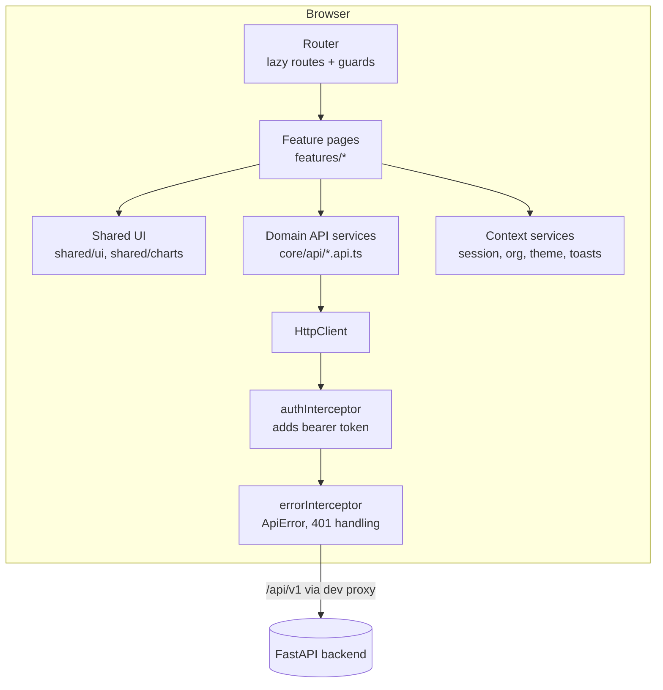
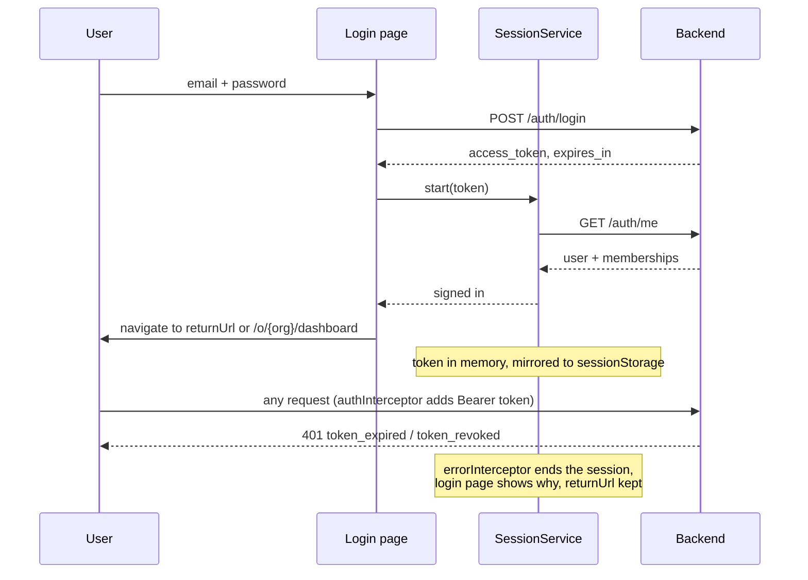

# Phase 8 — Frontend architecture

How the Angular application in `frontend/` is built. Companion documents:
[components](PHASE_8_FRONTEND_COMPONENTS.md), [API integration](PHASE_8_FRONTEND_API_INTEGRATION.md),
[testing](PHASE_8_FRONTEND_TESTING.md), and the [plan](PHASE_8_FRONTEND_PLAN.md) with the
screen-to-endpoint map and the list of features the backend does not support.

## 1. Principles

1. **The backend is the authority.** The UI never computes a business outcome the API
   decides (permissions, conflict policy, workflow validity, retries). It shows what the
   API returns and explains what the API refuses.
2. **Only real data.** Every figure, chart and list comes from an existing endpoint. Where
   the API has no data (for example, no time series for events), the screen does without
   rather than inventing it.
3. **Nothing hidden that fails.** A user who lacks a permission does not see the action.
   If the API still refuses something (a role changed in another tab, a stale record), the
   refusal is shown with its reason and request ID.
4. **Small, focused components.** Pages own data loading; shared components only present.

## 2. Technology

| Concern | Choice | Version |
|---|---|---|
| Framework | Angular, standalone components, zoneless change detection | 22.2.6 |
| Language | TypeScript, `strict` and strict templates | as pinned by Angular |
| Reactivity | Signals, `httpResource`, `rxResource`, `linkedSignal`; RxJS for writes and parallel reads | — |
| Forms | Reactive Forms (typed) | — |
| Overlays | Angular CDK (dialog, overlay, a11y) | 22.x |
| Charts | Apache ECharts 6 via `ngx-echarts`, loaded lazily | 6.x / 22.x |
| Icons | `lucide` SVG data, rendered by an own `<sf-icon>` component | — |
| Fonts | Inter and JetBrains Mono, self-hosted through fontsource | — |
| API types | Generated from the backend's OpenAPI document by `openapi-typescript` | 7.13.0 |
| Unit tests | Vitest through `ng test` | 5.x |
| Browser tests | Playwright with axe-core | 1.65.0 / 4.14.0 |

No state-management library (NgRx or similar) is used: the application's state is server
state, which `httpResource` caches per screen, plus a handful of signals. No UI component
library is used either; the design system is about 20 small components on CSS tokens.
Versions are recorded in `frontend/package.json` and locked by `package-lock.json`.

## 3. Layers



| Folder | Responsibility |
|---|---|
| `core/api` | Generated `schema.d.ts`, model aliases (`models.ts`), one injectable service per API area, `ApiError`, URL and query helpers |
| `core/auth` | `SessionService`, guards, interceptors, the permission matrix |
| `core/org` | `OrgContextService` (current organization and role), `EmployeeNamesService` (name cache) |
| `core/theme`, `core/toast`, `core/util` | Theme switching, notifications, formatting helpers |
| `layout` | Application shell: sidebar, top bar, organization switcher, user menu, navigation model |
| `shared` | Presentational components, chart wrapper, URL query state, auto-refresh, form helpers |
| `features/*` | One folder per area; each page is a lazily loaded route |

Rule: **no component injects `HttpClient`**. Pages call the domain API services, which
are the only code that knows URLs and headers.

## 4. Routing

All application routes are under `/o/:orgId/…`, so the organization is part of every
link: links can be shared, a reload keeps the context, and switching organization is a
navigation.

```
/                         → redirect: last organization used, or /organizations/new
/login, /register         guestGuard (signed-in users go to the app)
/organizations/new        authGuard
/unavailable              authGuard (organization not found or not a member)
/o/:orgId                 authGuard + organizationGuard → ShellComponent
  dashboard               org:read
  employees, employees/:id, reporting      employees:read
  departments             departments:read
  connectors, connectors/:id               connectors:read
  events, events/:id      events:read
  workflows, workflows/:id                 workflows:read
  workflows/new, workflows/:id/edit        workflows:manage
  reliability, dead-letters, dead-letters/:id   events:read
  conflicts, conflicts/:id, policies       conflicts:read
  audit                   audit:read
  team                    members:read
  settings                org:read
  forbidden               shown when a permission check fails
**                        not-found page
```

- **`authGuard`** — a session must exist; otherwise `/login?returnUrl=…`.
- **`organizationGuard`** — asks the API for the organization (`GET /organizations/{id}`).
  A 404 (not a member, or no such organization) leads to `/unavailable`. Membership is
  never assumed from the URL.
- **`permissionGuard`** — reads `data.permission` from the route and checks the user's
  role in that organization; failure goes to `forbidden`.
- Every route has a `title`, every feature is `loadComponent` (lazy), and route parameters
  bind to component inputs (`withComponentInputBinding`).

## 5. Authentication and session



- The backend issues a bearer token in the response body (no cookie, no refresh token,
  30-minute lifetime). It is held in a signal and mirrored to `sessionStorage` so a reload
  keeps the user signed in; `sessionStorage` is per tab and cleared when the tab closes.
- **This is not protection against XSS.** Any script running in the page could read the
  token, wherever it is kept in JavaScript. The protections that matter are Angular's
  template escaping, no `innerHTML` with untrusted data, no third-party scripts, the short
  token lifetime, and server-side revocation on logout. An HttpOnly cookie session needs
  backend changes and is listed for Phase 9.
- `SessionService.restore()` runs as an app initializer: an expired stored token is
  dropped before any page loads; a valid one is checked with `GET /auth/me`.
- The shell warns before the token expires. Sign-out calls `POST /auth/logout` (the API
  revokes the token) and clears the session even if that call fails, telling the user so.
- Passwords: minimum 8 characters (the API's rule), show/hide toggle with an accessible
  pressed state, Caps Lock notice, and a strength hint at registration.

## 6. Authorization in the UI

`core/auth/permissions.ts` mirrors the backend's `ROLE_PERMISSIONS` for the three
organization roles; Super Admins hold every permission. It is used to:

- hide navigation entries (`layout/nav.ts` lists the permission each entry needs),
- block routes (`permissionGuard`),
- hide or disable actions (for example "Add employee" needs `employees:write`).

The matrix only decides **what is shown**. The API enforces every permission, and its
403 responses are displayed rather than ignored. Unit tests (`permissions.spec.ts`) check
the matrix role by role.

## 7. State management

| Kind of state | Where it lives |
|---|---|
| Server data for a screen | `httpResource` (reads) — loading, error and value signals; a changed request cancels the superseded one, so a slow old response never overwrites a new filter |
| Data derived from several calls | `rxResource` over `forkJoin` (dashboard, reliability overview) |
| Filters, sort, pagination | The URL query string via `useQueryState()` — shareable, survives reload, works with Back |
| Session, organization, role, theme, toasts | Root services exposing signals |
| Form state | Reactive Forms; `linkedSignal` where a value resets when its source changes |
| Writes | `HttpClient` observables from the API services, followed by a resource `reload()` |

Background processing (events, retries, dead letters) is followed by **polling**: the API
has no push channel. `useAutoRefresh()` reloads a screen every 5 seconds while switched on
and while the tab is visible; event pages refresh themselves until the event settles.

## 8. Error handling

Every failed request becomes one `ApiError` (`status`, `code`, `message`, `details`,
`requestId`) in the error interceptor; nothing reaches a component as a raw
`HttpErrorResponse`, and errors are always re-thrown, never swallowed.

| Situation | Behaviour |
|---|---|
| API not running (status 0, or a 502/503/504 from the dev proxy without the API's envelope) | "The SyncForge API could not be reached" with the cause |
| 401 on an authenticated call | Session ends; login page explains why; the page is restored after sign-in |
| 403 | "You do not have permission" state with the request ID |
| 404 | Not-found state for that resource |
| 409 (business rule) | The API's message, plus specific help where useful (for example "activate refused: these connectors are disconnected") |
| 412 (stale employee) | "Someone else changed this employee" with "Load latest" |
| 422 | Field messages placed on the matching form controls (`applyServerErrors`) |
| 502 from a connector | The normalized category and message from the connector framework |

Page-level failures use `<sf-error-state>` (message, request ID to copy, Retry button);
action failures use toasts. Dashboard figures fail independently: one failing count shows
"unavailable" for that card only.

## 9. Design system

- **Tokens** (`src/styles/_tokens.scss`): colour, spacing, radius, typography and shadow
  as CSS custom properties on `:root[data-theme='dark' | 'light']`. Components use tokens
  only, so both themes come from one set of styles. Dark is the default; light and "follow
  the system" are available in Settings and the user menu.
- **Contrast:** text and button colours meet WCAG AA in both themes; this is checked by
  axe in the browser suite (values in the [testing report](PHASE_8_FRONTEND_TESTING.md)).
- **Global styles** (`_controls.scss`, `_overlays.scss`): buttons, inputs, selects, tables
  (`.sf-table` inside a scrolling `.sf-table-wrap`), cards, dialogs, drawers, menus.
- **Layout:** sidebar with an icons-only collapsed rail above 900 px (remembered in
  `localStorage`), a slide-in drawer below 900 px. Pages fit 390 px phone screens.
- **Accessibility:** landmarks ("Main navigation", "Sidebar"), skip link, visible focus
  ring (`--sf-focus`), CDK focus trapping in dialogs, labelled controls, `aria-live` for
  toasts, charts paired with a visually hidden data table, reduced motion respected.

## 10. Performance

- All feature pages are lazy route chunks; ECharts is a separate lazy chunk loaded only
  when a chart renders. Production build: **351.66 kB raw / 96.10 kB transfer** initial
  JavaScript and CSS (measured 2026-11-12, see the testing report).
- `OnPush` and zoneless change detection: a component updates only when a signal it reads
  changes.
- Employee names in event, dead-letter and conflict lists (the API returns IDs) are
  fetched once per employee and cached per organization.
- The dashboard reads totals with `limit=1` list calls, because the API has no aggregate
  endpoint. That is about 40 small requests per dashboard load; a summary endpoint would
  remove them (noted as a backend improvement for Phase 9).

## 11. Build and configuration

| Command | Purpose |
|---|---|
| `npm start` | Dev server on `http://localhost:4200`, proxying `/api`, `/health`, `/ready` to `http://127.0.0.1:8000` (`proxy.conf.json`) |
| `npx ng build` | Production build with size budgets |
| `npm run api:types` / `api:check` | Regenerate / verify the API types from `openapi/openapi.json` |
| `npm run test:ci`, `npx ng lint`, `npm run format:check` | Unit tests, lint, formatting |
| `npm run e2e` | Browser suite (needs the full stack running) |

The frontend has no secrets and no environment files: the API is always reached at the
same origin under `/api/v1`. Serving the production build behind a reverse proxy that
routes `/api` to the backend is Phase 10 (Docker) work.
