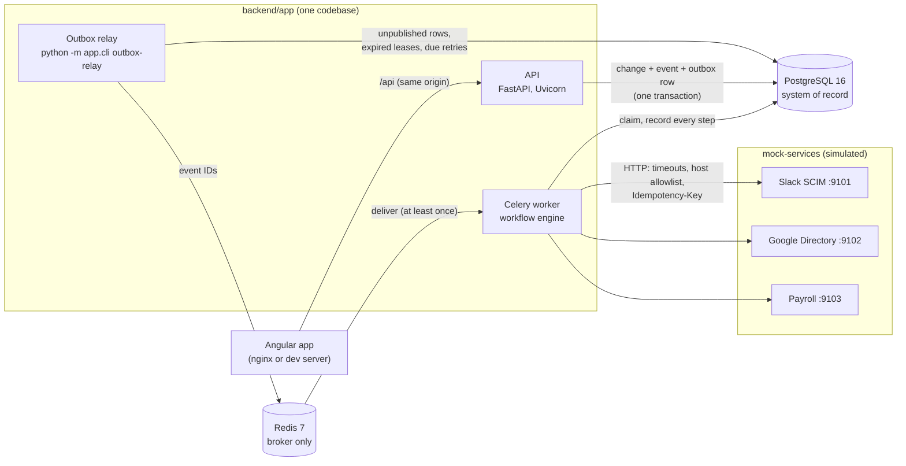
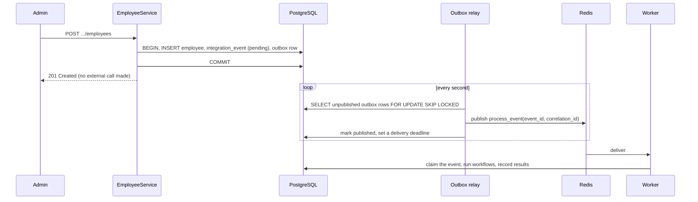
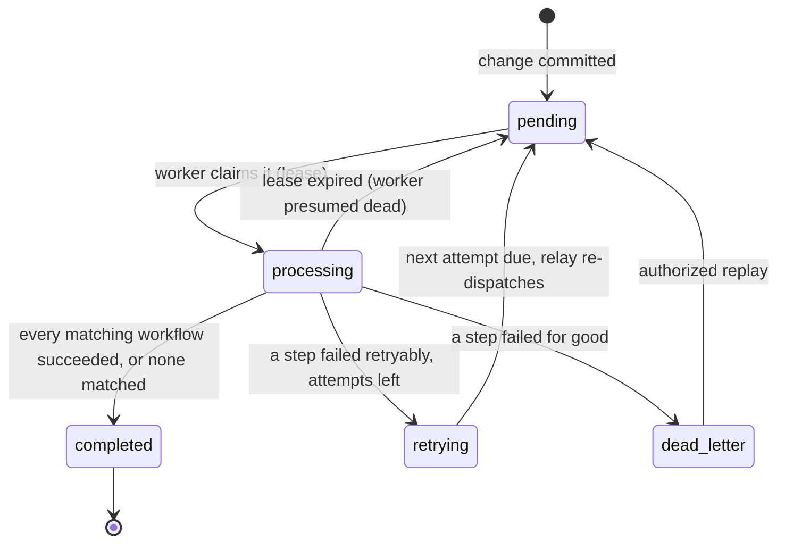
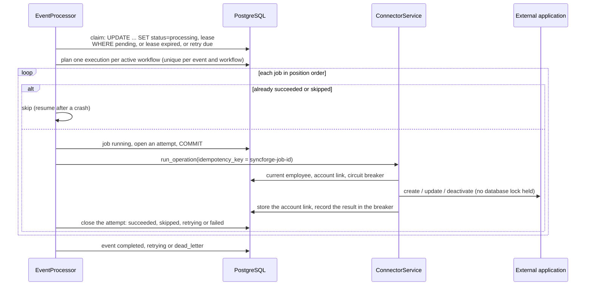

# Architecture

SyncForge is a **modular monolith**: one Python codebase that runs as three kinds of
process (the API, the outbox relay and the Celery workers), plus an Angular web
application. PostgreSQL is the system of record, and Redis only carries
"process event X" messages. Decision records: [ADR-0001](adr/0001-modular-monolith-with-fastapi.md),
[ADR-0011](adr/0011-asynchronous-event-processing.md),
[ADR-0012](adr/0012-transactional-outbox.md).

## 1. Components

The API never calls an external application during a user's request. It records what
happened and returns. A worker does the external work afterwards and records every step,
so a slow or broken vendor cannot fail an HR change, and a crash loses nothing.

## 2. Backend layers

| Layer | Folder | Responsibility |
|---|---|---|
| Routers | `app/api/v1`, `app/api/v2` | Parse and validate HTTP input, call a service, shape the response |
| Schemas | `app/schemas` | Pydantic request and response contracts; never ORM objects or secrets |
| Services | `app/services` | Business rules and transaction boundaries (`commit` / `rollback`) |
| Repositories | `app/repositories` | All database queries |
| Models | `app/models` | SQLAlchemy tables and database constraints |
| Security | `app/security` | Password hashing, JWT, roles and permissions, sign-in limits, credential encryption |
| Events | `app/events` | Lifecycle classification (pure functions), outbox writes, the relay |
| Workflows and workers | `app/workflows`, `app/workers` | The engine (`EventProcessor`) and thin Celery tasks that call it |
| Reliability | `app/reliability` | Retry policy, dead-lettering, circuit breaker, rate limiter, idempotency records |
| Connectors | `app/connectors` | One adapter per application behind a common interface, one hardened HTTP client, error normalization |
| Integrity and audit | `app/integrity`, `app/audit.py` | Field comparison and source-of-truth defaults; audit entries in the caller's transaction |
| Core | `app/core` | Settings, logging, middleware, errors, database engine |

Dependencies point one way: routers → services → repositories → models.

**Errors.** Every error has the same shape:
`{"error": {"code", "message", "details", "request_id"}}`. Validation errors list the
field and message but never echo submitted values. Unexpected exceptions return a generic
`500 internal_error`, and the traceback goes only to the logs (`app/core/errors.py`).

**Configuration.** Settings come from environment variables, falling back to `.env`
(`app/core/config.py`). With `APP_ENV=production`, the API refuses to start while the
JWT secret or database password is still a placeholder.

## 3. Employees and lifecycle events

An employee belongs to one organization and optionally to a department and a manager in
the same organization; composite foreign keys enforce the "same organization" part
([ADR-0006](adr/0006-composite-foreign-keys-for-tenant-integrity.md)). The employee number
and the email are each unique per organization. The status is `active`, `on_leave` or
`terminated`, and "archived" is a terminated employee with `archived_at` set.

Event detection is a pure function (`app/events/lifecycle.py`) that compares the employee
before and after a change:

| Change | Event |
|---|---|
| New employee | `employee.created` |
| Department | `employee.department_changed` |
| Manager | `employee.manager_changed` |
| Termination | `employee.terminated` (direct reports move to the next manager up, each with `manager_changed`) |
| Any other field | one `employee.updated` |

A request that changes nothing records nothing. Validation happens in three layers:
Pydantic for shape, the service for business rules (duplicates, references, reporting
cycles, read-only terminated employees), and PostgreSQL constraints as the backstop when
two requests race. Manager changes take a per-organization advisory lock, so two
simultaneous changes cannot form a reporting cycle
([ADR-0007](adr/0007-advisory-lock-for-reporting-line-changes.md)).

## 4. Event pipeline

**Transactional outbox.** The employee change, its events and their outbox rows commit in
one transaction. A committed change therefore always has its events, and a rolled-back
change never does. Publishing to Redis happens afterwards from the outbox, so neither a
crash nor a Redis outage between the commit and the publish can lose an event.
`test_employee_change_and_its_events_share_one_transaction` proves this by making the
outbox write fail and checking that the employee was not saved either.

**The relay** does three things on each poll:
1. **Publishes** new outbox rows. Several relays can run side by side because rows are
   locked with `SKIP LOCKED`.
2. **Recovers** events whose lease expired: a crashed worker's event goes back to
   `pending`, and a message lost by Redis is sent again.
3. **Dispatches retries** that are due. A retry is a timestamp in the database, not a
   sleeping worker.

**Workers** acknowledge a message only after the task finishes (`task_acks_late`), take
one message at a time, and carry only IDs, as JSON. Redis runs without persistence on
purpose, because reliability comes from PostgreSQL rather than from the broker.

### Event lifecycle

### Delivery guarantees

| Promise | How |
|---|---|
| A committed change always gets its events | Same transaction (outbox) |
| Every event eventually reaches a worker | The relay publishes until it succeeds and re-sends lost or abandoned events |
| An event delivered twice does not run twice | Atomic claim with a lease; one execution per (event, workflow), enforced by a unique constraint; finished steps are skipped |
| A worker crash does not lose or repeat finished work | Lease expiry, recovery to `pending`, resume at the first unfinished step |
| A repeated `create_user` does not create a second account | The account link, plus idempotency keys where the application honours them ([reliability](reliability.md#6-idempotency)) |

**Exactly-once delivery is not promised.** The design is at-least-once delivery with
idempotent processing. With several workers, two events for the same employee can run
concurrently. That is safe because every step reads the employee's **current** state
instead of replaying old event values, so a stale hire event cannot create accounts for
someone already terminated.

## 5. Workflow engine

A **workflow** is data, not code: a trigger (an employee event type) and up to 20 ordered
**steps**, each a connector operation (`create_user`, `update_user` or
`deactivate_user`). New workflows start inactive. They cannot be activated while a step
uses a disconnected connector, and they are deactivated rather than deleted, so their
history stays readable.

When an event is processed, each matching workflow gets one **execution**. The execution
copies the workflow's steps into **synchronization jobs**, so editing a workflow later
never rewrites history. Each external call made for a job is recorded as an **attempt**.

- **Sequential steps.** A failed step stops the rest of its execution, because real
  onboarding often depends on order (identity first). Parallel stages could be added
  later with a `stage` number on steps and one Celery task per job, without changing the
  data model.
- **Skipped is a decision, not an error.** Examples: no account exists to deactivate, or
  the employee was terminated before the create step ran.
- **One code path.** The engine and the manual `POST .../connectors/{id}/operations`
  endpoint both call `ConnectorService.run_operation`, so the business rules exist once.

| Failure | What happens |
|---|---|
| Retryable error (server, timeout, network, 429) | Job `retrying` with backoff; later steps wait ([reliability](reliability.md)) |
| Permanent error, or retries used up | Job `failed`, the rest `skipped`, event `dead_letter`, entry opened for replay |
| Application down | After 5 consecutive failures its circuit opens and calls are refused without a request |
| Worker crashes mid-event | Lease expires, the relay resets the event to `pending`, the next worker resumes; a repeated create is caught by the account link or the idempotency key |
| Database unavailable | Message not acknowledged; recovered by lease expiry once the database is back |

## 6. Logs and request IDs

Every log line is one JSON object with a `request_id`. Every response carries
`X-Request-ID`; a caller's ID is reused only if it is safe
(`^[A-Za-z0-9._-]{1,128}$`). The API stores the request ID on each event as its
`correlation_id`, and the worker logs under that ID. So one search shows the API request,
the event and every worker step of a hire. Logs contain IDs, never passwords, tokens,
names or emails. How to trace a failure: [deployment, section 4](deployment.md#4-investigating-a-failure).

## 7. Frontend

The Angular application is described in [frontend.md](frontend.md): its layers, routing,
session, state, API integration and tests.
