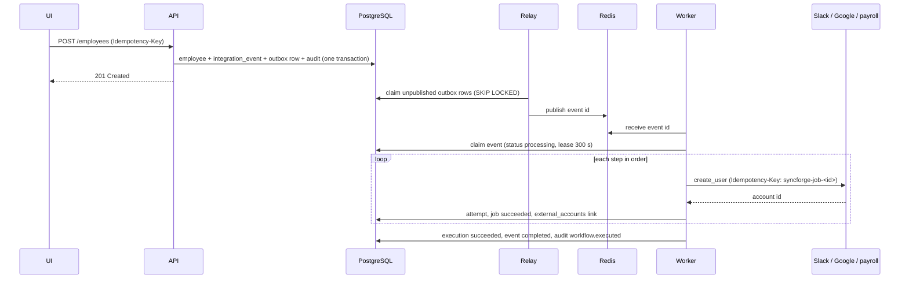
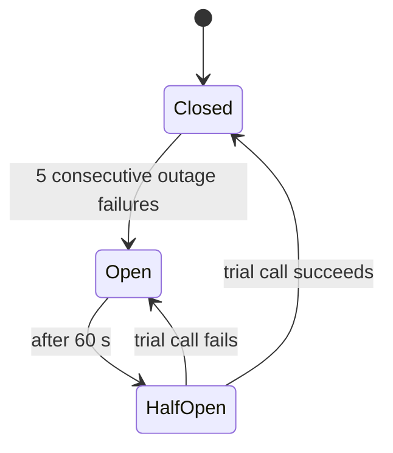

# Engineering case studies

Ten situations an enterprise integration platform meets, and exactly how SyncForge
handles each: the request, what happens inside, what is written to the database, what
external calls are made, how failures are recovered, and which tests prove it. Behaviour
described here is what the code does (`backend/app/...`); settings are the defaults in
`.env.example`. All external applications are the local simulated services.

Shared vocabulary:

- **Event:** a row in `integration_events` written with the employee change; delivered
  by the outbox relay through Redis to a worker (docs/architecture.md).
- **Execution / job:** one workflow run for an event (`workflow_executions`) and one step
  of it (`synchronization_jobs`); every external call is an attempt
  (`synchronization_attempts`).
- **Retry policy:** delay `min(300, 2 x 2^(n-1))` s with +-20 % jitter, at least
  `Retry-After`; 5 attempts (2, 4, 8, 16 s between them); then the dead-letter queue.

---

## 1. New employee onboarding across applications

**Business problem.** A new hire needs Slack, Google Workspace and payroll accounts on
day one, without IT creating them by hand.

**Initial state.** Three connected connectors; an active workflow "Onboarding" with
trigger `employee.created` and steps Slack `create_user` -> Google `create_user` ->
payroll `create_user`.

**Request.** `POST /api/v1/organizations/{org}/employees` with the hire's details and an
`Idempotency-Key` header (the UI sends one per dialog).

**Internal processing.**

**Database changes.** `employees` (+1), `integration_events` (`employee.created`,
pending -> processing -> completed), `outbox_events` (published), `workflow_executions`
(1), `synchronization_jobs` (3, succeeded), `synchronization_attempts` (3),
`external_accounts` (3 links), `idempotency_records` (the API key), `audit_logs`
(`employee.created` by the user, `workflow.executed` by the system).

**Connector operations.** Three `create_user` calls with an idempotency key per job.

**Failure scenarios.** Any step failing is covered in case studies 4, 5 and 9. A double
click on Save is answered from `idempotency_records` with the first employee
(`Idempotent-Replayed: true`).

**Final state.** Employee active; three linked accounts; event completed; dashboard
counts updated.

**Logs and audit.** API `request completed` and `employee lifecycle event` with the
request ID; worker `event processing started`, `synchronization job finished` x3,
`event delivery finished` (duration) - all carrying the request ID as correlation ID.

**Tests.** `test_onboarding_creates_accounts_in_every_application`,
`test_relay_to_worker_onboarding_and_duplicate_delivery`,
`test_employee_change_and_its_events_share_one_transaction`,
`test_an_identical_concurrent_request_gets_the_winners_response`; browser: "build and
activate an onboarding workflow, then a hire is provisioned".

**Trade-offs.** The hire is accepted in milliseconds but accounts appear a moment later
(eventual consistency) - in exchange, an application outage never blocks HR.

---

## 2. Employee department transfer

**Business problem.** Someone moves from Engineering to Finance; Slack and payroll must
show the new department.

**Initial state.** Employee with linked Slack and payroll accounts; an active workflow
with trigger `employee.department_changed` and steps Slack `update_user`, payroll
`update_user`.

**Request.** `PATCH /api/v1/organizations/{org}/employees/{id}` with
`{"department_id": "<finance>"}` and `If-Match: "<version>"`.

**Internal processing.** The service checks the version (412 if stale), validates the
department belongs to the organization, and the pure function in
`app/events/lifecycle.py` compares before and after: a department change yields
`employee.department_changed` (a designation change in the same request would add
`employee.updated`). Events, outbox rows and the audit entry commit with the change. The
worker runs the steps; `update_user` sends the employee's **current** profile.

**Database changes.** `employees.department_id`, `version` + 1, `updated_at`; one
event per lifecycle change; jobs and attempts as in case 1; `audit_logs`
`employee.updated` listing the changed field names (not values).

**Connector operations.** Slack SCIM `PATCH` replace; payroll `PUT` with the new
department. An employee with no account in an application is skipped (`not_linked`),
not failed.

**Failure scenarios.** A concurrent edit from another tab gets `412 version_conflict`
and must reload (case study 7 covers the data side). A failing application retries as in
case 4.

**Final state.** One version newer; both applications show Finance.

**Logs and audit.** `employee lifecycle event` with `event_type:
employee.department_changed` and field names only.

**Tests.** `test_lifecycle_events.py`, `test_optimistic_concurrency.py`,
`test_simultaneous_saves_from_the_same_version_let_exactly_one_win`; skip behaviour in
`test_workflow_engine.py`.

**Trade-offs.** Sending the current profile instead of a diff makes each update
self-correcting (it repairs earlier drift) at the cost of a slightly larger request.

---

## 3. Employee termination and access revocation

**Business problem.** When someone leaves, their access must be removed everywhere,
quickly and verifiably.

**Initial state.** Active employee with three linked accounts; an active workflow
"Offboarding": trigger `employee.terminated`, steps Slack `deactivate_user`, Google
`deactivate_user`, payroll `deactivate_user`.

**Request.** `POST /api/v1/organizations/{org}/employees/{id}/terminate` with the
termination date and `If-Match`; the UI asks for a typed confirmation.

**Internal processing.** Status becomes `terminated`; direct reports are reassigned to
the person's manager in the same transaction; `employee.terminated` is recorded. The
worker deactivates each account: Slack SCIM `DELETE` (deactivates), Google `PATCH
{"suspended": true}`, payroll deactivation.

**Database changes.** Employee status and termination date, reports' `manager_id`,
event and jobs, `audit_logs` `employee.terminated`.

**Connector operations.** Three deactivations.

**Failure scenarios.** If a deactivation keeps failing, the event ends in the
dead-letter queue and is visible on the dashboard - a failed revocation is never silent.
A subtle case: if the person was terminated **before** a queued onboarding event ran,
the worker reads current state and skips the `create_user` steps
(`employee_terminated`), so access is never created for a leaver. Reconciliation also
flags any account still active for a terminated person as a **critical** conflict.

**Final state.** Accounts suspended or deactivated, links kept for audit.

**Logs and audit.** `employee.terminated` (user), `workflow.executed` (system).

**Tests.** `test_offboarding_deactivates_the_accounts`,
`test_terminate_reassigns_direct_reports`,
`test_a_terminated_person_with_an_active_account_is_critical`; A live run where a
hire terminated before processing had its create steps skipped.

**Trade-offs.** Acting on current state instead of the event's snapshot can skip work
the event "asked for" - deliberately, because for access control the latest truth wins.

---

## 4. Slack API unavailable during onboarding

**Business problem.** Slack has an outage while three people are hired.

**Initial state.** As case 1; the Slack mock answers `503` (injected through its fault
API).

**Internal processing.** The Slack call fails with category `server` (retryable). The
job and event move to `retrying` with `next_attempt_at`; the relay re-dispatches due
retries. Retries follow the policy (2, 4, 8, 16 s with jitter). Each failure of an
outage category (`server`, `timeout`, `network`) counts towards the connector's circuit
breaker; after 5 consecutive failures the circuit **opens** for 60 s and further jobs
for Slack wait without calling it (category `circuit_open`, retryable, no attempt spent).
After 60 s one trial call (half-open) decides: success closes the circuit.

**Database changes.** `synchronization_attempts` per failed call (HTTP status, error,
duration, retryable, scheduled retry); `connector_circuits` state; audit
`connector.circuit_opened` / `connector.circuit_closed`, `sync.retry_scheduled`.

**Recovery.** When Slack returns within the retry budget, the waiting jobs succeed;
Google and payroll steps that already succeeded are not repeated. If the outage outlasts
the budget, the event goes to the dead-letter queue (case 10).

**Final state.** All accounts created once; circuit closed.

**Tests.** `test_a_transient_failure_is_retried_after_a_backoff_and_then_succeeds`,
`test_consecutive_outage_failures_open_the_circuit`,
`test_an_open_circuit_stops_calls_from_every_job`, `test_a_failed_trial_opens_the_circuit_again`.
Live run: Google down during three hires - breaker opened after 5 requests,
one trial after 60 s closed it, three accounts in total.

**Trade-offs.** A bounded retry budget means a long outage needs a person to replay -
chosen over retrying forever, which hides problems and piles up load.

---

## 5. Google API returns HTTP 429

**Business problem.** Google rate-limits SyncForge during a bulk hiring day.

**Internal processing.** The adapter normalizes 429 to `rate_limited` and reads
`Retry-After`. The retry delay is the backoff **or** `Retry-After`, whichever is longer
(capped at 300 s). Independently, each connector can have its own
`rate_limit_per_minute`; jobs over that limit wait for the next minute **without
spending an attempt**, so SyncForge stays under the application's limit in the first
place. Both the limit counters and the breaker state are in PostgreSQL, so every worker
respects them together.

**Database changes.** Attempts with HTTP 429 and the scheduled retry; job and event
`retrying`; the per-minute counter row.

**Recovery and final state.** Requests resume after the wait; all accounts created.

**Tests.** `test_rate_limit_carries_retry_after`,
`test_rate_limit_waits_at_least_retry_after`, `test_retry_after_is_respected_but_capped`,
`test_jobs_over_the_limit_wait_without_using_an_attempt`. Live run: Slack limited
to 2 calls per minute, the third hire waited for the next minute and made one attempt.

**Trade-offs.** A fixed one-minute window is simple and shared, but allows up to twice
the limit across a boundary; a sliding window would be smoother and costlier.

---

## 6. Duplicate event delivery

**Business problem.** At-least-once delivery means the same event can reach two workers
(a relay retry after a broker hiccup, a re-dispatch after a lease expired).

**Internal processing.** A worker must **claim** the event atomically
(`UPDATE ... WHERE status in (pending, due retrying) or lease expired`); the second
delivery finds it claimed or completed and logs `event not claimable, skipped`. Within an
event, there is one execution per (event, workflow) (unique constraint), and succeeded
jobs are skipped on resume. Towards the external application, each create carries
`Idempotency-Key: syncforge-job-<job id>`; an API that honours it returns the account
created by the earlier attempt. On `POST /employees`, the client's `Idempotency-Key`
returns the first response for a repeat.

**Database changes.** None for the duplicate.

**Final state.** Exactly one account per application.

**Tests.** `test_duplicate_delivery_is_skipped_and_creates_nothing_twice`,
`test_an_event_owned_by_a_live_worker_is_not_claimed_twice`,
`test_relay_to_worker_onboarding_and_duplicate_delivery`,
`test_a_timed_out_create_is_retried_safely`.

**Trade-offs.** Exactly-once delivery is not achievable across a broker and external
APIs; SyncForge makes processing idempotent instead. Real Slack and Google APIs do not
document an idempotency header, so a crash between their create and SyncForge storing the
link would surface as a `conflict` and a dead letter - visible, not a duplicate
(docs/reliability.md).

---

## 7. Conflicting employee department information

**Business problem.** SyncForge says Engineering, payroll says Finance. Which is right?

**Initial state.** Policy: `department` is owned by SyncForge (HR), mode manual,
severity medium. Someone changed the department directly in payroll.

**Request.** `POST /api/v1/organizations/{org}/connectors/{payroll}/reconcile`.

**Internal processing.** Reconciliation reads each linked account from payroll, compares
seven fields with normalization (case and spaces ignored where meaningless), and for each
difference **records a conflict** instead of overwriting anything. A repeated detection
refreshes the same open conflict. Resolution (`POST .../conflicts/{id}/resolve`):

| Decision | Effect | Rule |
|---|---|---|
| Keep SyncForge's value | Pushes Engineering to payroll | Follows the policy: allowed |
| Use payroll's value | Writes Finance into the employee record | Against the policy: needs `override: true` and a note; needs `employees:write` |
| Dismiss | Closes it | Needs a note |

If the employee changed since detection, resolution is refused with `409 conflict_stale`
(reconcile again). In auto mode the authoritative value is applied at detection.

**Database changes.** `data_conflicts` (open -> resolved), `conflict_resolutions`
(decision, actor, note), audit `conflict.detected`, `conflict.resolved`.

**Tests.** `test_a_difference_is_recorded_not_overwritten`,
`test_deciding_against_the_policy_needs_override_and_a_note`,
`test_hr_wins_pushes_syncforges_value_to_the_application`,
`test_auto_mode_applies_the_authoritative_value_at_once`; browser governance test.

**Trade-offs.** No universal source of truth: policies are per field and configurable
(an identity provider can own account status). Manual mode needs attention but never
loses data silently.

---

## 8. Worker crashes while processing an event

**Business problem.** A worker process is killed mid-event (deployment, out of memory).

**Internal processing.** The claim gave the worker a lease (`locked_until`, 300 s). The
crashed worker never finishes, so the event stays `processing` past its lease. The relay
looks for such events and re-dispatches them; a new worker can claim an event whose
lease has expired. It resumes: succeeded jobs are skipped, the interrupted job is retried
with the same idempotency key.

**Database changes.** The event's lease renewed by the new worker; attempts for the
retried job.

**Final state.** Completed, with no duplicate accounts. Meanwhile
`GET /api/v1/system/status` shows the stuck event (`events_stuck_processing`) and, if no
worker is running, "No worker has reported in the last 60 seconds".

**Tests.** `test_a_crashed_worker_is_resumed_without_repeating_finished_work`,
`test_relay_recovery_hands_a_crashed_workers_event_to_the_next_worker`,
`test_system_status_reports_stale_components_and_stuck_events`. Live run: worker
killed (`kill -9`) during a slow Google call, completed by the restarted worker on
attempt 2 without a duplicate. That run found and fixed a bug (recovery renewed the lease,
so the next worker skipped the event).

**Trade-offs.** A long lease delays recovery after a crash; a short one risks a second
worker claiming a slow but alive worker's event. 300 s covers the operation deadline of
one job with margin.

---

## 9. External connector credentials expire

**Business problem.** The payroll API key is rotated on the payroll side; SyncForge
still has the old one.

**Internal processing.** The call returns 401, normalized to `authentication`, which is
**not retryable** - retrying the same wrong key cannot help. The job fails, the event
goes straight to the dead-letter queue with reason `non_retryable` and the error copied.
Authentication failures do not count towards the circuit breaker (they are not an
outage). For Google, an expired OAuth access token is different: the adapter fetches a
new token and retries the call once, transparently.

**Recovery.** An integration manager replaces the credentials
(`PATCH .../connectors/{id}` with new `credentials`; audited as `connector.updated` with
"credentials" in the changed fields, never the values), tests the connection, and replays
the dead-letter entry.

**Database changes.** Connector credentials re-encrypted; connector status `pending`
until tested; dead-letter entry `replayed`.

**Tests.** `test_wrong_credentials_are_an_authentication_error`,
`test_permanent_failures_are_dead_lettered_at_once`,
`test_google_gets_a_new_token_when_the_old_one_expires`; browser: a wrong Slack token
fails the connection test.

**Trade-offs.** Failing fast on authentication spends no retries and alerts a person
immediately, at the cost of needing a manual replay.

---

## 10. A failed synchronization must be replayed

**Business problem.** After a long payroll outage, an onboarding event is in the
dead-letter queue; payroll is back.

**Initial state.** Event `dead_letter`; entry with reason `retries_exhausted`,
5 attempts, the last error; Slack and Google steps succeeded, payroll failed.

**Request.** `POST /api/v1/organizations/{org}/dead-letter-events/{id}/replay`
(permission `events:replay`; the UI asks for confirmation).

**Internal processing.** Only the failed and skipped steps of the failed executions are
reset; succeeded steps stay. The event gets a fresh retry budget and goes back to
`pending` through the outbox. A second replay of the same entry is refused
(`409 already_replayed`); replay is also refused while the failed workflow is inactive.
If it fails again, a new dead-letter entry is created.

**Database changes.** Entry `replayed` with `replayed_at` and `replayed_by_user_id`;
jobs reset; new outbox row; audit `dead_letter.replayed`.

**Connector operations.** Only payroll `create_user`; Slack and Google are not called
again.

**Final state.** Event completed; three accounts.

**Tests.** `test_replay_reruns_only_what_failed_and_completes`,
`test_a_replayed_event_gets_a_fresh_retry_budget_and_a_new_entry_if_it_fails_again`,
`test_an_entry_can_be_replayed_only_once`, `test_simultaneous_replays_of_one_entry_replay_it_once`;
browser: "a failing step is dead-lettered, then replayed to completion". Live run:
attempt 6 succeeded after replay, Slack and Google untouched; the same demonstration was repeated on Windows.

**Trade-offs.** Replays are explicit and audited rather than automatic, so a person
confirms the cause is fixed; bulk replay after a long outage is a future improvement.
