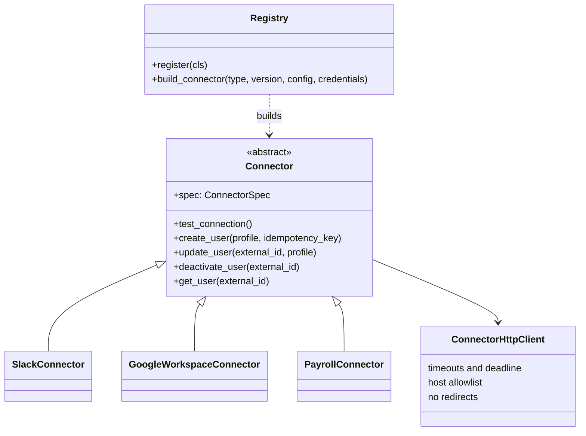

# Connectors

A **connector** is one organization's configured connection to one external application.
Every application exposes the same five operations and the same error vocabulary, so the
rest of SyncForge never needs to know which application it is talking to
([ADR-0008](adr/0008-connector-adapter-pattern.md)).

## 1. Real or simulated

| Connector | Follows the API shape of | Verified against | Status |
|---|---|---|---|
| Slack (`slack` 1.0.0) | Slack SCIM v2 users | Local mock only | **Simulated** |
| Google Workspace (`google_workspace` 1.0.0) | Admin SDK Directory API `users` | Local mock only | **Simulated** |
| Payroll (`payroll` 1.0.0) | A generic REST payroll API (no industry standard exists) | Local mock only | **Simulated** |

Every connector type reports `"simulated": true`, and the web application labels it.
None has been tested against a real tenant. Using the real services would need:
- **Slack:** a SCIM-enabled plan, a SCIM token, and `api.slack.com` added to
  `CONNECTOR_ALLOWED_HOSTS`.
- **Google:** a Workspace tenant and a service account with domain-wide delegation. The
  token exchange would switch from the mock's client-credentials grant to Google's
  JWT-bearer grant (section 4).

## 2. Design

**Adapters only translate requests.** The business rules live once, in
`services/connectors.py`: permissions, tenant checks, "no account for terminated
employees", and account links. Both the workflow engine and the manual operations
endpoint go through that service.

| Operation | Slack | Google | Payroll |
|---|---|---|---|
| `test_connection` | `GET /scim/v2/ServiceProviderConfig` | token + `GET /users?maxResults=1` | `GET /v1/ping` |
| `create_user` | `POST /scim/v2/Users` | `POST /admin/directory/v1/users` | `POST /v1/employees` |
| `update_user` | `PATCH` (SCIM replace) | `PATCH /users/{id}` | `PATCH /v1/employees/{id}` |
| `deactivate_user` | `DELETE` (Slack deactivates) | `PATCH {"suspended": true}` | `PATCH {"status": "inactive"}` |
| `get_user` | `GET /scim/v2/Users/{id}` | `GET /users/{id}` | `GET /v1/employees/{id}` |

The ID each application assigns is stored in `external_accounts`, keyed by connector and
employee. Updates and deactivations use that ID, because email is not a stable key.

**The HTTP client.** Every adapter uses one client, which enforces:
- connect and read timeouts, plus a deadline for the whole operation;
- a host allowlist (`CONNECTOR_ALLOWED_HOSTS`), checked when a connector is saved and on
  every call, so an admin cannot point a connector at an internal address such as
  `169.254.169.254`;
- no redirects, no environment proxies, and no credentials in URLs;
- no logging of request or response bodies.

The allowlist matches host names, not resolved IP addresses. In production, egress should
also be restricted at the network level.

## 3. Errors

Every failure becomes a `ConnectorError` with a category: `authentication`,
`authorization`, `validation`, `not_found`, `conflict`, `rate_limited`, `timeout`,
`network`, `server`, `in_progress`, `circuit_open`, `permanent` or `configuration`.
`Retry-After` is parsed (seconds or HTTP date, capped at an hour). The message comes from
the vendor's own error format, truncated, and the tests assert that credentials never
appear in it. Which categories are retried: [reliability](reliability.md#1-failure-classification).

Through the API, a failed manual operation returns `502 connector_error`, with the
normalized error in `details`. A 429 from Slack is reported as `502` with
`category: rate_limited`, not as SyncForge's own 429.

## 4. Authentication and OAuth

| Connector | `auth_type` | Credentials |
|---|---|---|
| Slack | `bearer_token` | `token` |
| Google Workspace | `oauth2_client_credentials` | `client_id`, `client_secret` |
| Payroll | `api_key` | `api_key` |

Google demonstrates the OAuth 2.0 token lifecycle:
1. Get a token from `/oauth2/token`.
2. Cache it per process. The cache key includes a hash of the secret, so a rotated secret
   never reuses an old token.
3. Refresh it 60 s before expiry.
4. On a 401, request a fresh token and retry the call **once**. A second rejection means
   the credentials are wrong (`authentication`).

The real Directory API uses the JWT-bearer grant instead of client credentials. Only
`_fetch_token` would change. The browser authorization-code flow ("Connect with Google")
is not implemented.

## 5. Credential security

- Credentials are encrypted with **Fernet** (AES-128-CBC with HMAC-SHA256) before they
  reach the database ([ADR-0009](adr/0009-encrypting-connector-credentials.md)). They are
  stored in their own table and decrypted only when an adapter is built for a call.
- They are **never returned**: responses show only `auth_type` and the last four
  characters. They are **never logged** (`test_logs_never_contain_credentials` checks
  every log record) and **never echoed** in validation errors.
- **Rotation:** a `PATCH` with new credentials replaces the ciphertext.
  **Revocation:** `POST .../disconnect` deletes it.
- `CONNECTOR_ENCRYPTION_KEY` takes several comma-separated keys. The first encrypts and
  all of them decrypt, so the key can be rotated without downtime. Production refuses to
  start without one.

## 6. Lifecycle and versioning

A connector's status (`pending`, `connected`, `error`, `disconnected`) reflects its last
connection test. A successful test also closes an open circuit breaker. Operations are
allowed in every state except `disconnected`.

Each adapter has a semantic version, and a connector stores the version it was configured
with. If the **major** version differs from the installed adapter (an incompatible
settings schema), the connector is refused with `connector_version_unsupported`.

## 7. Adding a connector

1. Create `backend/app/connectors/<name>.py` with a config model (non-secret settings)
   and a credentials model (`SecretStr`).
2. Subclass `Connector` and set `spec`: type, version, auth type, simulated flag, models.
3. Implement the five operations using `self.http.request(...)`. Never create your own
   HTTP client.
4. Decorate the class with `@register`, import it in `app/connectors/__init__.py`, and
   add its default base URL to the settings and to `.env.example`.
5. Add a mock to `mock-services/` and add the type to the parametrized adapter tests.

The service, API, encryption, errors, permissions, tenant isolation, retries, circuit
breaker and rate limiting need no changes.

## 8. Mock services

The three local services ([mock-services/README.md](../mock-services/README.md)) behave
like the real APIs and accept injected faults: a status code (for example 503), a 429
with `Retry-After`, or a delay. A delay still executes the request, like a slow server
whose answer arrives after the client gave up. They honour `Idempotency-Key`. The adapter
tests run them as real HTTP servers, so every failure category is produced over real
sockets.

Tests: `test_connector_core.py`, `test_connector_adapters.py`, `test_connectors_api.py`,
`test_encryption.py`, `test_connector_models.py`.
