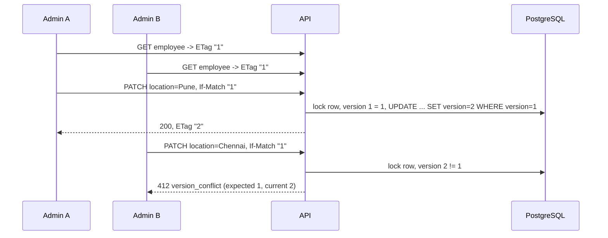
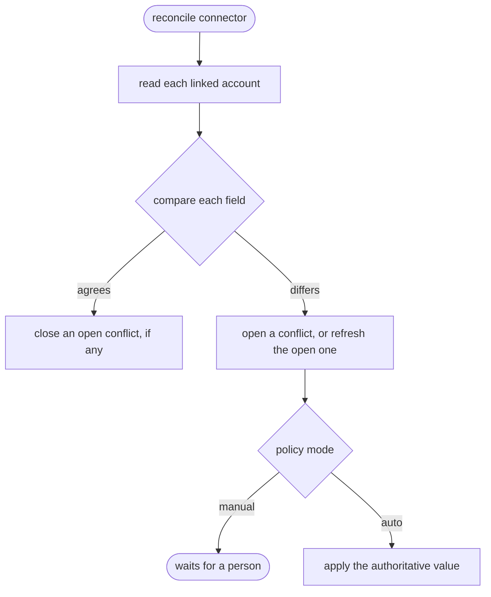

# Data integrity

| Problem | Example | Mechanism |
|---|---|---|
| Nobody can tell who changed what | "Why does Ada have no Slack account?" | Append-only **audit log** |
| Two people overwrite each other | The second admin's save silently undoes the first | **Optimistic concurrency** (ETag / If-Match) |
| Systems disagree | HR says Engineering; someone set Finance in payroll | **Source-of-truth policies**, reconciliation and resolution |

## 1. Audit log

`audit_logs` has one row per important action: who did it (a user or the system), the
action, the resource, the outcome, details, the time, and the request ID that links the
entry to the logs. `GET {org}/audit-logs` reads it, newest first, filtered by action
(exact or a prefix such as `employee.`), resource, actor, outcome or time range. Only
Organization Admins and Integration Managers can read it, because it shows other people's
actions and permission changes.

| Area | Actions |
|---|---|
| People | `employee.created`, `.updated`, `.terminated`, `.archived`; `department.*` |
| Organization and permissions | `organization.created`, `.renamed`; `member.added`, `member.role_changed`, `member.removed` |
| Integrations | `connector.created`, `.updated` (credentials appear only as "rotated"), `.tested`, `.disconnected`, `.operation_run`, `.reconciled`; `workflow.created`, `.updated`, `.activated`, `.deactivated` |
| Synchronization (system) | `workflow.executed`, `sync.retry_scheduled`, `event.dead_lettered`, `connector.circuit_opened`, `.circuit_closed` |
| Recovery and integrity | `dead_letter.replayed`, `conflict.detected`, `.resolved`, `.dismissed`, `data_source_policy.updated` |

- **Written with the change.** `app/audit.py` adds the entry to the same transaction as
  the change it describes. A rolled-back change leaves no entry, and an audited change
  never commits without one.
- **The actor** is taken from the session. Workers, the relay and CLI commands record the
  system. Worker entries carry the event's correlation ID, so the API request that hired
  someone, the event and the `workflow.executed` entry share one ID.
- **Never recorded:** passwords, tokens, credentials, connector configuration values or
  request payloads. Employee changes list field **names**. Old and new **values** appear
  only for non-personal fields (department, designation, manager, location, status,
  dates).
- **Append-only, twice.** The application has no update or delete path. A database
  trigger also refuses `UPDATE` and `DELETE`, even from `psql`, with two exceptions:
  - deleting a user clears `actor_user_id`, and the history stays;
  - a future retention job may delete after `SET LOCAL syncforge.allow_audit_delete = 'on'`.

Sign-ins are recorded separately in `security_events` ([security](security.md)).
Decision record: [ADR-0017](adr/0017-append-only-audit-log.md).

## 2. Optimistic concurrency

Two admins open Ada's record at version 1. A changes the location and saves. B, still on
the old screen, changes the designation and saves the whole form, old location included.
Without protection, B silently undoes A's change. Row locks don't help, because the saves
are seconds apart.

- `employees.version` increases on every update (SQLAlchemy `version_id_col`) and is
  returned as `ETag`. `PATCH`, terminate and archive accept `If-Match`. On a mismatch,
  nothing changes: no event and no audit entry.
- The row is locked before the comparison, so two saves from the same version serialize,
  and exactly one wins
  (`test_simultaneous_saves_from_the_same_version_let_exactly_one_win`, with two real
  sessions).
- Indirect changes count. Terminating a manager moves the direct reports and bumps their
  versions, so a stale edit of a report gets 412 instead of undoing the move.
- Clients that send no `If-Match` keep last-write-wins. The web application always sends
  it and offers "Load latest".

Decision record: [ADR-0018](adr/0018-optimistic-concurrency-with-etags.md).

## 3. Source of truth, per field

Each connected application keeps its own copy of some employee facts, and the copies
drift. **There is no universal source of truth.** Which side is right depends on the field
and the organization, so it is configured per field
(`PUT {org}/data-source-policies/{field}`, Organization Admin only):

| Setting | Values |
|---|---|
| `source` | `syncforge` (the employee record, fed by HR) or `connector` with a `connector_id` |
| `severity` | `low`, `medium`, `high`, `critical` |
| `resolution_mode` | `manual` (record it; a person decides) or `auto` (apply the authoritative value at once) |

Seven fields are compared: first name, last name, email, department, designation,
location and account status. They default to SyncForge as the authority. A terminated
person with an active account is always `critical`. A typical change: "Google is
authoritative for account status." Decision record:
[ADR-0019](adr/0019-field-level-source-of-truth-and-reconciliation.md).

## 4. Conflict detection

`POST {org}/connectors/{id}/reconcile` reads every account linked to that connector from
the application (up to 500 per run, through the circuit breaker) and compares it with the
employee record:

- **Detection never overwrites anything.** It records both values, the authoritative side
  and the severity.
- Fields an application does not store are not compared (Slack has no location). Text
  compares case-insensitively.
- There is one open conflict per employee, connector and field (partial unique index).
  Repeated detections refresh it.
- An account that cannot be read is reported and the run continues. An open circuit stops
  the run.

## 5. Conflict resolution

`POST {org}/conflicts/{id}/resolve`:

| Resolution | Effect |
|---|---|
| `use_syncforge` | Push SyncForge's value to the application (`update_user`, or `deactivate_user` for an account that should not be active) |
| `use_external` | Adopt the application's value through the **normal employee update**: versioned, audited, and emitting lifecycle events, so the other applications follow. Also needs `employees:write`. |
| `dismiss` | Accept the difference (for example, a shared mailbox). A note is required. |

| Guard | Response |
|---|---|
| Choosing the side the policy does not name | `422 resolution_against_policy`, unless `override: true` and a note are sent |
| The employee changed since detection | `409 conflict_stale`; reconcile again |
| Adopting a department SyncForge does not have | `422 department_not_found` (departments are never invented) |
| Already resolved | `409 conflict_not_open` |
| The application refuses the push | `502` with the normalized error; the conflict stays open |

Every decision is kept in `conflict_resolutions`, with who made it, the value, whether it
went against the policy, and the note.

## 6. Guarantees and limits

- **Guaranteed:**
  - An audited change commits with its entry.
  - A save with `If-Match` never overwrites a newer version.
  - A disagreement is recorded, never silently overwritten.
  - A decision is never applied to values that changed after it was shown.
- **Eventually consistent:** applications are compared when reconciliation runs, not
  continuously. Scheduling it (nightly per connector, for example) is the operator's
  choice.
- **Limits:**
  - 500 accounts per run, and seven fields.
  - Reactivating accounts and creating departments from an application's value are
    deliberately not automatic.

The reliability demo includes a full conflict scenario and a refused stale edit
([reliability, section 7](reliability.md#7-seeing-it-work)). Tests: `test_audit.py`,
`test_optimistic_concurrency.py`, `test_conflicts.py`, `test_concurrency.py`.
