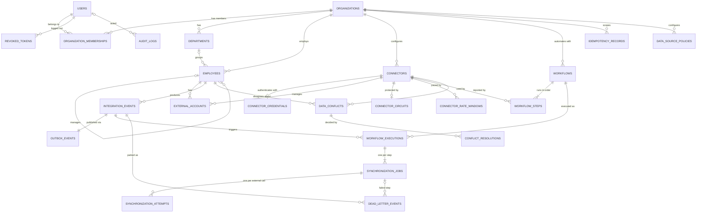

# Database

PostgreSQL 16 has 27 tables, created by 16 Alembic migrations in
`backend/migrations/versions/`. The models live in `backend/app/models/`, which is the
place to read exact column definitions. Why PostgreSQL:
[ADR-0002](adr/0002-postgresql-as-system-of-record.md).

## 1. Entity relationships



Three tables stand outside these relationships on purpose. `security_events` (sign-in
history) and `auth_rate_windows` (sign-in limits) exist before any organization is
chosen. `component_heartbeats` records worker and relay liveness.

## 2. Tables

| Area | Table | Purpose and key rules |
|---|---|---|
| Identity | `organizations` | Tenants; unique slug |
| | `users` | People who sign in (not the synchronized employees); email stored lower-case and unique; Argon2id hash only |
| | `organization_memberships` | One role per user per organization: `org_admin`, `integration_manager`, `viewer`. Super Admin is a user flag, not a membership. |
| | `revoked_tokens` | Logout denylist by JWT ID, kept until the token's expiry |
| | `auth_rate_windows` | Fixed-window sign-in counters; subjects (IP, email) stored only as SHA-256 hashes |
| | `security_events` | Append-only sign-in history (trigger refuses updates and deletes) |
| Workforce | `departments` | Unique name per organization, ignoring case (expression index on `lower(name)`) |
| | `employees` | Employee number and email unique per organization; status `active`, `on_leave` or `terminated`; `archived_at` for soft delete; `version` for optimistic concurrency |
| Connectors | `connectors` | Configured application, non-secret `config`, status, adapter version |
| | `connector_credentials` | Fernet-encrypted secret and a 4-character fingerprint, in a separate table so lists never load ciphertext |
| | `external_accounts` | Employee ↔ account in an application, keyed by the application's own ID; one per connector and employee |
| | `connector_circuits`, `connector_rate_windows` | Circuit-breaker state and calls per minute, shared by all workers |
| Workflows and events | `workflows`, `workflow_steps` | Trigger and ordered steps (1-20); a connector used by a step cannot be deleted |
| | `integration_events` | Durable events with status, lease (`locked_until`), next retry time and correlation ID |
| | `outbox_events` | Unpublished events (identity PK gives publication order) |
| | `workflow_executions` | One per (event, workflow), enforced by a unique constraint: the core of safe redelivery |
| | `synchronization_jobs`, `synchronization_attempts` | One job per step (copied from the workflow), one attempt row per external call |
| Reliability | `dead_letter_events` | Failed-for-good steps with the error copied as evidence; at most one open entry per event (partial unique index) |
| | `idempotency_records` | Stored first response per `Idempotency-Key`, user and organization; expires after 24 h |
| Integrity and audit | `data_source_policies` | Which side is authoritative per field, resolution mode, severity |
| | `data_conflicts`, `conflict_resolutions` | One open conflict per employee, connector and field; decision history |
| | `audit_logs` | Append-only (trigger); no foreign key to the organization, so history outlives it |
| Monitoring | `component_heartbeats` | Last-seen time per worker and relay instance |

## 3. Design rules

**Tenant integrity in the schema.** Every row that refers to another tenant-owned row
includes `organization_id` in its foreign key
([ADR-0006](adr/0006-composite-foreign-keys-for-tenant-integrity.md)):

```sql
FOREIGN KEY (organization_id, department_id) REFERENCES departments (organization_id, id)
FOREIGN KEY (organization_id, manager_id)    REFERENCES employees   (organization_id, id)
```

A row pointing at another organization's department, manager, connector or event has no
matching target, so PostgreSQL rejects it. A bug in application code cannot create a
cross-tenant reference.

**Conventions:**
- Primary keys are application-generated UUIDs (identity columns for the outbox and the
  logs).
- Timestamps are `timestamptz`.
- Enumerations are `VARCHAR` plus `CHECK`, so adding a value is a constraint change
  rather than an `ALTER TYPE`.
- Constraints have stable names (`pk_`, `uq_`, `ck_`, `fk_`, `ix_`), which the services
  map to API error codes.

**Indexes lead with `organization_id`**, because every query is scoped to one
organization. Some notable ones:
- `(organization_id, last_name, first_name, id)` serves the employee list order and the
  v2 cursor pages without a sort (migration 0016, from [performance](performance.md)).
- Partial indexes keep the relay's queries small: unpublished outbox rows, unfinished
  events by lease, and retrying events by due time.
- Substring search (`ILIKE '%x%'`) scans the organization's rows. A `pg_trgm` index is
  the upgrade path if it is ever needed.

## 4. Transactions and concurrency

- **Services own commits.** Each use case commits all of its changes or none.
- **The outbox commits with the change.** An employee change, its events and their
  outbox rows commit in one transaction ([ADR-0012](adr/0012-transactional-outbox.md)).
  Audit entries and idempotency records join the same transaction.
- **Constraints settle races.** For two simultaneous requests with the same email, the
  unique constraint lets one commit, and the service turns the other into
  `409 email_taken`.
- **Row locks** (`FOR UPDATE`) serialize changes to one employee and the last-admin
  check.
- **An advisory lock per organization** serializes manager changes, so two requests
  cannot each create half of a reporting cycle
  ([ADR-0007](adr/0007-advisory-lock-for-reporting-line-changes.md)).
- **Optimistic concurrency:** an employee update compares the client's `If-Match` version
  and writes `WHERE version = <read>` ([data integrity](data-integrity.md)).
- **No locks across external calls.** Workers commit "running" before calling an
  application and the result afterwards, so a slow vendor blocks nothing and a crash
  leaves a precise record.
- **`SKIP LOCKED`** lets several relays and workers share the outbox and the retry queue
  without blocking or double-publishing.

## 5. Migrations

- Every schema change is a reviewed Alembic migration, numbered `0001`-`0016`, each with
  a working `downgrade()`. The application never creates tables at start-up.
- `test_models_and_migrations_are_in_sync` runs `alembic check`, so a model change
  without a migration fails CI. `test_downgrade_to_base_and_upgrade_to_head` exercises
  every downgrade.
- Tests run against a separate `syncforge_test` database, rebuilt from the migrations on
  each run. Each test runs inside a transaction that is rolled back.

Commands (from `backend/`): `alembic upgrade head`, `alembic downgrade -1`,
`alembic current`, `alembic check`.

## 6. Retention

- Employees are archived (soft-deleted), not removed. Hard deletion happens only when the
  whole organization is deleted.
- `python -m app.cli purge-expired` deletes expired revoked tokens and idempotency
  records. The operator schedules it.
- Event, execution, attempt, dead-letter, conflict and audit history is kept. A retention
  job is a known gap. For the audit log it would use the trigger's explicit delete switch
  (`syncforge.allow_audit_delete`).
