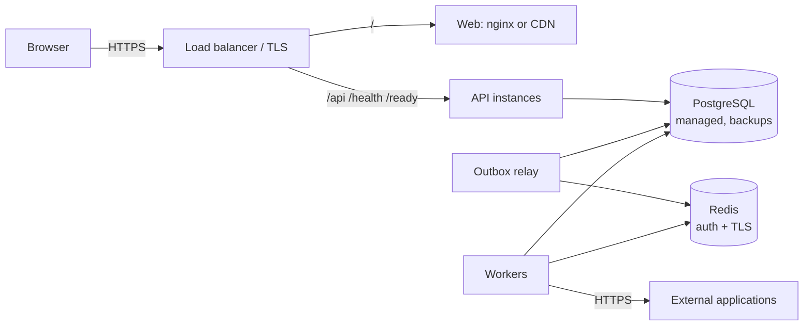

# Deployment and operations

This page covers what runs, how to configure it for production, how to tell whether it is
healthy, and how to fix common problems. Running it locally is covered in the
[README](../README.md#run-it).

## 1. Components

All backend processes run from **one image** (`backend/Dockerfile`) with different
commands.

| Component | Command | Instances | Needs |
|---|---|---|---|
| Migration job | `alembic upgrade head` | Once per release, before anything else | PostgreSQL |
| API | default (Uvicorn on port 8000) | 2+ behind a load balancer | PostgreSQL only: it writes to the outbox and never talks to Redis |
| Worker | `celery -A app.workers.celery_app worker --concurrency=N` | 1+, scaled to the event rate | PostgreSQL, Redis, outbound HTTPS |
| Outbox relay | `python -m app.cli outbox-relay` | 1 (a second is safe thanks to `SKIP LOCKED`) | PostgreSQL, Redis |
| Web | `frontend/Dockerfile`: nginx serves the Angular build and forwards `/api`, `/docs`, `/health` and `/ready` | 1+ or a CDN | The API |
| Maintenance | `python -m app.cli purge-expired` | Daily, from a scheduler | PostgreSQL |

The API, worker and relay are stateless. All state is in PostgreSQL, and losing Redis
loses no work.

**Local Docker Compose** (`docker compose --profile full up -d --build`) starts these
services in order:
1. PostgreSQL and Redis become healthy.
2. The migration job runs.
3. The API, worker and relay start.
4. The web server starts on http://localhost:8080 once the API is healthy.

The three simulated applications start too. The API has no published port; everything
goes through nginx. This setup is for development and demonstration, not production.

## 2. Production setup

Only the load balancer is public. PostgreSQL and Redis accept connections only from the
application network.

| Variable | Production value |
|---|---|
| `APP_ENV` | `production`. The API then refuses to start with a placeholder secret or without an encryption key. |
| `JWT_SECRET_KEY` | 64+ random characters: `python -c "import secrets; print(secrets.token_urlsafe(64))"` |
| `CONNECTOR_ENCRYPTION_KEY` | A Fernet key. During rotation, a comma-separated `new,old` pair, where the first key encrypts and all decrypt. |
| `POSTGRES_*` or `DATABASE_URL` | The managed database, with `sslmode=require` |
| `REDIS_URL` | `rediss://:<password>@<host>:6380/0` |
| `CORS_ORIGINS` | `[]` when the web app is served from the same origin |
| `CONNECTOR_ALLOWED_HOSTS` | Only the hosts of the connected applications |
| `FORWARDED_ALLOW_IPS` | The proxy's address range, so sign-in limits see real client addresses. Never `*` if anything other than the proxy can reach the API. |

Keep secrets in a secrets manager and inject them as environment variables. The images
contain no secrets, and `.dockerignore` excludes `.env`. Rotating the JWT secret signs
everyone out (sessions last at most 30 minutes). Losing the connector key makes stored
credentials unreadable, so back it up like the database.

**Database:**
- Run migrations as the schema owner, and grant the application role read and write
  access only.
- Each process has a connection pool of 5 plus up to 10 overflow, so watch
  `max_connections`, or use PgBouncer.
- Enable automated backups with point-in-time recovery, and test a restore.

**Releases:**
1. Build images tagged with the commit SHA.
2. Run the migration job. Migrations must be backward compatible (expand now, contract
   later).
3. Roll out the API, workers and relay. Old and new workers can run side by side, because
   leases keep each event with one worker.
4. Roll out the web build.
5. Roll back by redeploying the previous images.

## 3. Health and monitoring

| Signal | Endpoint | Use |
|---|---|---|
| API liveness | `GET /health` | Process is up; never touches dependencies |
| API readiness | `GET /ready` | Database reachable; take the instance out of rotation on `503` |
| Background processing | `GET /api/v1/system/status` (Super Admin) | Worker and relay heartbeats, outbox backlog, stuck events, open dead letters; `healthy: false` with the problem |
| One organization | `GET {org}/summary` | Counts and processing-time percentiles (p50, p95, max) over 24 h, shown on the dashboard |

Workers and the relay write a heartbeat every 15 s. A process unseen for 60 s is reported
unhealthy. `/ready` deliberately ignores workers: a worker outage must not take the API
offline, because changes are stored in the outbox and processed when the workers return.

Every process logs one JSON object per line to stdout. Index `request_id`,
`correlation_id`, `event_id`, `logger` and `level`. Suggested alerts:
- `/ready` failing;
- `system/status` unhealthy for more than 2 minutes;
- open dead letters rising;
- the oldest unpublished outbox row older than a few minutes;
- the 5xx rate;
- repeated `rate limited` warnings.

There is no metrics exporter yet. The JSON endpoints and the log lines are the signals.

## 4. Investigating a failure

1. **Is anything running?** Check `GET /api/v1/system/status` for a stale worker or
   relay, a backlog, or stuck events.
2. **Which event?** Use the dashboard, `GET {org}/events?event_status=retrying` (still
   trying), or `GET {org}/dead-letter-events?entry_status=open` (gave up).
3. **Which step, and why?** `GET {org}/events/{id}` shows each job's error category and
   next attempt time. `.../attempts` lists every external call, with HTTP status,
   duration and whether it was retryable.
4. **The logs:** search for the event's `correlation_id`. That ID is the request ID of
   the API call that caused the event, so one search shows the request and every worker
   line.
5. **Fix and replay:** correct the cause (credentials, permissions, the outage), then
   replay the dead-letter entry.

For a failed API request, search the logs for the `X-Request-ID` from the response.

## 5. Common problems

| Symptom | Cause | Fix |
|---|---|---|
| Events stay `pending` after a hire | The relay or worker is not running, or Redis is down | Start them; nothing is lost, and waiting events are processed in order |
| `system/status`: "No worker has reported in the last 60 seconds" | The worker is stopped or cannot reach PostgreSQL | Start it and check its log |
| An event stays `processing` after a worker was killed | Expected until its lease expires (300 s by default) | Wait; the relay re-dispatches it and the next worker resumes |
| An event stays `retrying` | A retryable failure waits for its next attempt | Check `.../attempts`; the relay must be running |
| Steps fail with `circuit_open` | That connector's breaker is open | Wait 60 s for the trial call, or run a connection test once the application is back |
| A job shows `throttled` with 0 attempts | The connector's `rate_limit_per_minute` was reached | Expected; it runs next minute |
| A step failed with `configuration` | The connector is disconnected or outdated | Reconnect it (`PATCH` with credentials), then replay |
| `503 encryption_not_configured` | `CONNECTOR_ENCRYPTION_KEY` is missing | Generate one (README) and restart the API |
| `412 version_conflict` | Someone changed the employee after you loaded it | Reload and re-apply |
| `429` at sign-in | 10 failed attempts for that email in 15 minutes, or 60 attempts per minute from one IP | Wait for the time shown; the limits are configurable |
| Everyone shares one sign-in limit behind a proxy | The API sees the proxy's address | Set `FORWARDED_ALLOW_IPS` to the proxy |
| Every connector call takes ~2 s on Windows | `localhost` is tried over IPv6 first | Use `127.0.0.1` in base URLs (the default) |
| Worker fails to start on Windows | Celery's prefork pool is not supported there | Add `--pool=solo` |
| A worker traceback shows another project's folder | A bare `celery` found another project's install on `PATH` | Start it with the project's interpreter: `python -m celery ...` from the venv |

## 6. Scaling

- Add API instances behind the load balancer.
- Add workers for throughput. Two workers measured 1.7× the throughput of one on 2 CPUs
  ([performance](performance.md)).
- Keep one relay.
- Scale PostgreSQL vertically first, and watch the connection count.
