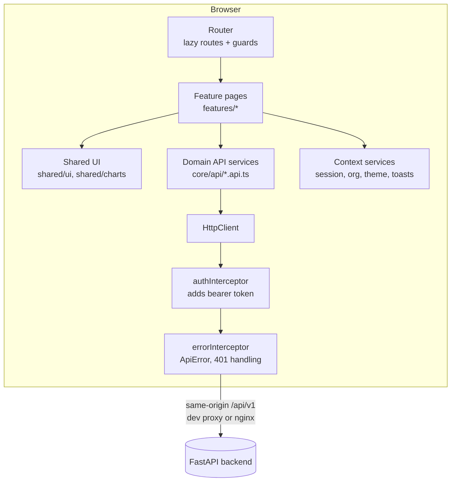
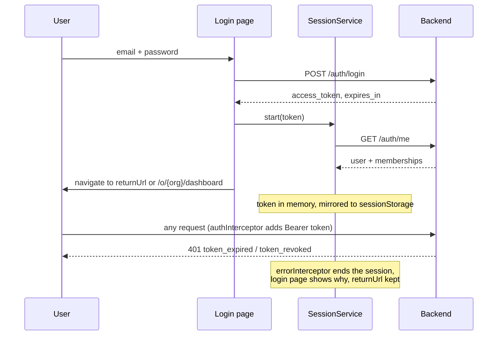

# Frontend

How the web application in `frontend/` is built: its architecture, components, how it
calls the API, and how it is tested. Commands for running it are in
[`frontend/README.md`](../frontend/README.md). The decision record is
[ADR-0020](adr/0020-angular-frontend-signals-and-server-state.md).

## 1. Principles

1. **The backend is the authority.** The UI never decides a business outcome the API
   decides, such as permissions, conflict policy, workflow validity or retries. It shows
   what the API returns and explains what the API refuses.
2. **Only real data.** Every figure, chart and list comes from an endpoint. Where the API
   has no data, the screen goes without it instead of inventing it.
3. **Nothing visible that fails.** A user who lacks a permission does not see the action.
   If the API still refuses (for example, a role changed in another tab, or a record is
   stale), the refusal is shown with its reason and request ID.
4. **Small components.** Pages load data, and shared components only present it.

## 2. Technology

| Concern | Choice | Version |
|---|---|---|
| Framework | Angular, standalone components, zoneless change detection | 22.2 |
| Language | TypeScript, `strict` and strict templates | as pinned by Angular |
| Reactivity | Signals, `httpResource`, `rxResource`, `linkedSignal`; RxJS for writes and parallel reads | - |
| Forms | Typed Reactive Forms | - |
| Overlays | Angular CDK (dialog, overlay, a11y) | 22.x |
| Charts | Apache ECharts 6 via `ngx-echarts`, loaded lazily | 6.x |
| Icons and fonts | Lucide SVG data in an own `<sf-icon>`; Inter and JetBrains Mono, self-hosted | - |
| API types | Generated from the backend's OpenAPI document by `openapi-typescript` | 7.13.0 |
| Tests | Vitest through `ng test`; Playwright with axe-core | 5.x; 1.65.0 / 4.14.0 |

The application uses no state-management library and no UI component library. Its state
is server state, which `httpResource` caches per screen, plus a handful of signals. The
design system is about 20 small components built on CSS tokens. Versions are locked by
`package-lock.json`.

## 3. Layers



| Folder | Responsibility |
|---|---|
| `core/api` | Generated `schema.d.ts`, readable aliases (`models.ts`), one service per API area, `ApiError`, URL helpers |
| `core/auth` | `SessionService`, guards, interceptors, the permission matrix |
| `core/org` | Current organization and role; employee-name cache |
| `core/theme`, `core/toast`, `core/util` | Theme switching, notifications, formatting |
| `layout` | Shell: sidebar, top bar, organization switcher, user menu, navigation model |
| `shared` | Presentational components, chart wrapper, URL query state, auto-refresh, form helpers |
| `features/*` | One folder per area; each page is a lazily loaded route |

Rule: **no component injects `HttpClient`.** Pages call the domain API services, and
only those services know URLs and headers.

The API is always reached at the same origin under `/api/v1`. In development the Angular
dev server proxies `/api`, `/health`, `/ready`, `/docs`, `/redoc` and `/openapi.json` to
port 8000 (`proxy.conf.json`). In Docker, nginx serves the build and forwards the same
paths to the API (`frontend/nginx.conf`). Because the browser only talks to one origin,
there are no CORS preflights, and it can read the `ETag` and `X-Request-ID` headers. The
frontend has no secrets and no environment files.

## 4. Routing

Every application route is under `/o/:orgId/...`, so the organization is part of every
link. Links can be shared, a reload keeps the context, and switching organization is a
navigation.

```
/                         -> last organization used, or /organizations/new
/login, /register         guestGuard
/organizations/new        authGuard
/unavailable              authGuard (organization not found or not a member)
/o/:orgId                 authGuard + organizationGuard -> ShellComponent
  dashboard, settings     org:read
  employees, employees/:id, reporting      employees:read
  departments             departments:read
  connectors, connectors/:id               connectors:read
  events, events/:id      events:read
  workflows, workflows/:id                 workflows:read
  workflows/new, workflows/:id/edit        workflows:manage
  reliability, dead-letters, dead-letters/:id   events:read
  conflicts, conflicts/:id, policies       conflicts:read
  audit                   audit:read
  team                    members:read
  forbidden               shown when a permission check fails
**                        not-found page
```

- **`authGuard`:** a session must exist. Otherwise the user goes to
  `/login?returnUrl=...`, and only same-origin return URLs are accepted.
- **`organizationGuard`:** calls `GET /organizations/{id}`. A 404 (not a member, or no
  such organization) leads to `/unavailable`. Membership is never assumed from the URL.
- **`permissionGuard`:** checks `data.permission` on the route against the user's role in
  that organization.
- Every route has a `title`, every page is loaded lazily, and route parameters bind to
  component inputs.

## 5. Authentication and session



- The API returns a bearer token in the response body. It lasts 30 minutes, and there is
  no refresh token and no cookie. The token is held in a signal and mirrored to
  `sessionStorage`, so a reload keeps the user signed in. `sessionStorage` is per tab and
  cleared when the tab closes.
- **This is not protection against XSS.** Any script running in the page could read the
  token, wherever JavaScript keeps it. The protections that matter are:
  - Angular's template escaping, and no `innerHTML` with untrusted data;
  - no third-party scripts;
  - the short token lifetime;
  - server-side revocation on logout.

  An HttpOnly cookie session is a future improvement ([security](security.md#8-not-implemented)).
- On start-up, an expired stored token is dropped and a valid one is checked with
  `GET /auth/me`. The shell warns before the token expires. Sign-out calls
  `POST /auth/logout` and clears the session even if that call fails.
- Passwords need at least 8 characters, and the API also refuses common passwords. The
  password field has a show/hide toggle with an accessible pressed state, a Caps Lock
  notice, and a strength hint at registration.

## 6. Authorization in the UI

`core/auth/permissions.ts` mirrors the backend's `ROLE_PERMISSIONS` for the three
organization roles, and Super Admins hold every permission. The matrix hides navigation
entries (`layout/nav.ts`), blocks routes, and hides actions. It only decides **what is
shown**. The API enforces every permission, and its 403 responses are displayed, never
ignored. `permissions.spec.ts` checks the matrix role by role.

## 7. State management

| Kind of state | Where it lives |
|---|---|
| Server data for a screen | `httpResource`: loading, error and value signals. A changed request cancels the old one, so a slow old response never overwrites a new filter. |
| Data from several calls | `rxResource` over `forkJoin` (dashboard, reliability overview) |
| Filters, sort, pagination | The URL query string (`useQueryState()`). It can be shared, survives a reload, and works with Back. |
| Session, organization, role, theme, toasts | Root services exposing signals |
| Forms | Reactive Forms; `linkedSignal` where a value resets when its source changes |
| Writes | Observables from the API services, followed by a resource `reload()` |

The API has no push channel, so background work (events, retries, dead letters) is
followed by **polling**. An event page reloads until the event settles. Lists have an
optional 5-second auto-refresh that runs only while the tab is visible.

## 8. API integration

### Generated types

```
backend /openapi.json -> frontend/openapi/openapi.json -> npm run api:types -> core/api/schema.d.ts
                                                                     core/api/models.ts (aliases, Page<T>)
```

`npm run api:check` regenerates the types into a temporary file and fails if they differ
from the committed ones. CI runs it, so the frontend cannot drift from the API contract.
To change the API safely:

1. Change the backend and its tests.
2. Save the new `/openapi.json` to `frontend/openapi/`.
3. Run `api:types` and fix the compile errors it reveals.
4. Run the unit and browser tests.

### Services and coverage

| Service (file) | Endpoints |
|---|---|
| `AuthApi` (`auth.api.ts`) | login, register, me, logout, activity |
| `OrganizationsApi` (`organizations.api.ts`) | organizations list, create, get, rename, summary; members list, add, change role, remove |
| `EmployeesApi`, `DepartmentsApi` (`workforce.api.ts`) | employees list, get, create (`Idempotency-Key`), update, terminate, archive (`If-Match`); departments CRUD |
| `ConnectorsApi`, `WorkflowsApi` (`integrations.api.ts`) | connector types, connectors CRUD, test, disconnect, reconcile, operations, accounts; workflows CRUD, activate, deactivate, executions |
| `EventsApi`, `DeadLettersApi`, `ConflictsApi`, `AuditApi` (`operations.api.ts`) | events, attempts, dead letters, replay, conflicts, resolve, data-source policies, audit logs |

The application calls 53 of the 58 operations. It does not call these five:
- the infrastructure probes `/health` and `/ready`;
- the Super Admin endpoints `GET /security-events` and `GET /system/status`;
- the `/api/v2` demonstration endpoint.

### Conventions

- **Paging:** `limit` and `offset`, returning `{items, total, limit, offset}`. The API
  caps `limit` at 100, and the offset is kept in the URL.
- **Totals:** the dashboard takes its counts and processing times from one call,
  `GET .../summary`. Daily history comes from audit-log totals in one-day windows
  (`workflow.executed` by outcome, `sync.retry_scheduled`).
- **Concurrent edits:** edit, terminate and archive send `If-Match: "<version>"`. A
  **412** offers "Load latest", and edits send only the changed fields.
- **Idempotent create:** the add-employee dialog creates one `crypto.randomUUID()` when it
  opens and sends it with every submit. A double click therefore cannot create two
  employees.
- **Errors:** every failure becomes one `ApiError` (`status`, `code`, `message`,
  `details`, `requestId`). Errors are always re-thrown, never swallowed.

| Situation | What the user sees |
|---|---|
| API not running (status 0, or a proxy 502/503/504 without the API's error format) | "The SyncForge API could not be reached" |
| 401 | Session ends; the login page explains why; the page is restored after sign-in |
| 403 / 404 | Permission or not-found state with the request ID |
| 409 | The API's message, plus specific help, such as the list of disconnected connectors when activation is refused |
| 412 | "Someone else changed this employee" with "Load latest" |
| 422 | Messages placed on the matching form fields (`applyServerErrors`) |
| 502 from a connector | The normalized category (for example `rate_limited`, `timeout`) and message, never credentials |

## 9. Components

All components are standalone, use `OnPush`, and use the `sf-` prefix.

**Shared UI** (presentational, never calls the API):
- page header, metric card, badge and status badge;
- empty, error and skeleton states;
- pagination, tabs, dialog frame and confirmation dialog (with typed confirmation for
  destructive actions);
- password field, employee picker, employee name, ID with copy, relative time, JSON
  viewer, icon, toast outlet;
- bar chart, which includes a visually hidden data table for screen readers.

Helpers: `DialogService`, `useQueryState()`, `useAutoRefresh()`, `applyServerErrors()`,
`safeReturnUrl()`.

**Pages** (one lazy route each):

| Area | Pages |
|---|---|
| Access | Login, register, create organization, unavailable, forbidden, not found |
| Overview | Dashboard (summary figures, connector health, 7-day workflow and retry history, events by status, employees by department, recent activity) |
| Workforce | Employee list (filters in the URL), employee form dialog, terminate dialog, employee detail with activity tabs, departments, reporting tree |
| Integrations | Connector catalog ("Simulated" marked), schema-generated connector form (write-only credentials, only a fingerprint shown), connector detail with test, operations, accounts, reconcile, disconnect; workflow list, builder (ordered steps, up to 20), detail with executions; event list and event detail with every attempt |
| Reliability | Overview (retrying events, open dead letters, circuits, rate limits), dead-letter list and detail with replay |
| Governance | Conflict list and side-by-side resolution (going against the policy needs an override and a note), source-of-truth policies, audit log, team and roles, settings (theme, memberships, recent sign-ins, Developer API card linking `/docs`) |

### Features the API does not offer, so the UI does not show them

These were left out on purpose and are not hidden behind dead buttons:
- notifications;
- invitations for unregistered people;
- an event date-range filter;
- per-employee linked accounts (accounts are listed per connector);
- global search (the top bar searches employees);
- profile editing and password change;
- deleting connectors or workflows (disconnect or deactivate instead);
- a drag-and-drop workflow canvas (workflows are ordered step lists).

## 10. Design system and accessibility

- **Tokens** (`src/styles/_tokens.scss`): colour, spacing, radius, type and shadow as CSS
  custom properties for the dark (default) and light themes. Settings also offers
  "follow the system".
- **Contrast:** text and buttons meet WCAG AA in both themes, checked by axe in the
  browser suite.
- **Layout:** above 900 px the sidebar collapses to an icons-only rail (the choice is
  remembered). Below 900 px the sidebar becomes a drawer. Pages fit a 390 px phone.
- **Accessibility:** named landmarks, a skip link, a visible focus ring, focus trapped
  in dialogs, labelled controls, a live region for toasts, charts paired with hidden data
  tables, and reduced motion respected.

## 11. Performance

- Every page is a lazy route chunk. ECharts is a separate chunk, loaded only when a chart
  renders.
- The production build's initial JavaScript and CSS is 351.5 kB raw, about 96 kB
  transferred.
- Change detection is `OnPush` and zoneless.
- Employee names in event, dead-letter and conflict lists are fetched once per employee
  and cached.
- Switching the dashboard to `GET .../summary` cut a dashboard load from 48 to
  33 API requests, measured.

## 12. Testing

| Layer | Tool | Count | Command |
|---|---|---|---|
| Unit and component | Vitest via `ng test` (HTTP mocked with `HttpTestingController`) | 60 tests, 17 files | `npm run test:ci` |
| Lint, including template accessibility rules | ESLint + angular-eslint | - | `npx ng lint` |
| Formatting | Prettier | - | `npm run format:check` |
| API contract | `api:check` | - | `npm run api:check` |
| Browser, end to end | Playwright against the real stack | 13 tests, 6 files | `npm run e2e` |
| Accessibility | axe-core in Playwright, WCAG 2 A/AA, serious and critical issues | 14 pages x 2 themes | part of `e2e` |

The unit tests cover:
- error parsing, interceptors and guards;
- session restore and expiry;
- the permission matrix;
- dashboard mapping, the reporting tree, and schema-to-form mapping;
- the password field;
- the employee form (changed fields only, `If-Match`, 412);
- the connector form, the workflow builder, and the conflict override rules.

**Browser suite.** The browser tests use no API mocks. They run against PostgreSQL,
Redis, the API, a worker, the relay and the three simulated applications.
`e2e/support/stack.ts` registers a fresh user and organization for every test, so the
tests never depend on each other. `payrollFault()` switches the payroll mock to HTTP 503
for the reliability test and always switches it back.

The 13 tests cover:
- registration and the password rules;
- a refused sign-in;
- deep link and logout revocation;
- organization isolation;
- the employee lifecycle with a concurrent edit (412);
- URL filters;
- connecting Slack and testing it;
- building a workflow, with a hire provisioned in three steps;
- a dead-lettered step replayed to completion;
- a payroll conflict resolved;
- read-only screens for a viewer;
- accessibility in both themes;
- phone-width layouts.

CI runs the suite against the Docker stack on every push ([testing](testing.md#continuous-integration)).

**Found by these tests and fixed:**
- colour contrast below AA in both themes, fixed with token changes and a solid danger
  colour for white text;
- horizontal scrolling on phones, from 11 tables outside the scrolling container and a
  hidden chart table with a width;
- the "Main navigation" label sitting on the wrong landmark.

**Gaps:**
- Only Chromium is tested.
- axe finds the machine-detectable share of accessibility issues. No full manual
  keyboard-only or screen-reader (NVDA or VoiceOver) pass has been recorded.
