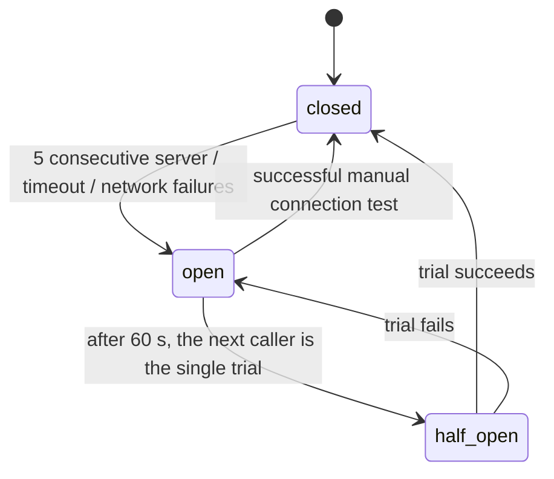

# Reliability

External applications fail all the time. Slack has an incident, Google answers 429 during
a burst, a payroll API is slow for a minute. SyncForge turns that into a delay, never into
lost or duplicated work, and it avoids making the outage worse.

| Concern | Mechanism | Code |
|---|---|---|
| Never hang | Connect, read and per-operation timeouts | `app/connectors/http.py` |
| Know what failed | Failure classification | `app/connectors/errors.py` |
| Recover from blips | Retries with exponential backoff, jitter and `Retry-After` | `app/reliability/retry.py` |
| Don't hammer a broken application | Circuit breaker per connector | `app/reliability/circuit_breaker.py` |
| Stay under API limits | Rate limit per connector | `app/reliability/rate_limit.py` |
| Give up safely, recover deliberately | Dead-letter queue and authorized replay | `app/reliability/dead_letter.py`, `app/services/dead_letters.py` |
| Never do it twice | Idempotency at every layer | section 6 |

Every external call is recorded as one row in `synchronization_attempts`, opened before
the call and closed after it. `GET .../events/{id}/attempts` shows the complete history.
An attempt left open by a crashed worker is closed as `interrupted` by the next worker.

## 1. Failure classification

Each adapter turns its application's errors into one `ConnectorError` with a category,
and the category decides what happens next:

| Category | Typical cause | Retried | Counts towards opening the circuit |
|---|---|---|---|
| `server` | 5xx | yes | yes |
| `timeout` | connect, read or operation timeout; 408 | yes | yes |
| `network` | refused, DNS failure, reset | yes | yes |
| `rate_limited` | 429 (`Retry-After` honoured) | yes | no: the application answered |
| `in_progress` | an earlier attempt with the same idempotency key is still running | yes | no |
| `circuit_open` | our breaker refused the call (no request sent) | yes, after the open period | - |
| `authentication`, `authorization` | 401, 403 | no | no |
| `validation`, `not_found`, `conflict`, `permanent` | 400/422, 404, 409, other 4xx | no | no |
| `configuration` | our side: disconnected connector, host not allowed, unreadable credentials | no | no |

Retrying a wrong password or an invalid payload fails the same way every time. It wastes
the retry budget, delays the dead-letter entry a person needs to see, and repeated 401s
can lock an account at the vendor. So only failures that might succeed later are retried.

## 2. Retries: exponential backoff with jitter

```
backoff(n) = min(MAX_DELAY, BASE_DELAY * 2^(n-1))
delay(n)   = min(MAX_DELAY, max(backoff(n) * uniform(1 - jitter, 1 + jitter), Retry-After))
```

| After attempt | Base delay | With ±20 % jitter |
|---|---|---|
| 1 | 2 s | 1.6-2.4 s |
| 2 | 4 s | 3.2-4.8 s |
| 3 | 8 s | 6.4-9.6 s |
| 4 | 16 s | 12.8-19.2 s |
| 5 | - | no more attempts: dead-letter |

These are the defaults: base 2 s, jitter 0.2, a cap of 300 s, and 5 attempts including
the first.
- **Exponential**, so a blip is retried quickly while a long outage is not hit every two
  seconds.
- **Jitter**, so fifty jobs that failed in the same second do not all retry in the same
  second and knock the recovering service over again.
- **`Retry-After` wins when it is longer.** A server that says "wait 60 s" is never
  called earlier.
- **Capped and bounded**, so there are no unbounded retries anywhere.

Decision record: [ADR-0013](adr/0013-retries-with-exponential-backoff-and-jitter.md).

**A retry is data, not a sleeping worker.** The failed job is marked `retrying` with a
`next_attempt_at`, and the worker moves on. The outbox relay re-dispatches the event when
it is due. A restart loses nothing, and no worker sits waiting. Later steps of the same
workflow wait, because steps are sequential.

> **Race found by the live demo and fixed:** the relay publishes a due retry while it
> still holds the event row. A fast worker's claim (`WHERE status = 'pending'`) then saw
> the old `retrying` row and skipped the event. The fix lets the claim also accept
> `retrying` events whose time has come, so the claim waits for the relay's lock instead.
> `test_a_worker_claims_a_due_retry_even_while_the_relay_holds_the_row` reproduces the
> race with two real sessions.

## 3. Dead-letter queue and replay

When a job fails for good (a non-retryable error, or the attempts are used up), the
execution fails, later steps are skipped, and the event becomes `dead_letter`. In the
same transaction, a `dead_letter_events` entry is opened. The entry **copies** the error
(connector, operation, category, HTTP status, message, attempts, and a reason:
`retries_exhausted` or `non_retryable`), because a replay resets the job and would
otherwise erase the evidence.

**Replay** (`POST .../dead-letter-events/{id}/replay`, Integration Manager or higher)
sends the event back through the normal pipeline:
1. It locks the entry, then the event. Two people pressing Replay at once replay it once;
   the second gets `409 already_replayed`.
2. Only failed jobs, and the jobs skipped because of them, go back to `pending`.
   Succeeded steps stay succeeded, so a replay never creates a second Slack account.
3. The retry budget is fresh, but the history is kept: attempt numbers continue (#6, #7,
   ...).
4. The event is requeued through the outbox in the same transaction that closes the
   entry. The response is `202 Accepted`. If the replay fails again, a new entry opens.

Decision record: [ADR-0014](adr/0014-dead-letter-queue-and-replay.md).

## 4. Circuit breaker

Retries protect one job. They do nothing for the application: fifty onboarding jobs
retrying five times each would send 250 calls to a Slack that is down. The breaker stops
that.



- **Any real answer resets the count.** That includes 400, 401, 404, 409 and 429, because
  they prove the application is reachable.
- **While open, calls are refused without a request** (`circuit_open`). A refusal counts
  as an attempt, so a long outage ends in the dead-letter queue, where one replay restarts
  the work, instead of jobs waiting forever.
- **The state lives in PostgreSQL** (`connector_circuits`), so the first worker to notice
  an outage protects all the others. The row is locked only while it is read or written,
  never during a call.

Decision record: [ADR-0016](adr/0016-shared-circuit-breaker-and-rate-limits.md).

## 5. Rate limits and timeouts

**Rate limit per connector.** A connector's config may set `rate_limit_per_minute`. All
workers share one counter per connector per minute, incremented atomically. A job over
the limit is deferred to the next minute **without using an attempt**, because waiting
for our own limit is not a failure. A fixed window can let up to twice the limit through
across a minute boundary. That is accepted for pacing provisioning calls, because it is
much simpler than a token bucket.

**Timeouts.** Connect 3 s and read 10 s per request, plus a **30 s deadline per
operation**. An operation can make several requests (Google: token, then API call), and
each request's timeouts are cut to the time left. Past the deadline, the operation fails
as a retryable `timeout` without sending another request.

## 6. Idempotency

Delivery is at-least-once: a message can arrive twice, a worker can die halfway, a call
can time out after the other side acted. So SyncForge makes repeating safe.

| Repetition | Protection |
|---|---|
| The same event delivered twice | Atomic claim: only a `pending`, due `retrying` or abandoned `processing` event can be claimed |
| Two workers plan the same event | One execution per (event, workflow), unique constraint |
| A resumed execution | Succeeded and skipped jobs never run again |
| Worker dies after the account link was stored | `create_user` finds the link and marks the job succeeded |
| Worker dies, or the call times out, before the link was stored | **Outgoing idempotency key** (below) |
| A client resends `POST /employees` | **Incoming `Idempotency-Key`** (below) |
| `update_user`, `deactivate_user` repeated | Naturally idempotent: they set state rather than add |

**Outgoing.** `create_user` is sent with `Idempotency-Key: syncforge-job-<job id>`. The
key is the same on every attempt and every replay of that step. An API that honours it
returns the stored response for a repeat (`Idempotent-Replayed: true`) and answers
`409 idempotency_key_in_use` while the first request is still running, which is retried.
The three mock services implement this. **The real Slack SCIM and Google Directory APIs
do not document such a header.** Against them, the one remaining crash window (account
created, link not yet stored) produces a visible `conflict` and a dead-letter entry, not
a silent duplicate. "Find before create" would close that window, and it is not
implemented.

**Incoming.** `POST .../employees` with `Idempotency-Key` stores the response **in the
same transaction as the employee**:
- A repeat with the same body within 24 h returns the stored `201`: no second employee,
  no second onboarding.
- A different body with the same key gets `422 idempotency_key_reused`.
- Failed requests are not stored, so a corrected request may reuse the key.
- Keys are scoped to (organization, user).
- Two identical requests at the same moment: one wins at the unique constraint, and the
  other returns the winner's response.

Decision record: [ADR-0015](adr/0015-idempotency-keys.md).

## 7. Seeing it work

With the full stack running, `infrastructure/scripts/demo_reliability.py` injects
failures into the mock services and prints what the API reports, in about three minutes.
Abridged output from one run:

```
1. Transient outage: payroll answers 503 twice
     payroll attempts: #1 failed (server 503), #2 failed (server 503), #3 succeeded
2. Idempotency: POST /employees twice with the same key
     same employee: True; second replayed: true; events recorded: 1
3. Retries exhausted -> dead-letter queue -> replay
     dead-letter entry: retries_exhausted, create_user server 503, 5 attempts
     replay: 202; replay again: 409 already_replayed; attempt #6 succeeded
4. Circuit breaker: Google is down while three people are hired
     5 Google requests before the circuit opened, none while open;
     after 60 s one trial succeeded, circuit closed, 3 accounts in total
5. Rate limit: Slack limited to 2 calls per minute, three hires
     the third hire waited for the next minute without using an attempt
```

It also covers a data conflict, a refused stale edit and the audit trail
([data integrity](data-integrity.md)). The timings are wall-clock times of a
demonstration, not performance measurements.

## 8. Configuration

| Variable | Default | Meaning |
|---|---|---|
| `RETRY_MAX_ATTEMPTS` | 5 | Attempts per job per round, the first included |
| `RETRY_BASE_DELAY_SECONDS` / `RETRY_MAX_DELAY_SECONDS` | 2 / 300 | First delay; cap for any delay, `Retry-After` included |
| `RETRY_JITTER_RATIO` | 0.2 | Proportional jitter |
| `CIRCUIT_FAILURE_THRESHOLD` / `CIRCUIT_OPEN_SECONDS` | 5 / 60 | Failures that open a breaker; open period |
| `CONNECTOR_CONNECT_TIMEOUT_SECONDS` / `..._READ_...` / `..._OPERATION_...` | 3 / 10 / 30 | Timeouts |
| `IDEMPOTENCY_TTL_HOURS` | 24 | How long incoming idempotency keys are remembered |
| connector config `rate_limit_per_minute` | unset | Optional pacing per connector |

Tests: `test_retries.py`, `test_dead_letters.py`, `test_circuit_breaker.py`,
`test_idempotency.py`, `test_concurrency.py`, `test_workflow_engine.py`.
