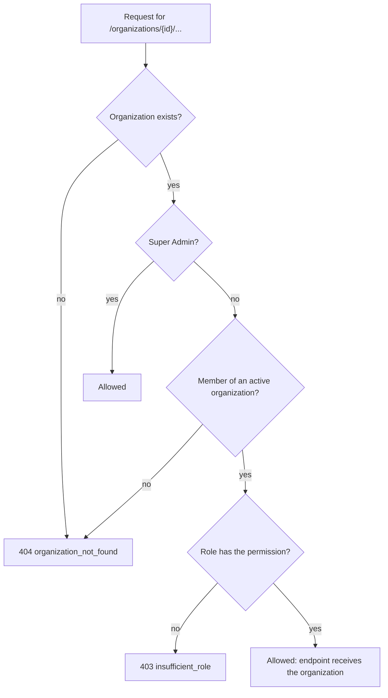

# Security

## 1. Authentication

- **Passwords:**
  - Hashed with **Argon2id** (`pwdlib`), with a random salt per hash. Outdated parameters
    are upgraded at the next sign-in.
  - Length 8-128 characters, with no composition rules (NIST SP 800-63B).
  - Common passwords are refused offline. The check uses the 2,087 entries of 8 or more
    characters from SecLists' list of the 10,000 most common passwords, plus repeated
    characters, the service name and the email's name. Nothing is sent to a third-party
    service.
- **JWT access tokens:**
  - HS256, valid for 30 minutes, each with a random `jti`.
  - Every request checks the signature, expiry, issuer, audience, token type, revocation
    and that the user is active.
  - Decoding accepts only `HS256`, so `alg: none` and algorithm-swapped tokens are refused.
- **Logout really ends the session.** The token's `jti` goes into `revoked_tokens`,
  costing one primary-key lookup per request
  ([ADR-0004](adr/0004-jwt-access-tokens-with-revocation-denylist.md)).
- **No account enumeration at sign-in.** Unknown email, wrong password and an inactive
  account all get the same `401 invalid_credentials`, and unknown emails still pay for a
  hash verification. Registration does reveal a taken email (`409`). That is the accepted
  trade-off of self-service sign-up, and registrations are rate-limited.

## 2. Sign-in limits and history

| Rule | Subject | Default |
|---|---|---|
| `login_ip` | client IP, every attempt | 60 per minute |
| `login_failures` | email, failed attempts (unknown emails count too) | 10 per 15 minutes |
| `register_ip` | client IP | 50 per hour |

- Limits are checked **before** any password hashing, and a refusal returns `429` with
  `Retry-After`.
- The counters live in PostgreSQL, so sign-in does not depend on Redis and every API
  process shares them. Subjects are stored only as SHA-256 hashes.
- Behind a reverse proxy, Uvicorn trusts `X-Forwarded-For` only from the configured proxy
  address.

`security_events` records registrations, successful and failed sign-ins (with the
reason), rate-limit refusals and logouts:
- It stores the user ID, the hashed email, the IP, the user agent and the request ID.
  Never passwords or tokens.
- It is append-only, enforced by a database trigger.
- Users see their own history in Settings ("Recent sign-ins"), and Super Admins see
  everything.

## 3. Roles and permissions

Endpoints check a **permission**, never a role name. The mapping lives in one place
(`ROLE_PERMISSIONS`, `app/security/authorization.py`), and `test_role_permission_matrix`
pins it.

| Permission | Viewer | Integration Manager | Organization Admin |
|---|---|---|---|
| `org:read`, `members:read`, `employees:read`, `departments:read`, `connectors:read`, `workflows:read`, `events:read`, `conflicts:read` | yes | yes | yes |
| `connectors:manage`, `workflows:manage`, `events:replay`, `conflicts:resolve`, `audit:read` | | yes | yes |
| `employees:write`, `departments:manage`, `members:manage`, `org:update`, `policies:manage` | | | yes |

Integration Managers run integrations but do not manage people, the organization or
source-of-truth policies. **Super Admin** is a platform flag, not a role. It holds every
permission and can only be created from the shell
(`python -m app.cli create-superadmin`), which prompts for the password. An organization
always keeps at least one Organization Admin. The check locks the admin rows, so two
admins demoting each other at the same moment cannot both succeed.

## 4. Organization isolation

- Outsiders get **404, not 403**, so they cannot tell whether an organization ID exists.
- Every repository query filters by the organization. There is no "get by ID" without
  one, so a foreign ID behaves exactly like an unknown one
  (`test_cross_organization_access_is_404_everywhere`).
- **Database backstop:** composite foreign keys that include `organization_id` make
  cross-tenant references impossible even if application code had a bug
  ([ADR-0005](adr/0005-organization-level-data-isolation.md),
  [ADR-0006](adr/0006-composite-foreign-keys-for-tenant-integrity.md)).

## 5. Secrets and credentials

- Real values live in `.env`, which git ignores. `.env.example` contains placeholders
  only, and CI uses throwaway values. With `APP_ENV=production`, the API refuses to start
  with a placeholder JWT secret or database password, or without a connector encryption
  key.
- Connector credentials are encrypted with Fernet and are never returned, logged or
  echoed. Keys can be rotated ([connectors](connectors.md#5-credential-security)).
- Outbound calls are restricted to an allowlist of host names, with no redirects and with
  timeouts. The limitation is that the check uses host names, not resolved IP addresses,
  so production should also restrict egress at the network level.

## 6. Data exposure

- Response schemas list their fields explicitly, so a password hash cannot be serialized.
  Validation errors name fields, never values. Unexpected errors return a generic message
  and the traceback goes only to the logs.
- Logs and audit entries carry IDs and field **names**, never passwords, tokens, names or
  emails. Several tests capture every log record and assert this.
- Broker messages carry only an event ID and a correlation ID, as JSON (never pickle).
  The events API returns the names of changed fields, not their values.
- Data conflicts store both values, because a person must see them to decide. They are
  shown only to members who may see employees anyway, and they are never logged.

## 7. HTTP hardening

- **CORS:** explicit allowlist (`CORS_ORIGINS`) without credentials. The web application
  is served from the same origin, so it does not depend on CORS.
- **Headers on every response:** `X-Content-Type-Options: nosniff`,
  `X-Frame-Options: DENY`, `Referrer-Policy: no-referrer`. On `/api` they also include
  `Cache-Control: no-store` and `Content-Security-Policy: default-src 'none'`.
- **Request bodies over 1 MiB** get `413` before the handler runs, including streamed
  bodies.
- **SQL** is built only from SQLAlchemy expressions with bound parameters. Search escapes
  `%` and `_`.
- **Dependencies** were checked with `pip-audit` (backend and mock services: no findings)
  and `npm audit --omit=dev` (0). Dependabot keeps watching them.

## 8. Not implemented

- Multi-factor authentication. NIST SP 800-63B-4 recommends 15 or more characters for
  password-only sign-in.
- HttpOnly-cookie sessions. The browser keeps the 30-minute token in `sessionStorage`,
  which is **not** protection against XSS. The protections that matter are Angular's
  escaping, no third-party scripts, the short lifetime and server-side revocation.
- The OAuth authorization-code flow, email invitations, retention jobs, and a secrets
  manager for the connector key.
- Redis authentication and TLS. These are configuration in production
  ([deployment](deployment.md)) and are not enforced by the code.

To report a vulnerability, see [SECURITY.md](../SECURITY.md).
